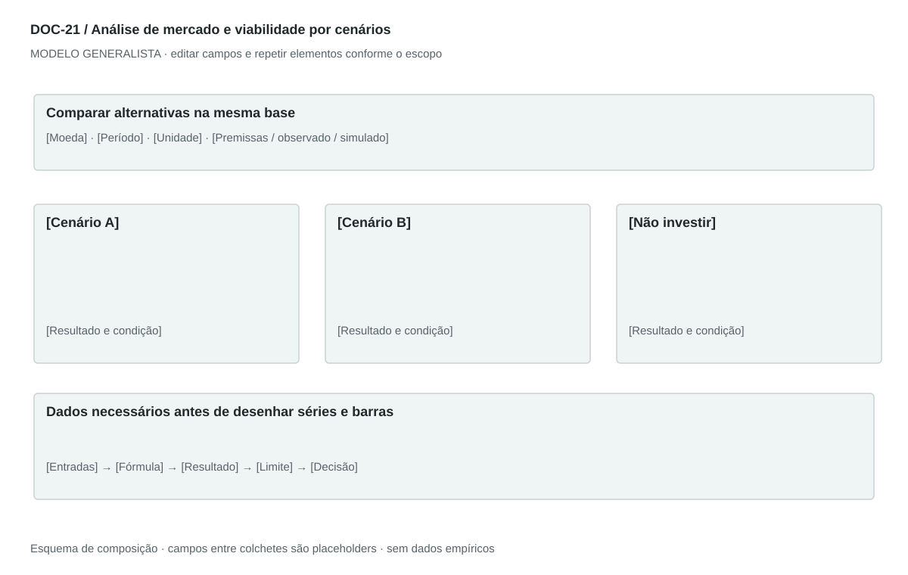

## For future Claude
Biblioteca generalista de Disruptive Venture Lab. Estrutura reutilizável, não análise preenchida nem evidência de um novo negócio.

# DOC-21 — Análise de mercado e viabilidade por cenários

Apoiar uma decisão de entrada, investimento ou expansão com hipóteses explícitas, alternativas e limites.

## Estudo do arquivo de referência

Fonte: `DOC-21-fonte.md`. Arquivo Markdown. Markdown extenso, datado, com convenção Fato observado/Inferência/Premissa de cenário, resumo executivo, nove seções numeradas e fontes. Compara parceiros, escalas, capital, horizontes e economia unitária por tabelas e narrativa. Não contém gráficos ou imagens embutidos. Algumas conclusões chamadas de fatos derivam de premissas; o modelo reforça essa distinção.

Esta descrição registra o original. As recomendações abaixo são uma adaptação generalista, não uma reprodução nem validação do negócio-fonte.

## Formato e estilo recomendados

Relatório executivo de 8–15 páginas conforme evidência, resumo de uma página e anexos técnicos. Preservar narrativa decisória e tabelas comparativas; gráficos são extensões recomendadas, não conteúdo visual observado no original.

Aplicar o [sistema editorial](../SISTEMA-EDITORIAL.md), mantendo a hierarquia e a legibilidade.

## Dados comuns

| Campo comum | Tipo | O que preencher |
| --- | --- | --- |
| negocio | texto | Nome do negócio analisado, sem herdar o caso-fonte |
| documento_id | referência | ID do modelo e ID da instância, quando criada |
| versao | texto | Versão e estado de revisão |
| idioma | texto | Idioma escolhido para a entrega |
| audiencia | texto | Quem precisa tomar qual decisão |
| responsavel | referência | Autor responsável pela análise |
| data_base | data ISO | Data à qual as informações se referem |
| territorio | texto | Geografia relevante ou justificativa de não aplicação |
| objetivo_decisao | texto | Pergunta que o documento precisa responder |
| escopo | texto | Incluído, excluído e horizonte |
| estado | enum | rascunho, em_revisao, aprovado ou obsoleto |

## Dicionário específico

| Campo | Tipo | Descrição e dado necessário |
| --- | --- | --- |
| cenario_id | referencia | Alternativa independente, não período temporal |
| territorio | texto | Área analisada |
| data_base | data | Data do retrato usado |
| horizonte | texto | Período de planejamento |
| escala | decimal | Quantidade em unidade declarada |
| preco | decimal | Preço por unidade, null quando indefinido |
| volume | decimal | Unidades por período, sem confundir com receita |
| receita | decimal | Derivada da regra de cobrança, na moeda e período definidos |
| custo_variavel | decimal | Custo atribuível ao volume |
| custo_fixo | decimal | Custo por período independente do volume dentro da faixa |
| investimento | decimal | Desembolso inicial e reposições, separado de despesa |
| caixa | decimal | Saldo reconciliado por período |
| metrica_decisao | texto | Indicador, limiar e condição de avanço |
| limitacao | texto | Lacuna que pode alterar a decisão |

## Regras de preenchimento

Use este modelo como estrutura de investigação, não como análise concluída. Substitua os campos entre colchetes e retire as instruções de redação da versão entregue ao cliente. Na ausência de informação, escreva “não informado” e registre a tarefa de coleta; no JSON use `null`. Zero só representa um valor confirmado como zero. “Não aplicável” exige justificativa e responsável pela decisão.

Cada registro específico deve conter `proveniencia`: classificação (`observado`, `hipotese`, `inferencia`, `simulado` ou `desconhecido`), referência da fonte, localização na fonte, data-base, data de consulta, confiança e limitação. Uma conta feita com hipóteses continua sendo estimativa. Fontes podem ser locais ou externas, mas nenhum dado específico de outro negócio deve ser herdado.

Números precisam de unidade, denominador, moeda quando pertinente e período. Comparações usam a mesma base. Gráficos temporais exigem tempo; cenários independentes usam categorias. Figuras têm título, legenda, fonte, data-base e alternativa textual. Adapte o idioma e a identidade visual ao novo negócio.

## Gráficos, diagramas e imagens

Visual principal: **Comparação de cenários e caixa**.

Barras categóricas para alternativas e mesma unidade por gráfico; linha apenas para caixa em períodos reais. Painel de sensibilidade usa variações declaradas. Sem entradas, mostrar tabela de lacunas, não dados fabricados.

Imagens: Gráficos analíticos e tabelas de equivalência; mapa só com dados geográficos fornecidos e fonte. Fotografias não sustentam viabilidade nem provam demanda.

### Brief para produzir o visual em outro negócio

Criar “Comparação de cenários e caixa” para [negócio], em português ou no idioma escolhido, usando apenas [dados aprovados]. Aplicar: Barras categóricas para alternativas e mesma unidade por gráfico; linha apenas para caixa em períodos reais. Painel de sensibilidade usa variações declaradas. Sem entradas, mostrar tabela de lacunas, não dados fabricados. Incluir título, rótulos legíveis, legenda, fonte, período e classificação da evidência. Sem dados, manter campos vazios e indicar o que falta. Usar o SVG como wireframe editável, não como gráfico factual.

## Relações com outros documentos

[business-model-canvas](./business-model-canvas.md), [pestel](./pestel.md), [cinco-forcas](./cinco-forcas.md), [gestao-riscos](./gestao-riscos.md), [estrategia-integrada](./estrategia-integrada.md).

## Critérios de revisão

- Premissa somada ou multiplicada produz estimativa, não fato observado.
- Faturamento, GMV, receita líquida, contribuição, lucro e caixa são definidos separadamente.
- Não concluir tamanho amostral suficiente apenas pela quantidade de pontos ou agentes.
- Retorno tem horizonte, desembolsos, impostos aplicáveis e fórmula; lacunas ficam visíveis.

- Toda conclusão tem evidência ou rótulo de hipótese/inferência; toda lacuna tem próximo passo.
- A versão final responde à decisão indicada no cabeçalho.

---

# Modelo preenchível

> Copie a partir deste título para criar a instância. Instruções e campos devem ser substituídos; um esqueleto preenchido mecanicamente não equivale a análise.

# [Negócio] — Análise de mercado e viabilidade por cenários

**Versão:** [versão] · **Data-base:** [data] · **Responsável:** [papel]

**Audiência:** [quem decide] · **Território:** [recorte] · **Estado:** [rascunho/revisão/aprovado]

**Pergunta decisória:** [qual decisão este documento apoia?]

**Escopo e horizonte:** [incluído, excluído e período]

## 1. Pergunta e convenção de evidência

[Instrução: Defina decisão, audiência, território, data-base e distinção entre observado, hipótese, inferência e simulação.]

[A preencher: análise, evidência, implicação e lacuna.]

## 2. Resumo executivo

[Instrução: Recomendação condicional, razão, principais riscos e próximo teste.]

[A preencher: análise, evidência, implicação e lacuna.]

## 3. Oferta e adaptação

[Instrução: Descreva o que muda em cada mercado ou segmento e por quê.]

[A preencher: análise, evidência, implicação e lacuna.]

## 4. Mercado e alternativas

[Instrução: Demanda, substitutos, canais, fontes, recência e cobertura.]

[A preencher: análise, evidência, implicação e lacuna.]

## 5. Condições operacionais e requisitos

[Instrução: Capacidade, fornecedores, pessoas, dependências e verificações profissionais pertinentes.]

[A preencher: análise, evidência, implicação e lacuna.]

## 6. Cenários de parceiros e escala

[Instrução: Compare alternativas viáveis, incluindo não investir, com premissas equivalentes.]

[A preencher: análise, evidência, implicação e lacuna.]

## 7. Capital e retorno

[Instrução: Usos, capital de giro, caixa por período, horizonte e definição do retorno.]

[A preencher: análise, evidência, implicação e lacuna.]

## 8. Modelo e sensibilidade

[Instrução: Receita, custos, contribuição, caixa e variáveis dominantes. Não chamar cálculo determinístico de previsão validada.]

[A preencher: análise, evidência, implicação e lacuna.]

## 9. Riscos e condições de reversão

[Instrução: O que pode invalidar a conclusão e sinais a monitorar.]

[A preencher: análise, evidência, implicação e lacuna.]

## 10. Decisão e experimento

[Instrução: Escolha, condições, responsável, prazo, orçamento, métrica, limiar e regra de parada.]

[A preencher: análise, evidência, implicação e lacuna.]

## 11. Fontes e anexo reproduzível

[Instrução: Referências datadas, fórmulas, entradas, lacunas e resultados reconciliados.]

[A preencher: análise, evidência, implicação e lacuna.]

## Registros estruturados

Preencher uma ficha por registro e repetir conforme necessário.

| Campo | Valor |
| --- | --- |
| cenario_id | [A preencher] |
| territorio | [A preencher] |
| data_base | [A preencher] |
| horizonte | [A preencher] |
| escala | [A preencher] |
| preco | [A preencher] |
| volume | [A preencher] |
| receita | [A preencher] |
| custo_variavel | [A preencher] |
| custo_fixo | [A preencher] |
| investimento | [A preencher] |
| caixa | [A preencher] |
| metrica_decisao | [A preencher] |
| limitacao | [A preencher] |
| Classificação | [observado / hipótese / inferência / simulado / desconhecido] |
| Fonte e localização | [ID + página, seção ou registro] |
| Data-base / consulta | [datas] |
| Unidade, moeda e período | [quando pertinente] |
| Limitação | [lacuna ou condição de interpretação] |

## Conclusão e encaminhamento

**Decisão proposta:** [decisão ou investigação necessária]

**Por quê:** [síntese das evidências e limitações]

**Alternativa considerada:** [alternativa e razão de rejeição]

**Condição de reversão:** [qual evidência mudaria a decisão]

**Próximo passo:** [ação] · **Dono:** [papel] · **Prazo:** [data] · **Critério:** [métrica e limiar, se pertinente]

## Fontes e lacunas

| ID | Fonte e localização | Data-base / consulta | O que sustenta | Limite / tarefa de coleta |
| --- | --- | --- | --- | --- |
| [ID] | [documento/página ou URL] | [datas] | [afirmação] | [limite e responsável] |
