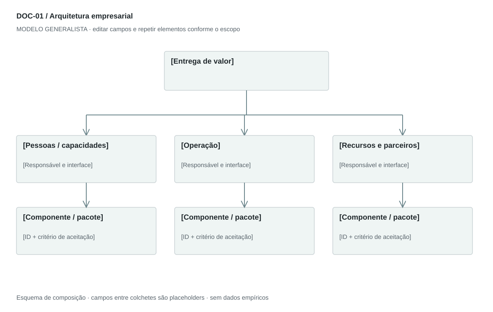

## For future Claude
Biblioteca generalista de Disruptive Venture Lab. Estrutura reutilizável, não análise preenchida nem evidência de um novo negócio.

# DOC-01 — Arquitetura empresarial

Definir capacidades, responsabilidades, componentes e interfaces necessários para entregar a proposta de valor.

## Estudo do arquivo de referência

Fonte: `DOC-01-fonte.pdf`. 4 página(s). Quatro páginas A4 retrato. Organização, tecnologia, processo operacional e segurança são apresentados em texto curto e tabelas cinzas de duas colunas. As quatro tabelas principais são imagens. Papéis executivos são listados antes das camadas técnicas. A última página separa proteção dos dados de controle de acesso.

Esta descrição registra o original. As recomendações abaixo são uma adaptação generalista, não uma reprodução nem validação do negócio-fonte.

## Formato e estilo recomendados

4–6 páginas A4 retrato; visão geral em paisagem quando o fluxo exigir. Tabelas Capacidade × Responsável e Camada × Componente × Interface. A sequência operacional deve permanecer separada da hierarquia organizacional.

Aplicar o [sistema editorial](../SISTEMA-EDITORIAL.md), mantendo a hierarquia e a legibilidade.

## Dados comuns

| Campo comum | Tipo | O que preencher |
| --- | --- | --- |
| negocio | texto | Nome do negócio analisado, sem herdar o caso-fonte |
| documento_id | referência | ID do modelo e ID da instância, quando criada |
| versao | texto | Versão e estado de revisão |
| idioma | texto | Idioma escolhido para a entrega |
| audiencia | texto | Quem precisa tomar qual decisão |
| responsavel | referência | Autor responsável pela análise |
| data_base | data ISO | Data à qual as informações se referem |
| territorio | texto | Geografia relevante ou justificativa de não aplicação |
| objetivo_decisao | texto | Pergunta que o documento precisa responder |
| escopo | texto | Incluído, excluído e horizonte |
| estado | enum | rascunho, em_revisao, aprovado ou obsoleto |

## Dicionário específico

| Campo | Tipo | Descrição e dado necessário |
| --- | --- | --- |
| capacidade | texto | Função necessária para entregar valor, sem pressupor cargo executivo |
| responsavel | referencia | Papel que responde pela capacidade |
| componente | texto | Recurso, sistema ou unidade de operação |
| interface | texto | Troca entre componentes, com entrada e saída |
| ativo_critico | texto | Recurso ou informação cuja perda prejudica a entrega |
| controle | texto | Medida preventiva ou de recuperação e prova de funcionamento |
| gatilho_escala | texto | Condição mensurável para mudar equipe ou infraestrutura |

## Regras de preenchimento

Use este modelo como estrutura de investigação, não como análise concluída. Substitua os campos entre colchetes e retire as instruções de redação da versão entregue ao cliente. Na ausência de informação, escreva “não informado” e registre a tarefa de coleta; no JSON use `null`. Zero só representa um valor confirmado como zero. “Não aplicável” exige justificativa e responsável pela decisão.

Cada registro específico deve conter `proveniencia`: classificação (`observado`, `hipotese`, `inferencia`, `simulado` ou `desconhecido`), referência da fonte, localização na fonte, data-base, data de consulta, confiança e limitação. Uma conta feita com hipóteses continua sendo estimativa. Fontes podem ser locais ou externas, mas nenhum dado específico de outro negócio deve ser herdado.

Números precisam de unidade, denominador, moeda quando pertinente e período. Comparações usam a mesma base. Gráficos temporais exigem tempo; cenários independentes usam categorias. Figuras têm título, legenda, fonte, data-base e alternativa textual. Adapte o idioma e a identidade visual ao novo negócio.

## Gráficos, diagramas e imagens

Visual principal: **Mapa de capacidades e interfaces**.

Camadas: pessoas → operação → recursos; setas rotuladas com o que é transferido. Fronteiras distinguem interno de parceiro. Não implica relação hierárquica.

Imagens: Diagrama vetorial obrigatório; ícones opcionais de pessoas, processos e recursos com o mesmo traço. Fotos e logos de fornecedores dispensáveis.

### Brief para produzir o visual em outro negócio

Criar “Mapa de capacidades e interfaces” para [negócio], em português ou no idioma escolhido, usando apenas [dados aprovados]. Aplicar: Camadas: pessoas → operação → recursos; setas rotuladas com o que é transferido. Fronteiras distinguem interno de parceiro. Não implica relação hierárquica. Incluir título, rótulos legíveis, legenda, fonte, período e classificação da evidência. Sem dados, manter campos vazios e indicar o que falta. Usar o SVG como wireframe editável, não como gráfico factual.

## Relações com outros documentos

[estrategia-integrada](./estrategia-integrada.md), [pbs](./pbs.md), [raci](./raci.md), [service-blueprint](./service-blueprint.md).

## Critérios de revisão

- Cada capacidade tem responsável e saída.
- Controle proposto não é evidência de controle implantado.
- Papéis são compatíveis com estágio e orçamento; não copiar uma diretoria completa.

- Toda conclusão tem evidência ou rótulo de hipótese/inferência; toda lacuna tem próximo passo.
- A versão final responde à decisão indicada no cabeçalho.

---

# Modelo preenchível

> Copie a partir deste título para criar a instância. Instruções e campos devem ser substituídos; um esqueleto preenchido mecanicamente não equivale a análise.

# [Negócio] — Arquitetura empresarial

**Versão:** [versão] · **Data-base:** [data] · **Responsável:** [papel]

**Audiência:** [quem decide] · **Território:** [recorte] · **Estado:** [rascunho/revisão/aprovado]

**Pergunta decisória:** [qual decisão este documento apoia?]

**Escopo e horizonte:** [incluído, excluído e período]

## 1. Escopo e fronteiras

[Instrução: Descreva a entrega principal, atores externos e o que fica fora da operação.]

[A preencher: análise, evidência, implicação e lacuna.]

## 2. Arquitetura organizacional

[Instrução: Liste capacidades indispensáveis, responsável atual, terceirização e gatilho de contratação. Um fundador pode acumular papéis.]

[A preencher: análise, evidência, implicação e lacuna.]

## 3. Arquitetura da solução

[Instrução: Explique recursos físicos, pessoas, ferramentas, sistemas e fluxos de informação. Para serviços sem software próprio, descreva a infraestrutura de entrega.]

[A preencher: análise, evidência, implicação e lacuna.]

## 4. Processo operacional

[Instrução: Do pedido à entrega e ao suporte: entrada, atividade, saída e exceção.]

[A preencher: análise, evidência, implicação e lacuna.]

## 5. Controles e continuidade

[Instrução: Para cada ativo crítico, ligue ameaça, controle, responsável, teste e recuperação.]

[A preencher: análise, evidência, implicação e lacuna.]

## 6. Decisões e evolução

[Instrução: Compare fazer, comprar e contratar; registre dependências e gatilhos de escala.]

[A preencher: análise, evidência, implicação e lacuna.]

## Registros estruturados

Preencher uma ficha por registro e repetir conforme necessário.

| Campo | Valor |
| --- | --- |
| capacidade | [A preencher] |
| responsavel | [A preencher] |
| componente | [A preencher] |
| interface | [A preencher] |
| ativo_critico | [A preencher] |
| controle | [A preencher] |
| gatilho_escala | [A preencher] |
| Classificação | [observado / hipótese / inferência / simulado / desconhecido] |
| Fonte e localização | [ID + página, seção ou registro] |
| Data-base / consulta | [datas] |
| Unidade, moeda e período | [quando pertinente] |
| Limitação | [lacuna ou condição de interpretação] |

## Conclusão e encaminhamento

**Decisão proposta:** [decisão ou investigação necessária]

**Por quê:** [síntese das evidências e limitações]

**Alternativa considerada:** [alternativa e razão de rejeição]

**Condição de reversão:** [qual evidência mudaria a decisão]

**Próximo passo:** [ação] · **Dono:** [papel] · **Prazo:** [data] · **Critério:** [métrica e limiar, se pertinente]

## Fontes e lacunas

| ID | Fonte e localização | Data-base / consulta | O que sustenta | Limite / tarefa de coleta |
| --- | --- | --- | --- | --- |
| [ID] | [documento/página ou URL] | [datas] | [afirmação] | [limite e responsável] |
