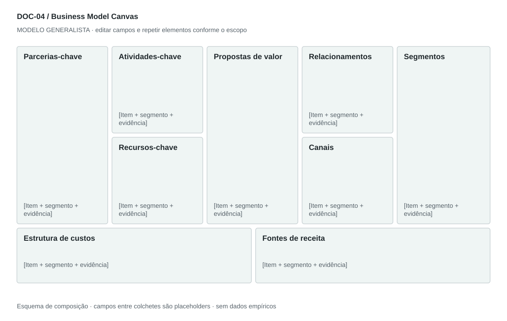

## For future Claude
Biblioteca generalista de Disruptive Venture Lab. Estrutura reutilizável, não análise preenchida nem evidência de um novo negócio.

# DOC-04 — Business Model Canvas

Sintetizar como o negócio cria, entrega e captura valor, mantendo coerência entre os nove blocos.

## Estudo do arquivo de referência

Fonte: `DOC-04-fonte.pdf`. 2 página(s). Duas páginas em paisagem com cinco colunas verticais e pequenos ícones. A primeira página concentra parceiros, atividades, valor, relacionamento e segmentos; a segunda traz recursos, custos, receitas e canais. A distribuição mantém os blocos, mas a quebra em duas páginas prejudica a leitura conjunta.

Esta descrição registra o original. As recomendações abaixo são uma adaptação generalista, não uma reprodução nem validação do negócio-fonte.

## Formato e estilo recomendados

Uma prancha A3 paisagem com nove blocos na topologia do Canvas e anexo textual de 1–2 páginas para evidências. Usar poucos itens priorizados por bloco.

Aplicar o [sistema editorial](../SISTEMA-EDITORIAL.md), mantendo a hierarquia e a legibilidade.

## Dados comuns

| Campo comum | Tipo | O que preencher |
| --- | --- | --- |
| negocio | texto | Nome do negócio analisado, sem herdar o caso-fonte |
| documento_id | referência | ID do modelo e ID da instância, quando criada |
| versao | texto | Versão e estado de revisão |
| idioma | texto | Idioma escolhido para a entrega |
| audiencia | texto | Quem precisa tomar qual decisão |
| responsavel | referência | Autor responsável pela análise |
| data_base | data ISO | Data à qual as informações se referem |
| territorio | texto | Geografia relevante ou justificativa de não aplicação |
| objetivo_decisao | texto | Pergunta que o documento precisa responder |
| escopo | texto | Incluído, excluído e horizonte |
| estado | enum | rascunho, em_revisao, aprovado ou obsoleto |

## Dicionário específico

| Campo | Tipo | Descrição e dado necessário |
| --- | --- | --- |
| bloco | enum | segmentos, valor, canais, relacionamento, receitas, recursos, atividades, parceiros, custos |
| item | texto | Afirmação curta e verificável do bloco |
| segmento_id | referencia | Segmento ao qual o item serve |
| conexao_id | referencia | Item de outro bloco que sustenta a afirmação |
| prioridade | enum | essencial, complementar ou a testar |
| pagador | referencia | Quem efetivamente financia a oferta |
| unidade_economica | texto | Denominador consistente de receita e custo |

## Regras de preenchimento

Use este modelo como estrutura de investigação, não como análise concluída. Substitua os campos entre colchetes e retire as instruções de redação da versão entregue ao cliente. Na ausência de informação, escreva “não informado” e registre a tarefa de coleta; no JSON use `null`. Zero só representa um valor confirmado como zero. “Não aplicável” exige justificativa e responsável pela decisão.

Cada registro específico deve conter `proveniencia`: classificação (`observado`, `hipotese`, `inferencia`, `simulado` ou `desconhecido`), referência da fonte, localização na fonte, data-base, data de consulta, confiança e limitação. Uma conta feita com hipóteses continua sendo estimativa. Fontes podem ser locais ou externas, mas nenhum dado específico de outro negócio deve ser herdado.

Números precisam de unidade, denominador, moeda quando pertinente e período. Comparações usam a mesma base. Gráficos temporais exigem tempo; cenários independentes usam categorias. Figuras têm título, legenda, fonte, data-base e alternativa textual. Adapte o idioma e a identidade visual ao novo negócio.

## Gráficos, diagramas e imagens

Visual principal: **Canvas em nove blocos**.

Parceiros à esquerda; atividades/recursos; valor ao centro; relacionamento/canais; segmentos à direita. Custos e receitas na faixa inferior. Cada item pode carregar um marcador de evidência.

Imagens: O próprio Canvas é a imagem principal; ícones pequenos opcionais por bloco. Não usar fotos decorativas. Preservar a atribuição conceitual do Business Model Canvas; o desenho fornecido é original.

### Brief para produzir o visual em outro negócio

Criar “Canvas em nove blocos” para [negócio], em português ou no idioma escolhido, usando apenas [dados aprovados]. Aplicar: Parceiros à esquerda; atividades/recursos; valor ao centro; relacionamento/canais; segmentos à direita. Custos e receitas na faixa inferior. Cada item pode carregar um marcador de evidência. Incluir título, rótulos legíveis, legenda, fonte, período e classificação da evidência. Sem dados, manter campos vazios e indicar o que falta. Usar o SVG como wireframe editável, não como gráfico factual.

## Relações com outros documentos

[modelo-b2b](./modelo-b2b.md), [modelo-b2c](./modelo-b2c.md), [proposta-valor](./proposta-valor.md), [estrategia-integrada](./estrategia-integrada.md).

## Critérios de revisão

- Os nove blocos estão presentes na mesma visão.
- Receitas têm pagador e unidade; custos sustentam atividades e recursos.
- Cada segmento tem proposta e canal correspondentes.

- Toda conclusão tem evidência ou rótulo de hipótese/inferência; toda lacuna tem próximo passo.
- A versão final responde à decisão indicada no cabeçalho.

---

# Modelo preenchível

> Copie a partir deste título para criar a instância. Instruções e campos devem ser substituídos; um esqueleto preenchido mecanicamente não equivale a análise.

# [Negócio] — Business Model Canvas

**Versão:** [versão] · **Data-base:** [data] · **Responsável:** [papel]

**Audiência:** [quem decide] · **Território:** [recorte] · **Estado:** [rascunho/revisão/aprovado]

**Pergunta decisória:** [qual decisão este documento apoia?]

**Escopo e horizonte:** [incluído, excluído e período]

## 1. Segmentos de clientes

[Instrução: Quem usa, paga e decide; criar IDs distintos por lado de plataforma.]

[A preencher: análise, evidência, implicação e lacuna.]

## 2. Propostas de valor

[Instrução: Problema, resultado e diferencial por segmento.]

[A preencher: análise, evidência, implicação e lacuna.]

## 3. Canais

[Instrução: Aquisição, venda, entrega e pós-venda, com custo e dependência.]

[A preencher: análise, evidência, implicação e lacuna.]

## 4. Relacionamentos

[Instrução: Aquisição, assistência, retenção e custo de servir.]

[A preencher: análise, evidência, implicação e lacuna.]

## 5. Fontes de receita

[Instrução: Pagador, unidade, preço, frequência e condição de recebimento.]

[A preencher: análise, evidência, implicação e lacuna.]

## 6. Recursos-chave

[Instrução: Pessoas, ativos, tecnologia, capital e acesso necessários.]

[A preencher: análise, evidência, implicação e lacuna.]

## 7. Atividades-chave

[Instrução: O trabalho essencial para cumprir a promessa.]

[A preencher: análise, evidência, implicação e lacuna.]

## 8. Parcerias-chave

[Instrução: O que é fornecido, por quem e sob qual dependência.]

[A preencher: análise, evidência, implicação e lacuna.]

## 9. Estrutura de custos

[Instrução: Fixos, variáveis, implantação e escala, sem misturar caixa e lucro.]

[A preencher: análise, evidência, implicação e lacuna.]

## Registros estruturados

Preencher uma ficha por registro e repetir conforme necessário.

| Campo | Valor |
| --- | --- |
| bloco | [A preencher] |
| item | [A preencher] |
| segmento_id | [A preencher] |
| conexao_id | [A preencher] |
| prioridade | [A preencher] |
| pagador | [A preencher] |
| unidade_economica | [A preencher] |
| Classificação | [observado / hipótese / inferência / simulado / desconhecido] |
| Fonte e localização | [ID + página, seção ou registro] |
| Data-base / consulta | [datas] |
| Unidade, moeda e período | [quando pertinente] |
| Limitação | [lacuna ou condição de interpretação] |

## Conclusão e encaminhamento

**Decisão proposta:** [decisão ou investigação necessária]

**Por quê:** [síntese das evidências e limitações]

**Alternativa considerada:** [alternativa e razão de rejeição]

**Condição de reversão:** [qual evidência mudaria a decisão]

**Próximo passo:** [ação] · **Dono:** [papel] · **Prazo:** [data] · **Critério:** [métrica e limiar, se pertinente]

## Fontes e lacunas

| ID | Fonte e localização | Data-base / consulta | O que sustenta | Limite / tarefa de coleta |
| --- | --- | --- | --- | --- |
| [ID] | [documento/página ou URL] | [datas] | [afirmação] | [limite e responsável] |
