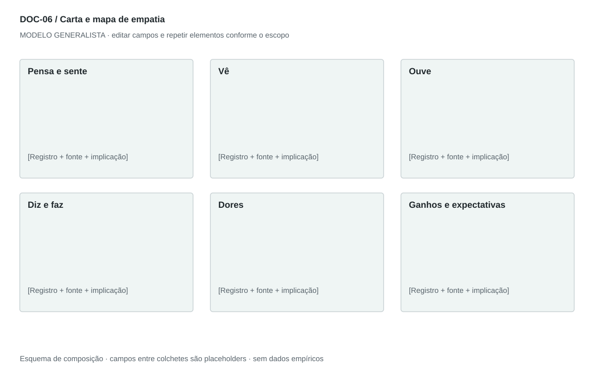

## For future Claude
Biblioteca generalista de Disruptive Venture Lab. Estrutura reutilizável, não análise preenchida nem evidência de um novo negócio.

# DOC-06 — Carta e mapa de empatia

Organizar perspectivas do cliente e transformar lacunas de entendimento em perguntas de pesquisa.

## Estudo do arquivo de referência

Fonte: `DOC-06-fonte.pdf`. 3 página(s). Três páginas retrato com sete seções: pensa/sente, vê, ouve, diz/faz, dores, ganhos e expectativas. Apesar do nome Empathy Letter, é um relatório estruturado em bullets, não uma carta em primeira pessoa. Frases representativas aparecem entre aspas sem evidência de entrevista identificada.

Esta descrição registra o original. As recomendações abaixo são uma adaptação generalista, não uma reprodução nem validação do negócio-fonte.

## Formato e estilo recomendados

Relatório de 2–3 páginas com os sete domínios; mapa visual em uma página opcional. Carta em primeira pessoa pode ser um anexo, rotulado como síntese construída.

Aplicar o [sistema editorial](../SISTEMA-EDITORIAL.md), mantendo a hierarquia e a legibilidade.

## Dados comuns

| Campo comum | Tipo | O que preencher |
| --- | --- | --- |
| negocio | texto | Nome do negócio analisado, sem herdar o caso-fonte |
| documento_id | referência | ID do modelo e ID da instância, quando criada |
| versao | texto | Versão e estado de revisão |
| idioma | texto | Idioma escolhido para a entrega |
| audiencia | texto | Quem precisa tomar qual decisão |
| responsavel | referência | Autor responsável pela análise |
| data_base | data ISO | Data à qual as informações se referem |
| territorio | texto | Geografia relevante ou justificativa de não aplicação |
| objetivo_decisao | texto | Pergunta que o documento precisa responder |
| escopo | texto | Incluído, excluído e horizonte |
| estado | enum | rascunho, em_revisao, aprovado ou obsoleto |

## Dicionário específico

| Campo | Tipo | Descrição e dado necessário |
| --- | --- | --- |
| persona_id | referencia | Perfil ao qual a perspectiva pertence |
| dominio | enum | pensa_sente, ve, ouve, diz_faz, dores, ganhos, expectativas |
| registro | texto | Observação, relato ou interpretação curta |
| natureza | enum | fala_literal, observacao, inferencia ou hipotese |
| contexto_coleta | texto | Situação, método e data da coleta |
| pergunta_validacao | texto | Pergunta aberta para reduzir a lacuna |
| implicacao | texto | Decisão de produto ou atendimento afetada |

## Regras de preenchimento

Use este modelo como estrutura de investigação, não como análise concluída. Substitua os campos entre colchetes e retire as instruções de redação da versão entregue ao cliente. Na ausência de informação, escreva “não informado” e registre a tarefa de coleta; no JSON use `null`. Zero só representa um valor confirmado como zero. “Não aplicável” exige justificativa e responsável pela decisão.

Cada registro específico deve conter `proveniencia`: classificação (`observado`, `hipotese`, `inferencia`, `simulado` ou `desconhecido`), referência da fonte, localização na fonte, data-base, data de consulta, confiança e limitação. Uma conta feita com hipóteses continua sendo estimativa. Fontes podem ser locais ou externas, mas nenhum dado específico de outro negócio deve ser herdado.

Números precisam de unidade, denominador, moeda quando pertinente e período. Comparações usam a mesma base. Gráficos temporais exigem tempo; cenários independentes usam categorias. Figuras têm título, legenda, fonte, data-base e alternativa textual. Adapte o idioma e a identidade visual ao novo negócio.

## Gráficos, diagramas e imagens

Visual principal: **Mapa de sete domínios**.

Persona ao centro, quatro perspectivas ao redor e faixa inferior para dores, ganhos e expectativas. Cores apenas agrupam domínios, sem sugerir intensidade.

Imagens: Avatar neutro ou ilustração identificada como representativa; retrato não é necessário. Não associar uma pessoa real a falas inventadas.

### Brief para produzir o visual em outro negócio

Criar “Mapa de sete domínios” para [negócio], em português ou no idioma escolhido, usando apenas [dados aprovados]. Aplicar: Persona ao centro, quatro perspectivas ao redor e faixa inferior para dores, ganhos e expectativas. Cores apenas agrupam domínios, sem sugerir intensidade. Incluir título, rótulos legíveis, legenda, fonte, período e classificação da evidência. Sem dados, manter campos vazios e indicar o que falta. Usar o SVG como wireframe editável, não como gráfico factual.

## Relações com outros documentos

[persona](./persona.md), [jornada-cliente](./jornada-cliente.md), [proposta-valor](./proposta-valor.md).

## Critérios de revisão

- Aspas só indicam fala literal com fonte; sínteses devem ser rotuladas.
- Desejo do cliente não é benefício comprovado do produto.
- Itens sem coleta real permanecem hipóteses.

- Toda conclusão tem evidência ou rótulo de hipótese/inferência; toda lacuna tem próximo passo.
- A versão final responde à decisão indicada no cabeçalho.

---

# Modelo preenchível

> Copie a partir deste título para criar a instância. Instruções e campos devem ser substituídos; um esqueleto preenchido mecanicamente não equivale a análise.

# [Negócio] — Carta e mapa de empatia

**Versão:** [versão] · **Data-base:** [data] · **Responsável:** [papel]

**Audiência:** [quem decide] · **Território:** [recorte] · **Estado:** [rascunho/revisão/aprovado]

**Pergunta decisória:** [qual decisão este documento apoia?]

**Escopo e horizonte:** [incluído, excluído e período]

## 1. Pensa e sente

[Instrução: Registre preocupação, desejo e sentimento, distinguindo observação de interpretação.]

[A preencher: análise, evidência, implicação e lacuna.]

## 2. Vê

[Instrução: Contexto, alternativas e sinais que encontra no ambiente.]

[A preencher: análise, evidência, implicação e lacuna.]

## 3. Ouve

[Instrução: Fontes de influência e mensagens recebidas, sem inventar canais.]

[A preencher: análise, evidência, implicação e lacuna.]

## 4. Diz e faz

[Instrução: Separe falas literais autorizadas de comportamento observado.]

[A preencher: análise, evidência, implicação e lacuna.]

## 5. Dores

[Instrução: Obstáculos, riscos percebidos e custo de não resolver.]

[A preencher: análise, evidência, implicação e lacuna.]

## 6. Ganhos

[Instrução: Resultado desejado e critério usado para reconhecer sucesso.]

[A preencher: análise, evidência, implicação e lacuna.]

## 7. Expectativas e pesquisa

[Instrução: O que a oferta precisa demonstrar e o que ainda precisa ser perguntado.]

[A preencher: análise, evidência, implicação e lacuna.]

## Registros estruturados

Preencher uma ficha por registro e repetir conforme necessário.

| Campo | Valor |
| --- | --- |
| persona_id | [A preencher] |
| dominio | [A preencher] |
| registro | [A preencher] |
| natureza | [A preencher] |
| contexto_coleta | [A preencher] |
| pergunta_validacao | [A preencher] |
| implicacao | [A preencher] |
| Classificação | [observado / hipótese / inferência / simulado / desconhecido] |
| Fonte e localização | [ID + página, seção ou registro] |
| Data-base / consulta | [datas] |
| Unidade, moeda e período | [quando pertinente] |
| Limitação | [lacuna ou condição de interpretação] |

## Conclusão e encaminhamento

**Decisão proposta:** [decisão ou investigação necessária]

**Por quê:** [síntese das evidências e limitações]

**Alternativa considerada:** [alternativa e razão de rejeição]

**Condição de reversão:** [qual evidência mudaria a decisão]

**Próximo passo:** [ação] · **Dono:** [papel] · **Prazo:** [data] · **Critério:** [métrica e limiar, se pertinente]

## Fontes e lacunas

| ID | Fonte e localização | Data-base / consulta | O que sustenta | Limite / tarefa de coleta |
| --- | --- | --- | --- | --- |
| [ID] | [documento/página ou URL] | [datas] | [afirmação] | [limite e responsável] |
