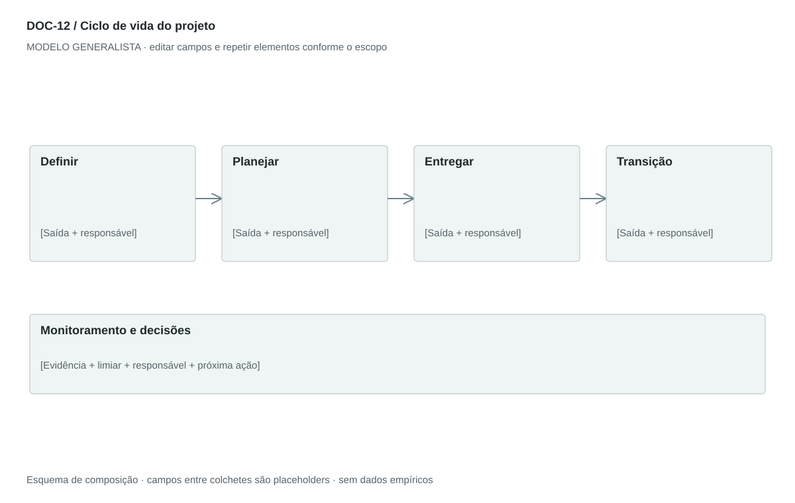

## For future Claude
Biblioteca generalista de Disruptive Venture Lab. Estrutura reutilizável, não análise preenchida nem evidência de um novo negócio.

# DOC-12 — Ciclo de vida do projeto

Definir fases, atividades, entregas e critérios de passagem até a transição para operação.

## Estudo do arquivo de referência

Fonte: `DOC-12-fonte.pdf`. 2 página(s). Duas páginas em paisagem com grandes tabelas rasterizadas. Coluna esquerda apresenta fase e objetivo; direita agrupa Key Activities e Deliverables, com faixas azuis. Iniciação, planejamento, execução, monitoramento/controle e encerramento. Monitoramento é transversal e não deveria aparentar uma etapa apenas após execução.

Esta descrição registra o original. As recomendações abaixo são uma adaptação generalista, não uma reprodução nem validação do negócio-fonte.

## Formato e estilo recomendados

2–3 páginas; quadro em paisagem com Fase × Objetivo × Atividades × Entregas × Gate. Monitoramento atravessa as fases aplicáveis.

Aplicar o [sistema editorial](../SISTEMA-EDITORIAL.md), mantendo a hierarquia e a legibilidade.

## Dados comuns

| Campo comum | Tipo | O que preencher |
| --- | --- | --- |
| negocio | texto | Nome do negócio analisado, sem herdar o caso-fonte |
| documento_id | referência | ID do modelo e ID da instância, quando criada |
| versao | texto | Versão e estado de revisão |
| idioma | texto | Idioma escolhido para a entrega |
| audiencia | texto | Quem precisa tomar qual decisão |
| responsavel | referência | Autor responsável pela análise |
| data_base | data ISO | Data à qual as informações se referem |
| territorio | texto | Geografia relevante ou justificativa de não aplicação |
| objetivo_decisao | texto | Pergunta que o documento precisa responder |
| escopo | texto | Incluído, excluído e horizonte |
| estado | enum | rascunho, em_revisao, aprovado ou obsoleto |

## Dicionário específico

| Campo | Tipo | Descrição e dado necessário |
| --- | --- | --- |
| fase_id | referencia | Identificador de fase |
| objetivo | texto | Mudança de estado que a fase produz |
| entrada | texto | Condições para começar |
| atividade | texto | Trabalho típico dentro da fase |
| entrega_id | referencia | Resultado verificável de PBS/WBS |
| saida | texto | Condição para concluir |
| aprovador | referencia | Papel que decide a passagem |
| monitoramento | texto | Controle transversal e cadência |

## Regras de preenchimento

Use este modelo como estrutura de investigação, não como análise concluída. Substitua os campos entre colchetes e retire as instruções de redação da versão entregue ao cliente. Na ausência de informação, escreva “não informado” e registre a tarefa de coleta; no JSON use `null`. Zero só representa um valor confirmado como zero. “Não aplicável” exige justificativa e responsável pela decisão.

Cada registro específico deve conter `proveniencia`: classificação (`observado`, `hipotese`, `inferencia`, `simulado` ou `desconhecido`), referência da fonte, localização na fonte, data-base, data de consulta, confiança e limitação. Uma conta feita com hipóteses continua sendo estimativa. Fontes podem ser locais ou externas, mas nenhum dado específico de outro negócio deve ser herdado.

Números precisam de unidade, denominador, moeda quando pertinente e período. Comparações usam a mesma base. Gráficos temporais exigem tempo; cenários independentes usam categorias. Figuras têm título, legenda, fonte, data-base e alternativa textual. Adapte o idioma e a identidade visual ao novo negócio.

## Gráficos, diagramas e imagens

Visual principal: **Fases com gates e controle transversal**.

Blocos de fase conectados com marcadores de decisão entre eles; uma faixa abaixo representa monitoramento contínuo. Iterações devem aparecer como retorno explícito.

Imagens: Diagrama e quadro de fases; fotografias dispensáveis. Não desenhar porcentagens concluídas sem registro de progresso.

### Brief para produzir o visual em outro negócio

Criar “Fases com gates e controle transversal” para [negócio], em português ou no idioma escolhido, usando apenas [dados aprovados]. Aplicar: Blocos de fase conectados com marcadores de decisão entre eles; uma faixa abaixo representa monitoramento contínuo. Iterações devem aparecer como retorno explícito. Incluir título, rótulos legíveis, legenda, fonte, período e classificação da evidência. Sem dados, manter campos vazios e indicar o que falta. Usar o SVG como wireframe editável, não como gráfico factual.

## Relações com outros documentos

[pbs](./pbs.md), [wbs](./wbs.md), [roadmap](./roadmap.md), [raci](./raci.md).

## Critérios de revisão

- Gates incluem critérios e autoridade.
- Monitoramento não fica isolado como única fase tardia.
- Ciclo não fixa duração sem dados do roadmap.

- Toda conclusão tem evidência ou rótulo de hipótese/inferência; toda lacuna tem próximo passo.
- A versão final responde à decisão indicada no cabeçalho.

---

# Modelo preenchível

> Copie a partir deste título para criar a instância. Instruções e campos devem ser substituídos; um esqueleto preenchido mecanicamente não equivale a análise.

# [Negócio] — Ciclo de vida do projeto

**Versão:** [versão] · **Data-base:** [data] · **Responsável:** [papel]

**Audiência:** [quem decide] · **Território:** [recorte] · **Estado:** [rascunho/revisão/aprovado]

**Pergunta decisória:** [qual decisão este documento apoia?]

**Escopo e horizonte:** [incluído, excluído e período]

## 1. Abordagem

[Instrução: Escolha ciclo sequencial, iterativo ou híbrido conforme incerteza e tipo de entrega.]

[A preencher: análise, evidência, implicação e lacuna.]

## 2. Fases e propósito

[Instrução: Nome, objetivo, entrada e saída de cada fase.]

[A preencher: análise, evidência, implicação e lacuna.]

## 3. Entregas e aceite

[Instrução: O que demonstra prontidão e quem aceita.]

[A preencher: análise, evidência, implicação e lacuna.]

## 4. Monitoramento transversal

[Instrução: Riscos, qualidade, custos, mudanças e indicadores durante o trabalho.]

[A preencher: análise, evidência, implicação e lacuna.]

## 5. Transição e encerramento

[Instrução: Treinamento, documentação, continuidade, lições e aceite da operação.]

[A preencher: análise, evidência, implicação e lacuna.]

## Registros estruturados

Preencher uma ficha por registro e repetir conforme necessário.

| Campo | Valor |
| --- | --- |
| fase_id | [A preencher] |
| objetivo | [A preencher] |
| entrada | [A preencher] |
| atividade | [A preencher] |
| entrega_id | [A preencher] |
| saida | [A preencher] |
| aprovador | [A preencher] |
| monitoramento | [A preencher] |
| Classificação | [observado / hipótese / inferência / simulado / desconhecido] |
| Fonte e localização | [ID + página, seção ou registro] |
| Data-base / consulta | [datas] |
| Unidade, moeda e período | [quando pertinente] |
| Limitação | [lacuna ou condição de interpretação] |

## Conclusão e encaminhamento

**Decisão proposta:** [decisão ou investigação necessária]

**Por quê:** [síntese das evidências e limitações]

**Alternativa considerada:** [alternativa e razão de rejeição]

**Condição de reversão:** [qual evidência mudaria a decisão]

**Próximo passo:** [ação] · **Dono:** [papel] · **Prazo:** [data] · **Critério:** [métrica e limiar, se pertinente]

## Fontes e lacunas

| ID | Fonte e localização | Data-base / consulta | O que sustenta | Limite / tarefa de coleta |
| --- | --- | --- | --- | --- |
| [ID] | [documento/página ou URL] | [datas] | [afirmação] | [limite e responsável] |
