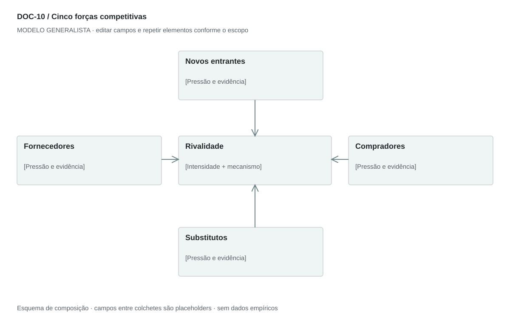

## For future Claude
Biblioteca generalista de Disruptive Venture Lab. Estrutura reutilizável, não análise preenchida nem evidência de um novo negócio.

# DOC-10 — Cinco forças competitivas

Avaliar pressões estruturais sobre margem e capacidade de competir em um mercado definido.

## Estudo do arquivo de referência

Fonte: `DOC-10-fonte.pdf`. 3 página(s). Três páginas retrato. Cinco seções com introdução, fatores e conclusão qualitativa; quadro-resumo inserido como imagem na terceira página e três recomendações finais. A forma é explicativa, não quantitativa. Intensidades dependem da fronteira de mercado escolhida.

Esta descrição registra o original. As recomendações abaixo são uma adaptação generalista, não uma reprodução nem validação do negócio-fonte.

## Formato e estilo recomendados

2–3 páginas + diagrama de cinco forças. Uma ficha por força com mecanismo, evidência, intensidade e implicação estratégica.

Aplicar o [sistema editorial](../SISTEMA-EDITORIAL.md), mantendo a hierarquia e a legibilidade.

## Dados comuns

| Campo comum | Tipo | O que preencher |
| --- | --- | --- |
| negocio | texto | Nome do negócio analisado, sem herdar o caso-fonte |
| documento_id | referência | ID do modelo e ID da instância, quando criada |
| versao | texto | Versão e estado de revisão |
| idioma | texto | Idioma escolhido para a entrega |
| audiencia | texto | Quem precisa tomar qual decisão |
| responsavel | referência | Autor responsável pela análise |
| data_base | data ISO | Data à qual as informações se referem |
| territorio | texto | Geografia relevante ou justificativa de não aplicação |
| objetivo_decisao | texto | Pergunta que o documento precisa responder |
| escopo | texto | Incluído, excluído e horizonte |
| estado | enum | rascunho, em_revisao, aprovado ou obsoleto |

## Dicionário específico

| Campo | Tipo | Descrição e dado necessário |
| --- | --- | --- |
| mercado | texto | Fronteira competitiva analisada |
| forca | enum | entrantes, fornecedores, compradores, substitutos ou rivalidade |
| fator | texto | Driver estrutural da pressão |
| mecanismo_margem | texto | Como o fator altera preço, custo ou captura de valor |
| intensidade | enum | baixa, media, alta ou desconhecida |
| justificativa | texto | Rubrica e evidência da classificação |
| alternativa | texto | Concorrente, substituto ou mudança de arranjo |
| resposta | texto | Escolha estratégica relacionada à força |

## Regras de preenchimento

Use este modelo como estrutura de investigação, não como análise concluída. Substitua os campos entre colchetes e retire as instruções de redação da versão entregue ao cliente. Na ausência de informação, escreva “não informado” e registre a tarefa de coleta; no JSON use `null`. Zero só representa um valor confirmado como zero. “Não aplicável” exige justificativa e responsável pela decisão.

Cada registro específico deve conter `proveniencia`: classificação (`observado`, `hipotese`, `inferencia`, `simulado` ou `desconhecido`), referência da fonte, localização na fonte, data-base, data de consulta, confiança e limitação. Uma conta feita com hipóteses continua sendo estimativa. Fontes podem ser locais ou externas, mas nenhum dado específico de outro negócio deve ser herdado.

Números precisam de unidade, denominador, moeda quando pertinente e período. Comparações usam a mesma base. Gráficos temporais exigem tempo; cenários independentes usam categorias. Figuras têm título, legenda, fonte, data-base e alternativa textual. Adapte o idioma e a identidade visual ao novo negócio.

## Gráficos, diagramas e imagens

Visual principal: **Mapa de cinco forças**.

Rivalidade ao centro; entrantes acima, substitutos abaixo, fornecedores à esquerda e compradores à direita. Rótulos de intensidade e síntese; setas indicam pressão, não fluxo financeiro.

Imagens: Diagrama vetorial é suficiente. Logotipos de concorrentes são opcionais e precisam de origem; não incluir marcas apenas para preencher espaço.

### Brief para produzir o visual em outro negócio

Criar “Mapa de cinco forças” para [negócio], em português ou no idioma escolhido, usando apenas [dados aprovados]. Aplicar: Rivalidade ao centro; entrantes acima, substitutos abaixo, fornecedores à esquerda e compradores à direita. Rótulos de intensidade e síntese; setas indicam pressão, não fluxo financeiro. Incluir título, rótulos legíveis, legenda, fonte, período e classificação da evidência. Sem dados, manter campos vazios e indicar o que falta. Usar o SVG como wireframe editável, não como gráfico factual.

## Relações com outros documentos

[pestel](./pestel.md), [swot-tows](./swot-tows.md), [estrategia-integrada](./estrategia-integrada.md).

## Critérios de revisão

- Substituto resolve a tarefa por outra via; concorrente direto disputa oferta semelhante.
- Intensidade é qualitativa e fundamentada, não média estatística.
- Recomendação responde ao mecanismo de pressão.

- Toda conclusão tem evidência ou rótulo de hipótese/inferência; toda lacuna tem próximo passo.
- A versão final responde à decisão indicada no cabeçalho.

---

# Modelo preenchível

> Copie a partir deste título para criar a instância. Instruções e campos devem ser substituídos; um esqueleto preenchido mecanicamente não equivale a análise.

# [Negócio] — Cinco forças competitivas

**Versão:** [versão] · **Data-base:** [data] · **Responsável:** [papel]

**Audiência:** [quem decide] · **Território:** [recorte] · **Estado:** [rascunho/revisão/aprovado]

**Pergunta decisória:** [qual decisão este documento apoia?]

**Escopo e horizonte:** [incluído, excluído e período]

## 1. Definição do mercado

[Instrução: Delimite produto ou serviço, comprador, território e alternativas para o mesmo resultado.]

[A preencher: análise, evidência, implicação e lacuna.]

## 2. Novos entrantes

[Instrução: Barreiras de capital, acesso, escala, conhecimento e distribuição.]

[A preencher: análise, evidência, implicação e lacuna.]

## 3. Poder de fornecedores

[Instrução: Concentração, dependência, substituição e custo de troca.]

[A preencher: análise, evidência, implicação e lacuna.]

## 4. Poder de compradores

[Instrução: Concentração de receita, alternativas, negociação e custo de troca.]

[A preencher: análise, evidência, implicação e lacuna.]

## 5. Substitutos

[Instrução: Outras maneiras de resolver a tarefa, incluindo fazer internamente ou não agir.]

[A preencher: análise, evidência, implicação e lacuna.]

## 6. Rivalidade

[Instrução: Concorrentes diretos, crescimento, diferenciação e disputa de preço.]

[A preencher: análise, evidência, implicação e lacuna.]

## 7. Síntese e resposta

[Instrução: Escolhas para reduzir exposição e hipóteses que poderiam mudar a avaliação.]

[A preencher: análise, evidência, implicação e lacuna.]

## Registros estruturados

Preencher uma ficha por registro e repetir conforme necessário.

| Campo | Valor |
| --- | --- |
| mercado | [A preencher] |
| forca | [A preencher] |
| fator | [A preencher] |
| mecanismo_margem | [A preencher] |
| intensidade | [A preencher] |
| justificativa | [A preencher] |
| alternativa | [A preencher] |
| resposta | [A preencher] |
| Classificação | [observado / hipótese / inferência / simulado / desconhecido] |
| Fonte e localização | [ID + página, seção ou registro] |
| Data-base / consulta | [datas] |
| Unidade, moeda e período | [quando pertinente] |
| Limitação | [lacuna ou condição de interpretação] |

## Conclusão e encaminhamento

**Decisão proposta:** [decisão ou investigação necessária]

**Por quê:** [síntese das evidências e limitações]

**Alternativa considerada:** [alternativa e razão de rejeição]

**Condição de reversão:** [qual evidência mudaria a decisão]

**Próximo passo:** [ação] · **Dono:** [papel] · **Prazo:** [data] · **Critério:** [métrica e limiar, se pertinente]

## Fontes e lacunas

| ID | Fonte e localização | Data-base / consulta | O que sustenta | Limite / tarefa de coleta |
| --- | --- | --- | --- | --- |
| [ID] | [documento/página ou URL] | [datas] | [afirmação] | [limite e responsável] |
