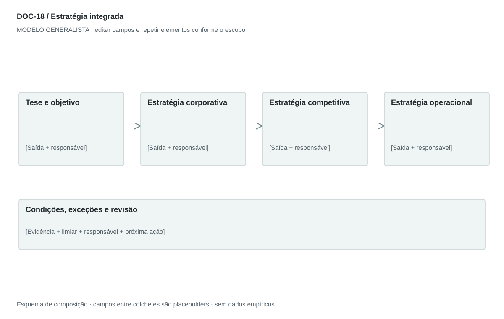

## For future Claude
Biblioteca generalista de Disruptive Venture Lab. Estrutura reutilizável, não análise preenchida nem evidência de um novo negócio.

# DOC-18 — Estratégia integrada

Definir escolhas sobre onde competir, como vencer e como operar dentro dos recursos disponíveis.

## Estudo do arquivo de referência

Fonte: `DOC-18-fonte.pdf`. 4 página(s). Quatro páginas retrato. Três níveis: estratégia corporativa, de negócio e operacional. Combina objetivos, mercados, caminhos de desenvolvimento e alianças, com separadores horizontais. Repete alianças e usa integrações vertical/horizontal em sentidos diferentes; o generalista exige definição e fronteiras.

Esta descrição registra o original. As recomendações abaixo são uma adaptação generalista, não uma reprodução nem validação do negócio-fonte.

## Formato e estilo recomendados

4–6 páginas: tese executiva, três níveis de decisão e quadro de iniciativas. Usar texto curto para justificar escolhas e quadros para execução.

Aplicar o [sistema editorial](../SISTEMA-EDITORIAL.md), mantendo a hierarquia e a legibilidade.

## Dados comuns

| Campo comum | Tipo | O que preencher |
| --- | --- | --- |
| negocio | texto | Nome do negócio analisado, sem herdar o caso-fonte |
| documento_id | referência | ID do modelo e ID da instância, quando criada |
| versao | texto | Versão e estado de revisão |
| idioma | texto | Idioma escolhido para a entrega |
| audiencia | texto | Quem precisa tomar qual decisão |
| responsavel | referência | Autor responsável pela análise |
| data_base | data ISO | Data à qual as informações se referem |
| territorio | texto | Geografia relevante ou justificativa de não aplicação |
| objetivo_decisao | texto | Pergunta que o documento precisa responder |
| escopo | texto | Incluído, excluído e horizonte |
| estado | enum | rascunho, em_revisao, aprovado ou obsoleto |

## Dicionário específico

| Campo | Tipo | Descrição e dado necessário |
| --- | --- | --- |
| nivel | enum | corporativo, competitivo ou operacional |
| objetivo | texto | Resultado e horizonte |
| escolha | texto | Onde atuar e como criar vantagem |
| renuncia | texto | Alternativa deliberadamente não escolhida |
| mecanismo | texto | Por que a escolha pode produzir o resultado |
| iniciativa | texto | Trabalho prioritário para realizar a escolha |
| recurso | texto | Pessoas, tempo, capital e parceiros necessários |
| indicador | texto | Medida com unidade, baseline, meta e horizonte |
| condicao_reversao | texto | Evidência que exige rever a escolha |

## Regras de preenchimento

Use este modelo como estrutura de investigação, não como análise concluída. Substitua os campos entre colchetes e retire as instruções de redação da versão entregue ao cliente. Na ausência de informação, escreva “não informado” e registre a tarefa de coleta; no JSON use `null`. Zero só representa um valor confirmado como zero. “Não aplicável” exige justificativa e responsável pela decisão.

Cada registro específico deve conter `proveniencia`: classificação (`observado`, `hipotese`, `inferencia`, `simulado` ou `desconhecido`), referência da fonte, localização na fonte, data-base, data de consulta, confiança e limitação. Uma conta feita com hipóteses continua sendo estimativa. Fontes podem ser locais ou externas, mas nenhum dado específico de outro negócio deve ser herdado.

Números precisam de unidade, denominador, moeda quando pertinente e período. Comparações usam a mesma base. Gráficos temporais exigem tempo; cenários independentes usam categorias. Figuras têm título, legenda, fonte, data-base e alternativa textual. Adapte o idioma e a identidade visual ao novo negócio.

## Gráficos, diagramas e imagens

Visual principal: **Cascata de estratégia para execução**.

Objetivo → escolha competitiva → capacidade → iniciativa → indicador. Setas expressam hipótese causal a testar, não causalidade demonstrada.

Imagens: Mapa de escolhas e quadro de iniciativas; imagens conceituais opcionais apenas se explicarem posicionamento. Não usar logos de parceiros como se houvesse acordo.

### Brief para produzir o visual em outro negócio

Criar “Cascata de estratégia para execução” para [negócio], em português ou no idioma escolhido, usando apenas [dados aprovados]. Aplicar: Objetivo → escolha competitiva → capacidade → iniciativa → indicador. Setas expressam hipótese causal a testar, não causalidade demonstrada. Incluir título, rótulos legíveis, legenda, fonte, período e classificação da evidência. Sem dados, manter campos vazios e indicar o que falta. Usar o SVG como wireframe editável, não como gráfico factual.

## Relações com outros documentos

[business-model-canvas](./business-model-canvas.md), [cinco-forcas](./cinco-forcas.md), [swot-tows](./swot-tows.md), [roadmap](./roadmap.md).

## Critérios de revisão

- Existe escolha e renúncia, não só lista de ambições.
- Iniciativas cabem nos recursos declarados.
- Definir integração vertical, horizontal e parceria sem tratá-las como sinônimos.

- Toda conclusão tem evidência ou rótulo de hipótese/inferência; toda lacuna tem próximo passo.
- A versão final responde à decisão indicada no cabeçalho.

---

# Modelo preenchível

> Copie a partir deste título para criar a instância. Instruções e campos devem ser substituídos; um esqueleto preenchido mecanicamente não equivale a análise.

# [Negócio] — Estratégia integrada

**Versão:** [versão] · **Data-base:** [data] · **Responsável:** [papel]

**Audiência:** [quem decide] · **Território:** [recorte] · **Estado:** [rascunho/revisão/aprovado]

**Pergunta decisória:** [qual decisão este documento apoia?]

**Escopo e horizonte:** [incluído, excluído e período]

## 1. Tese e objetivo

[Instrução: Resultado buscado, horizonte, restrição de capital/capacidade e razão para agir.]

[A preencher: análise, evidência, implicação e lacuna.]

## 2. Estratégia corporativa

[Instrução: Portfólio, territórios, prioridades, crescimento e opções rejeitadas.]

[A preencher: análise, evidência, implicação e lacuna.]

## 3. Estratégia competitiva

[Instrução: Segmento, problema, posicionamento, diferencial e mecanismo de captura de valor.]

[A preencher: análise, evidência, implicação e lacuna.]

## 4. Estratégia operacional

[Instrução: Processos, pessoas, canais, recursos e padrões necessários.]

[A preencher: análise, evidência, implicação e lacuna.]

## 5. Desenvolver, comprar ou formar parceria

[Instrução: Defina alternativa, dependência, custo e gatilho. Aquisição ou integração não é padrão obrigatório.]

[A preencher: análise, evidência, implicação e lacuna.]

## 6. Iniciativas e indicadores

[Instrução: Vincule objetivo, ação, dono, prazo, investimento e indicador com limiar.]

[A preencher: análise, evidência, implicação e lacuna.]

## 7. Riscos e revisão

[Instrução: Condições que invalidam a tese e próximo teste de maior valor informacional.]

[A preencher: análise, evidência, implicação e lacuna.]

## Registros estruturados

Preencher uma ficha por registro e repetir conforme necessário.

| Campo | Valor |
| --- | --- |
| nivel | [A preencher] |
| objetivo | [A preencher] |
| escolha | [A preencher] |
| renuncia | [A preencher] |
| mecanismo | [A preencher] |
| iniciativa | [A preencher] |
| recurso | [A preencher] |
| indicador | [A preencher] |
| condicao_reversao | [A preencher] |
| Classificação | [observado / hipótese / inferência / simulado / desconhecido] |
| Fonte e localização | [ID + página, seção ou registro] |
| Data-base / consulta | [datas] |
| Unidade, moeda e período | [quando pertinente] |
| Limitação | [lacuna ou condição de interpretação] |

## Conclusão e encaminhamento

**Decisão proposta:** [decisão ou investigação necessária]

**Por quê:** [síntese das evidências e limitações]

**Alternativa considerada:** [alternativa e razão de rejeição]

**Condição de reversão:** [qual evidência mudaria a decisão]

**Próximo passo:** [ação] · **Dono:** [papel] · **Prazo:** [data] · **Critério:** [métrica e limiar, se pertinente]

## Fontes e lacunas

| ID | Fonte e localização | Data-base / consulta | O que sustenta | Limite / tarefa de coleta |
| --- | --- | --- | --- | --- |
| [ID] | [documento/página ou URL] | [datas] | [afirmação] | [limite e responsável] |
