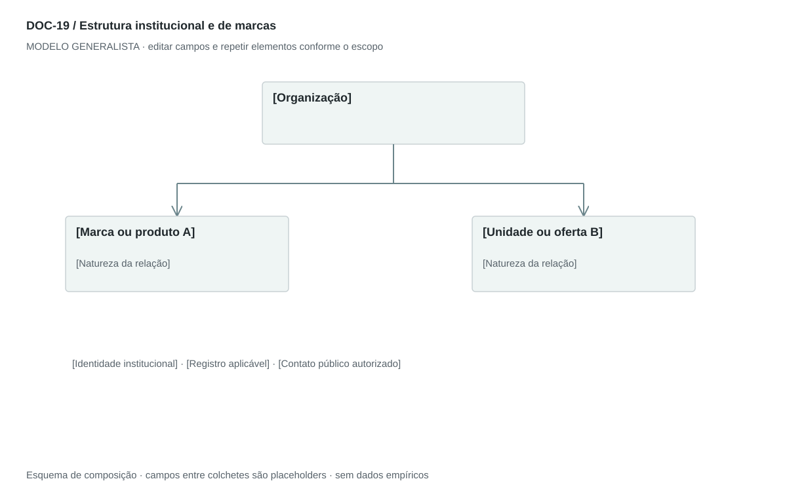

## For future Claude
Biblioteca generalista de Disruptive Venture Lab. Estrutura reutilizável, não análise preenchida nem evidência de um novo negócio.

# DOC-19 — Estrutura institucional e de marcas

Mostrar a relação entre organização, marcas, produtos ou unidades e os dados institucionais pertinentes.

## Estudo do arquivo de referência

Fonte: `DOC-19-fonte.pdf`. 1 página(s). Uma página em paisagem. Caixa superior azul ligada a duas caixas inferiores laranja e verde; abaixo, registro, endereço e contatos centralizados. O desenho mostra uma organização e duas ofertas, mas sozinho não comprova controle societário ou participação jurídica.

Esta descrição registra o original. As recomendações abaixo são uma adaptação generalista, não uma reprodução nem validação do negócio-fonte.

## Formato e estilo recomendados

Uma página com árvore de portfólio e ficha institucional. Rotular cada relação como marca, produto, unidade ou entidade; estrutura societária exige evidência documental específica.

Aplicar o [sistema editorial](../SISTEMA-EDITORIAL.md), mantendo a hierarquia e a legibilidade.

## Dados comuns

| Campo comum | Tipo | O que preencher |
| --- | --- | --- |
| negocio | texto | Nome do negócio analisado, sem herdar o caso-fonte |
| documento_id | referência | ID do modelo e ID da instância, quando criada |
| versao | texto | Versão e estado de revisão |
| idioma | texto | Idioma escolhido para a entrega |
| audiencia | texto | Quem precisa tomar qual decisão |
| responsavel | referência | Autor responsável pela análise |
| data_base | data ISO | Data à qual as informações se referem |
| territorio | texto | Geografia relevante ou justificativa de não aplicação |
| objetivo_decisao | texto | Pergunta que o documento precisa responder |
| escopo | texto | Incluído, excluído e horizonte |
| estado | enum | rascunho, em_revisao, aprovado ou obsoleto |

## Dicionário específico

| Campo | Tipo | Descrição e dado necessário |
| --- | --- | --- |
| no_id | referencia | Identificador da organização ou oferta |
| nome | texto | Nome oficial ou de apresentação |
| tipo_no | enum | organizacao, entidade_juridica, marca, produto ou unidade |
| parent_id | referencia | Nó superior ou null para raiz |
| tipo_relacao | enum | portfolio, operacao, marca ou societaria |
| registro | texto | Identificador institucional quando aplicável e autorizado |
| contato_publico | texto | Canal autorizado, não dado privado |
| confirmacao | data | Data de verificação dos dados |

## Regras de preenchimento

Use este modelo como estrutura de investigação, não como análise concluída. Substitua os campos entre colchetes e retire as instruções de redação da versão entregue ao cliente. Na ausência de informação, escreva “não informado” e registre a tarefa de coleta; no JSON use `null`. Zero só representa um valor confirmado como zero. “Não aplicável” exige justificativa e responsável pela decisão.

Cada registro específico deve conter `proveniencia`: classificação (`observado`, `hipotese`, `inferencia`, `simulado` ou `desconhecido`), referência da fonte, localização na fonte, data-base, data de consulta, confiança e limitação. Uma conta feita com hipóteses continua sendo estimativa. Fontes podem ser locais ou externas, mas nenhum dado específico de outro negócio deve ser herdado.

Números precisam de unidade, denominador, moeda quando pertinente e período. Comparações usam a mesma base. Gráficos temporais exigem tempo; cenários independentes usam categorias. Figuras têm título, legenda, fonte, data-base e alternativa textual. Adapte o idioma e a identidade visual ao novo negócio.

## Gráficos, diagramas e imagens

Visual principal: **Árvore institucional e de portfólio**.

Organização no topo e ofertas/unidades abaixo. Conectores rotulados indicam natureza da relação. Não desenhar porcentagens ou controle societário sem documento.

Imagens: Caixas vetoriais com cores por tipo de nó; logo oficial opcional com origem. Fotografias não agregam informação estrutural.

### Brief para produzir o visual em outro negócio

Criar “Árvore institucional e de portfólio” para [negócio], em português ou no idioma escolhido, usando apenas [dados aprovados]. Aplicar: Organização no topo e ofertas/unidades abaixo. Conectores rotulados indicam natureza da relação. Não desenhar porcentagens ou controle societário sem documento. Incluir título, rótulos legíveis, legenda, fonte, período e classificação da evidência. Sem dados, manter campos vazios e indicar o que falta. Usar o SVG como wireframe editável, não como gráfico factual.

## Relações com outros documentos

[arquitetura-empresarial](./arquitetura-empresarial.md), [estrategia-integrada](./estrategia-integrada.md).

## Critérios de revisão

- Marca, produto e entidade jurídica não são tratados como equivalentes.
- Dados de registro e contato do original não entram no modelo.
- Uma seta de portfólio não afirma propriedade societária.

- Toda conclusão tem evidência ou rótulo de hipótese/inferência; toda lacuna tem próximo passo.
- A versão final responde à decisão indicada no cabeçalho.

---

# Modelo preenchível

> Copie a partir deste título para criar a instância. Instruções e campos devem ser substituídos; um esqueleto preenchido mecanicamente não equivale a análise.

# [Negócio] — Estrutura institucional e de marcas

**Versão:** [versão] · **Data-base:** [data] · **Responsável:** [papel]

**Audiência:** [quem decide] · **Território:** [recorte] · **Estado:** [rascunho/revisão/aprovado]

**Pergunta decisória:** [qual decisão este documento apoia?]

**Escopo e horizonte:** [incluído, excluído e período]

## 1. Identidade

[Instrução: Nome institucional e nome de apresentação; dados oficiais somente quando disponíveis e necessários.]

[A preencher: análise, evidência, implicação e lacuna.]

## 2. Portfólio

[Instrução: Marcas, produtos e unidades, com natureza de cada nó.]

[A preencher: análise, evidência, implicação e lacuna.]

## 3. Relações

[Instrução: Indique comercial, operacional ou societária; percentuais só com comprovação.]

[A preencher: análise, evidência, implicação e lacuna.]

## 4. Contatos

[Instrução: Canais públicos autorizados e data de confirmação.]

[A preencher: análise, evidência, implicação e lacuna.]

## 5. Notas de interpretação

[Instrução: Explique o que o diagrama prova e o que permanece indefinido.]

[A preencher: análise, evidência, implicação e lacuna.]

## Registros estruturados

Preencher uma ficha por registro e repetir conforme necessário.

| Campo | Valor |
| --- | --- |
| no_id | [A preencher] |
| nome | [A preencher] |
| tipo_no | [A preencher] |
| parent_id | [A preencher] |
| tipo_relacao | [A preencher] |
| registro | [A preencher] |
| contato_publico | [A preencher] |
| confirmacao | [A preencher] |
| Classificação | [observado / hipótese / inferência / simulado / desconhecido] |
| Fonte e localização | [ID + página, seção ou registro] |
| Data-base / consulta | [datas] |
| Unidade, moeda e período | [quando pertinente] |
| Limitação | [lacuna ou condição de interpretação] |

## Conclusão e encaminhamento

**Decisão proposta:** [decisão ou investigação necessária]

**Por quê:** [síntese das evidências e limitações]

**Alternativa considerada:** [alternativa e razão de rejeição]

**Condição de reversão:** [qual evidência mudaria a decisão]

**Próximo passo:** [ação] · **Dono:** [papel] · **Prazo:** [data] · **Critério:** [métrica e limiar, se pertinente]

## Fontes e lacunas

| ID | Fonte e localização | Data-base / consulta | O que sustenta | Limite / tarefa de coleta |
| --- | --- | --- | --- | --- |
| [ID] | [documento/página ou URL] | [datas] | [afirmação] | [limite e responsável] |
