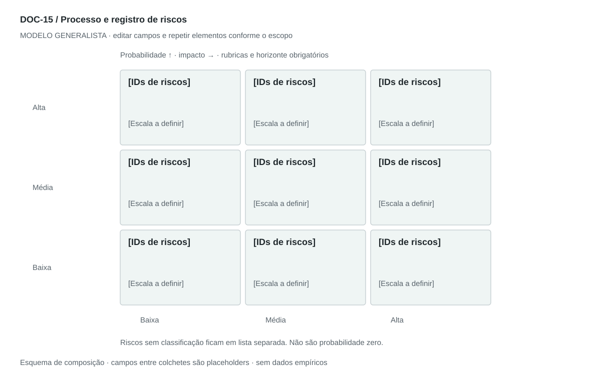

## For future Claude
Biblioteca generalista de Disruptive Venture Lab. Estrutura reutilizável, não análise preenchida nem evidência de um novo negócio.

# DOC-15 — Processo e registro de riscos

Identificar, avaliar, tratar e acompanhar incertezas que ameaçam objetivos, com responsáveis e resposta.

## Estudo do arquivo de referência

Fonte: `DOC-15-fonte.pdf`. 3 página(s). Três páginas retrato. Primeiro explica identificação, avaliação, mitigação e monitoramento; depois catálogo com likelihood/impact/priority/description e RBS hierárquica de três níveis em imagens. O catálogo prioriza qualitativamente, mas não define rubrica visível nem responsável ou risco residual por linha.

Esta descrição registra o original. As recomendações abaixo são uma adaptação generalista, não uma reprodução nem validação do negócio-fonte.

## Formato e estilo recomendados

3–5 páginas: processo, rubrica, registro priorizado, respostas e RBS. Heatmap somente depois de definir escala e horizonte.

Aplicar o [sistema editorial](../SISTEMA-EDITORIAL.md), mantendo a hierarquia e a legibilidade.

## Dados comuns

| Campo comum | Tipo | O que preencher |
| --- | --- | --- |
| negocio | texto | Nome do negócio analisado, sem herdar o caso-fonte |
| documento_id | referência | ID do modelo e ID da instância, quando criada |
| versao | texto | Versão e estado de revisão |
| idioma | texto | Idioma escolhido para a entrega |
| audiencia | texto | Quem precisa tomar qual decisão |
| responsavel | referência | Autor responsável pela análise |
| data_base | data ISO | Data à qual as informações se referem |
| territorio | texto | Geografia relevante ou justificativa de não aplicação |
| objetivo_decisao | texto | Pergunta que o documento precisa responder |
| escopo | texto | Incluído, excluído e horizonte |
| estado | enum | rascunho, em_revisao, aprovado ou obsoleto |

## Dicionário específico

| Campo | Tipo | Descrição e dado necessário |
| --- | --- | --- |
| risco_id | referencia | Identificador único do risco |
| categoria | texto | Grupo e subgrupo da RBS |
| causa_evento_efeito | texto | Encadeamento específico do risco |
| probabilidade | enum | baixa, media, alta ou desconhecida com rubrica e horizonte |
| impacto | enum | baixo, medio, alto ou desconhecido com critério |
| resposta | texto | Evitar, reduzir, transferir, aceitar ou investigar |
| responsavel | referencia | Quem acompanha e atua |
| gatilho | texto | Sinal de acionamento da contingência |
| residual | texto | Exposição esperada após resposta |
| revisao | data | Próxima data de revisão ou null |

## Regras de preenchimento

Use este modelo como estrutura de investigação, não como análise concluída. Substitua os campos entre colchetes e retire as instruções de redação da versão entregue ao cliente. Na ausência de informação, escreva “não informado” e registre a tarefa de coleta; no JSON use `null`. Zero só representa um valor confirmado como zero. “Não aplicável” exige justificativa e responsável pela decisão.

Cada registro específico deve conter `proveniencia`: classificação (`observado`, `hipotese`, `inferencia`, `simulado` ou `desconhecido`), referência da fonte, localização na fonte, data-base, data de consulta, confiança e limitação. Uma conta feita com hipóteses continua sendo estimativa. Fontes podem ser locais ou externas, mas nenhum dado específico de outro negócio deve ser herdado.

Números precisam de unidade, denominador, moeda quando pertinente e período. Comparações usam a mesma base. Gráficos temporais exigem tempo; cenários independentes usam categorias. Figuras têm título, legenda, fonte, data-base e alternativa textual. Adapte o idioma e a identidade visual ao novo negócio.

## Gráficos, diagramas e imagens

Visual principal: **Heatmap qualitativo e RBS**.

Matriz probabilidade × impacto com IDs, rubricas e legenda; desconhecidos ficam fora da matriz. Árvore de categorias em anexo. Pontuação ordinal não é probabilidade estatística.

Imagens: Heatmap e árvore; ícones de alerta opcionais. Não gerar números de probabilidade ou perda para preencher o gráfico.

### Brief para produzir o visual em outro negócio

Criar “Heatmap qualitativo e RBS” para [negócio], em português ou no idioma escolhido, usando apenas [dados aprovados]. Aplicar: Matriz probabilidade × impacto com IDs, rubricas e legenda; desconhecidos ficam fora da matriz. Árvore de categorias em anexo. Pontuação ordinal não é probabilidade estatística. Incluir título, rótulos legíveis, legenda, fonte, período e classificação da evidência. Sem dados, manter campos vazios e indicar o que falta. Usar o SVG como wireframe editável, não como gráfico factual.

## Relações com outros documentos

[pestel](./pestel.md), [swot-tows](./swot-tows.md), [momentos-verdade](./momentos-verdade.md), [roadmap](./roadmap.md).

## Critérios de revisão

- Nenhum risco prioritário fica sem dono ou resposta.
- Rubrica e horizonte acompanham a classificação.
- Risco residual só muda após justificar efeito do controle.

- Toda conclusão tem evidência ou rótulo de hipótese/inferência; toda lacuna tem próximo passo.
- A versão final responde à decisão indicada no cabeçalho.

---

# Modelo preenchível

> Copie a partir deste título para criar a instância. Instruções e campos devem ser substituídos; um esqueleto preenchido mecanicamente não equivale a análise.

# [Negócio] — Processo e registro de riscos

**Versão:** [versão] · **Data-base:** [data] · **Responsável:** [papel]

**Audiência:** [quem decide] · **Território:** [recorte] · **Estado:** [rascunho/revisão/aprovado]

**Pergunta decisória:** [qual decisão este documento apoia?]

**Escopo e horizonte:** [incluído, excluído e período]

## 1. Escopo e critérios

[Instrução: Objetivos protegidos, horizonte e rubricas de probabilidade e impacto.]

[A preencher: análise, evidência, implicação e lacuna.]

## 2. Processo

[Instrução: Identificar, avaliar, escolher resposta, atribuir responsável e revisar.]

[A preencher: análise, evidência, implicação e lacuna.]

## 3. Registro de riscos

[Instrução: Descreva causa → evento incerto → efeito; se o problema já ocorreu, registrar como incidente.]

[A preencher: análise, evidência, implicação e lacuna.]

## 4. Tratamento

[Instrução: Prevenção, contingência, custo, prazo, gatilho e dono.]

[A preencher: análise, evidência, implicação e lacuna.]

## 5. Risco residual e aceitação

[Instrução: Reavaliar após controles e indicar quem aceita a exposição.]

[A preencher: análise, evidência, implicação e lacuna.]

## 6. RBS e acompanhamento

[Instrução: Agrupar por categoria, sem substituir o registro operacional; cadência e sinais de alerta.]

[A preencher: análise, evidência, implicação e lacuna.]

## Registros estruturados

Preencher uma ficha por registro e repetir conforme necessário.

| Campo | Valor |
| --- | --- |
| risco_id | [A preencher] |
| categoria | [A preencher] |
| causa_evento_efeito | [A preencher] |
| probabilidade | [A preencher] |
| impacto | [A preencher] |
| resposta | [A preencher] |
| responsavel | [A preencher] |
| gatilho | [A preencher] |
| residual | [A preencher] |
| revisao | [A preencher] |
| Classificação | [observado / hipótese / inferência / simulado / desconhecido] |
| Fonte e localização | [ID + página, seção ou registro] |
| Data-base / consulta | [datas] |
| Unidade, moeda e período | [quando pertinente] |
| Limitação | [lacuna ou condição de interpretação] |

## Conclusão e encaminhamento

**Decisão proposta:** [decisão ou investigação necessária]

**Por quê:** [síntese das evidências e limitações]

**Alternativa considerada:** [alternativa e razão de rejeição]

**Condição de reversão:** [qual evidência mudaria a decisão]

**Próximo passo:** [ação] · **Dono:** [papel] · **Prazo:** [data] · **Critério:** [métrica e limiar, se pertinente]

## Fontes e lacunas

| ID | Fonte e localização | Data-base / consulta | O que sustenta | Limite / tarefa de coleta |
| --- | --- | --- | --- | --- |
| [ID] | [documento/página ou URL] | [datas] | [afirmação] | [limite e responsável] |
