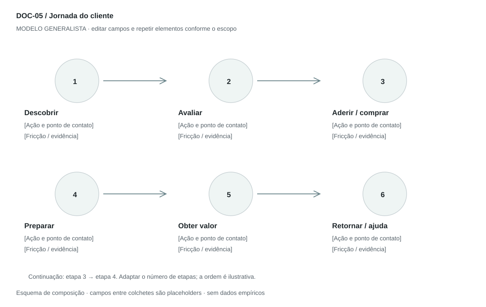

## For future Claude
Biblioteca generalista de Disruptive Venture Lab. Estrutura reutilizável, não análise preenchida nem evidência de um novo negócio.

# DOC-05 — Jornada do cliente

Mostrar as ações e pontos de contato da pessoa para alcançar um objetivo, incluindo fricções e oportunidades.

## Estudo do arquivo de referência

Fonte: `DOC-05-fonte.pdf`. 1 página(s). Uma página em paisagem com oito imagens circulares, bordas escuras, sombras e setas curvas em percurso serpenteado. Legendas numeradas acompanham as ações. Retrata principalmente onboarding, terminando no registro; não documenta toda a relação nem mede emoções.

Esta descrição registra o original. As recomendações abaixo são uma adaptação generalista, não uma reprodução nem validação do negócio-fonte.

## Formato e estilo recomendados

Uma prancha paisagem com 5–8 etapas por linha; quando houver retorno, numerar e usar setas sem ambiguidade. Anexo em tabela registra dados que não cabem no mapa.

Aplicar o [sistema editorial](../SISTEMA-EDITORIAL.md), mantendo a hierarquia e a legibilidade.

## Dados comuns

| Campo comum | Tipo | O que preencher |
| --- | --- | --- |
| negocio | texto | Nome do negócio analisado, sem herdar o caso-fonte |
| documento_id | referência | ID do modelo e ID da instância, quando criada |
| versao | texto | Versão e estado de revisão |
| idioma | texto | Idioma escolhido para a entrega |
| audiencia | texto | Quem precisa tomar qual decisão |
| responsavel | referência | Autor responsável pela análise |
| data_base | data ISO | Data à qual as informações se referem |
| territorio | texto | Geografia relevante ou justificativa de não aplicação |
| objetivo_decisao | texto | Pergunta que o documento precisa responder |
| escopo | texto | Incluído, excluído e horizonte |
| estado | enum | rascunho, em_revisao, aprovado ou obsoleto |

## Dicionário específico

| Campo | Tipo | Descrição e dado necessário |
| --- | --- | --- |
| etapa_id | referencia | Identificador compartilhado com blueprint e momentos da verdade |
| ordem | inteiro | Ordem ou ramo da ação |
| acao_cliente | texto | O que a pessoa tenta fazer |
| ponto_contato | texto | Canal, pessoa, espaço ou objeto |
| expectativa | texto | Resultado esperado na etapa |
| friccao | texto | Esforço, dúvida ou falha |
| emocao | texto | Sentimento com origem observada ou hipotética |
| metrica | texto | Tempo, conclusão, abandono ou outro indicador com denominador |
| oportunidade | texto | Mudança que pode melhorar a etapa |

## Regras de preenchimento

Use este modelo como estrutura de investigação, não como análise concluída. Substitua os campos entre colchetes e retire as instruções de redação da versão entregue ao cliente. Na ausência de informação, escreva “não informado” e registre a tarefa de coleta; no JSON use `null`. Zero só representa um valor confirmado como zero. “Não aplicável” exige justificativa e responsável pela decisão.

Cada registro específico deve conter `proveniencia`: classificação (`observado`, `hipotese`, `inferencia`, `simulado` ou `desconhecido`), referência da fonte, localização na fonte, data-base, data de consulta, confiança e limitação. Uma conta feita com hipóteses continua sendo estimativa. Fontes podem ser locais ou externas, mas nenhum dado específico de outro negócio deve ser herdado.

Números precisam de unidade, denominador, moeda quando pertinente e período. Comparações usam a mesma base. Gráficos temporais exigem tempo; cenários independentes usam categorias. Figuras têm título, legenda, fonte, data-base e alternativa textual. Adapte o idioma e a identidade visual ao novo negócio.

## Gráficos, diagramas e imagens

Visual principal: **Jornada visual numerada**.

Ícone ou cena por etapa, ação e ponto de contato; setas mostram progressão e retorno. Curva emocional é opcional e só recebe números quando houver escala e observações.

Imagens: Uma cena por ação, com composição coerente; podem ser ícones originais. Se usar fotografia, variar contexto, não pessoa arbitrariamente; informar origem e licença. Sem QR codes funcionais ou dados pessoais.

### Brief para produzir o visual em outro negócio

Criar “Jornada visual numerada” para [negócio], em português ou no idioma escolhido, usando apenas [dados aprovados]. Aplicar: Ícone ou cena por etapa, ação e ponto de contato; setas mostram progressão e retorno. Curva emocional é opcional e só recebe números quando houver escala e observações. Incluir título, rótulos legíveis, legenda, fonte, período e classificação da evidência. Sem dados, manter campos vazios e indicar o que falta. Usar o SVG como wireframe editável, não como gráfico factual.

## Relações com outros documentos

[persona](./persona.md), [carta-empatia](./carta-empatia.md), [momentos-verdade](./momentos-verdade.md), [service-blueprint](./service-blueprint.md).

## Critérios de revisão

- O título explicita se é jornada completa ou recorte.
- Nenhum sentimento é apresentado como pesquisa sem fonte.
- Etapas usam os mesmos IDs nos três mapas de experiência.

- Toda conclusão tem evidência ou rótulo de hipótese/inferência; toda lacuna tem próximo passo.
- A versão final responde à decisão indicada no cabeçalho.

---

# Modelo preenchível

> Copie a partir deste título para criar a instância. Instruções e campos devem ser substituídos; um esqueleto preenchido mecanicamente não equivale a análise.

# [Negócio] — Jornada do cliente

**Versão:** [versão] · **Data-base:** [data] · **Responsável:** [papel]

**Audiência:** [quem decide] · **Território:** [recorte] · **Estado:** [rascunho/revisão/aprovado]

**Pergunta decisória:** [qual decisão este documento apoia?]

**Escopo e horizonte:** [incluído, excluído e período]

## 1. Recorte

[Instrução: Persona, objetivo, início, fim e cenário atual ou proposto.]

[A preencher: análise, evidência, implicação e lacuna.]

## 2. Sequência de ações

[Instrução: Liste ações em primeira pessoa, sem confundir ação do usuário com processo interno.]

[A preencher: análise, evidência, implicação e lacuna.]

## 3. Pontos de contato

[Instrução: Canal, pessoa ou objeto com que o cliente interage em cada etapa.]

[A preencher: análise, evidência, implicação e lacuna.]

## 4. Experiência

[Instrução: Expectativa, dúvida, fricção e sentimento observado ou hipotético.]

[A preencher: análise, evidência, implicação e lacuna.]

## 5. Oportunidades e indicadores

[Instrução: Associe melhoria, responsável e métrica a uma etapa.]

[A preencher: análise, evidência, implicação e lacuna.]

## 6. Exceções

[Instrução: Inclua abandono, retorno e ajuda, além do caminho ideal.]

[A preencher: análise, evidência, implicação e lacuna.]

## Registros estruturados

Preencher uma ficha por registro e repetir conforme necessário.

| Campo | Valor |
| --- | --- |
| etapa_id | [A preencher] |
| ordem | [A preencher] |
| acao_cliente | [A preencher] |
| ponto_contato | [A preencher] |
| expectativa | [A preencher] |
| friccao | [A preencher] |
| emocao | [A preencher] |
| metrica | [A preencher] |
| oportunidade | [A preencher] |
| Classificação | [observado / hipótese / inferência / simulado / desconhecido] |
| Fonte e localização | [ID + página, seção ou registro] |
| Data-base / consulta | [datas] |
| Unidade, moeda e período | [quando pertinente] |
| Limitação | [lacuna ou condição de interpretação] |

## Conclusão e encaminhamento

**Decisão proposta:** [decisão ou investigação necessária]

**Por quê:** [síntese das evidências e limitações]

**Alternativa considerada:** [alternativa e razão de rejeição]

**Condição de reversão:** [qual evidência mudaria a decisão]

**Próximo passo:** [ação] · **Dono:** [papel] · **Prazo:** [data] · **Critério:** [métrica e limiar, se pertinente]

## Fontes e lacunas

| ID | Fonte e localização | Data-base / consulta | O que sustenta | Limite / tarefa de coleta |
| --- | --- | --- | --- | --- |
| [ID] | [documento/página ou URL] | [datas] | [afirmação] | [limite e responsável] |
