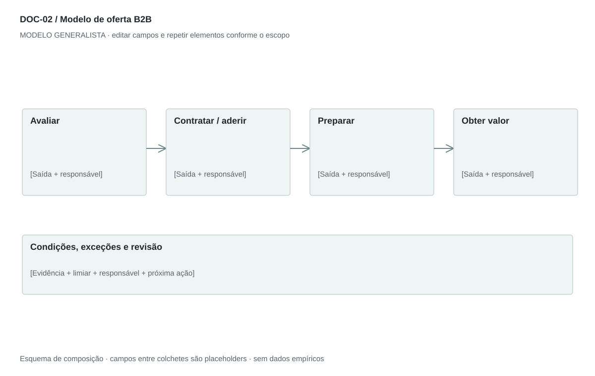

## For future Claude
Biblioteca generalista de Disruptive Venture Lab. Estrutura reutilizável, não análise preenchida nem evidência de um novo negócio.

# DOC-02 — Modelo de oferta B2B

Explicar a contratação, implantação, uso, cobrança e suporte para uma organização compradora.

## Estudo do arquivo de referência

Fonte: `DOC-02-fonte.pdf`. 1 página(s). Uma página retrato. Título central, seção How It Works, duas etapas numeradas, condições comerciais em bullets, funcionalidades do painel e vantagens em negrito. É uma ficha de oferta e funcionamento, não um plano de negócios completo.

Esta descrição registra o original. As recomendações abaixo são uma adaptação generalista, não uma reprodução nem validação do negócio-fonte.

## Formato e estilo recomendados

1–2 páginas retrato. Ordem: problema e resultado → como contratar → condições → implantação e uso → benefícios demonstráveis → próximo passo.

Aplicar o [sistema editorial](../SISTEMA-EDITORIAL.md), mantendo a hierarquia e a legibilidade.

## Dados comuns

| Campo comum | Tipo | O que preencher |
| --- | --- | --- |
| negocio | texto | Nome do negócio analisado, sem herdar o caso-fonte |
| documento_id | referência | ID do modelo e ID da instância, quando criada |
| versao | texto | Versão e estado de revisão |
| idioma | texto | Idioma escolhido para a entrega |
| audiencia | texto | Quem precisa tomar qual decisão |
| responsavel | referência | Autor responsável pela análise |
| data_base | data ISO | Data à qual as informações se referem |
| territorio | texto | Geografia relevante ou justificativa de não aplicação |
| objetivo_decisao | texto | Pergunta que o documento precisa responder |
| escopo | texto | Incluído, excluído e horizonte |
| estado | enum | rascunho, em_revisao, aprovado ou obsoleto |

## Dicionário específico

| Campo | Tipo | Descrição e dado necessário |
| --- | --- | --- |
| segmento | referencia | Grupo de organizações que enfrenta o problema |
| papel_compra | texto | Usuário, comprador, decisor ou aprovador |
| problema | texto | Custo, atraso ou oportunidade da organização |
| unidade_cobranca | texto | Por entrega, assento, licença, uso ou outro denominador |
| preco | decimal | null enquanto não houver hipótese ou preço aprovado |
| moeda | texto | Código da moeda, sem assumir real ou euro |
| recorrencia | texto | Única, mensal, anual ou variável |
| requisito_cliente | texto | Condição necessária para a entrega |
| metrica_valor | texto | Como verificar o benefício e em qual período |
| canal_suporte | texto | Canal e prazo acordado |

## Regras de preenchimento

Use este modelo como estrutura de investigação, não como análise concluída. Substitua os campos entre colchetes e retire as instruções de redação da versão entregue ao cliente. Na ausência de informação, escreva “não informado” e registre a tarefa de coleta; no JSON use `null`. Zero só representa um valor confirmado como zero. “Não aplicável” exige justificativa e responsável pela decisão.

Cada registro específico deve conter `proveniencia`: classificação (`observado`, `hipotese`, `inferencia`, `simulado` ou `desconhecido`), referência da fonte, localização na fonte, data-base, data de consulta, confiança e limitação. Uma conta feita com hipóteses continua sendo estimativa. Fontes podem ser locais ou externas, mas nenhum dado específico de outro negócio deve ser herdado.

Números precisam de unidade, denominador, moeda quando pertinente e período. Comparações usam a mesma base. Gráficos temporais exigem tempo; cenários independentes usam categorias. Figuras têm título, legenda, fonte, data-base e alternativa textual. Adapte o idioma e a identidade visual ao novo negócio.

## Gráficos, diagramas e imagens

Visual principal: **Fluxo de contratação B2B**.

Avaliar → contratar → implantar → operar → renovar/encerrar. Abaixo de cada etapa, indicar responsável e documento de saída.

Imagens: Diagrama de fluxo; captura real ou wireframe do serviço apenas se ajudar a explicar a entrega. Não inserir painel ou equipamento que o novo negócio não tenha.

### Brief para produzir o visual em outro negócio

Criar “Fluxo de contratação B2B” para [negócio], em português ou no idioma escolhido, usando apenas [dados aprovados]. Aplicar: Avaliar → contratar → implantar → operar → renovar/encerrar. Abaixo de cada etapa, indicar responsável e documento de saída. Incluir título, rótulos legíveis, legenda, fonte, período e classificação da evidência. Sem dados, manter campos vazios e indicar o que falta. Usar o SVG como wireframe editável, não como gráfico factual.

## Relações com outros documentos

[persona](./persona.md), [proposta-valor](./proposta-valor.md), [arquitetura-empresarial](./arquitetura-empresarial.md).

## Critérios de revisão

- Taxas mostram base de incidência e periodicidade.
- Requisitos do cliente são explícitos.
- Garantias e comparações exigem evidência.

- Toda conclusão tem evidência ou rótulo de hipótese/inferência; toda lacuna tem próximo passo.
- A versão final responde à decisão indicada no cabeçalho.

---

# Modelo preenchível

> Copie a partir deste título para criar a instância. Instruções e campos devem ser substituídos; um esqueleto preenchido mecanicamente não equivale a análise.

# [Negócio] — Modelo de oferta B2B

**Versão:** [versão] · **Data-base:** [data] · **Responsável:** [papel]

**Audiência:** [quem decide] · **Território:** [recorte] · **Estado:** [rascunho/revisão/aprovado]

**Pergunta decisória:** [qual decisão este documento apoia?]

**Escopo e horizonte:** [incluído, excluído e período]

## 1. Cliente e situação de compra

[Instrução: Separe usuário, comprador, decisor e aprovador; detalhe o problema e a alternativa atual.]

[A preencher: análise, evidência, implicação e lacuna.]

## 2. Como funciona

[Instrução: Descreva avaliação, contratação, implantação, uso recorrente e encerramento.]

[A preencher: análise, evidência, implicação e lacuna.]

## 3. Condições comerciais

[Instrução: Informe unidade cobrada, preço, moeda, recorrência, implantação, variáveis, prazo e itens não incluídos.]

[A preencher: análise, evidência, implicação e lacuna.]

## 4. Requisitos e responsabilidades

[Instrução: Declare recursos que o cliente fornece, dependências e o que o prestador entrega.]

[A preencher: análise, evidência, implicação e lacuna.]

## 5. Valor e prova

[Instrução: Associe cada benefício a um indicador, comparação e evidência; mantenha benefícios não testados como hipóteses.]

[A preencher: análise, evidência, implicação e lacuna.]

## 6. Suporte e próximo passo

[Instrução: Defina canais, horários, prazos negociados e a ação para avaliar ou contratar.]

[A preencher: análise, evidência, implicação e lacuna.]

## Registros estruturados

Preencher uma ficha por registro e repetir conforme necessário.

| Campo | Valor |
| --- | --- |
| segmento | [A preencher] |
| papel_compra | [A preencher] |
| problema | [A preencher] |
| unidade_cobranca | [A preencher] |
| preco | [A preencher] |
| moeda | [A preencher] |
| recorrencia | [A preencher] |
| requisito_cliente | [A preencher] |
| metrica_valor | [A preencher] |
| canal_suporte | [A preencher] |
| Classificação | [observado / hipótese / inferência / simulado / desconhecido] |
| Fonte e localização | [ID + página, seção ou registro] |
| Data-base / consulta | [datas] |
| Unidade, moeda e período | [quando pertinente] |
| Limitação | [lacuna ou condição de interpretação] |

## Conclusão e encaminhamento

**Decisão proposta:** [decisão ou investigação necessária]

**Por quê:** [síntese das evidências e limitações]

**Alternativa considerada:** [alternativa e razão de rejeição]

**Condição de reversão:** [qual evidência mudaria a decisão]

**Próximo passo:** [ação] · **Dono:** [papel] · **Prazo:** [data] · **Critério:** [métrica e limiar, se pertinente]

## Fontes e lacunas

| ID | Fonte e localização | Data-base / consulta | O que sustenta | Limite / tarefa de coleta |
| --- | --- | --- | --- | --- |
| [ID] | [documento/página ou URL] | [datas] | [afirmação] | [limite e responsável] |
