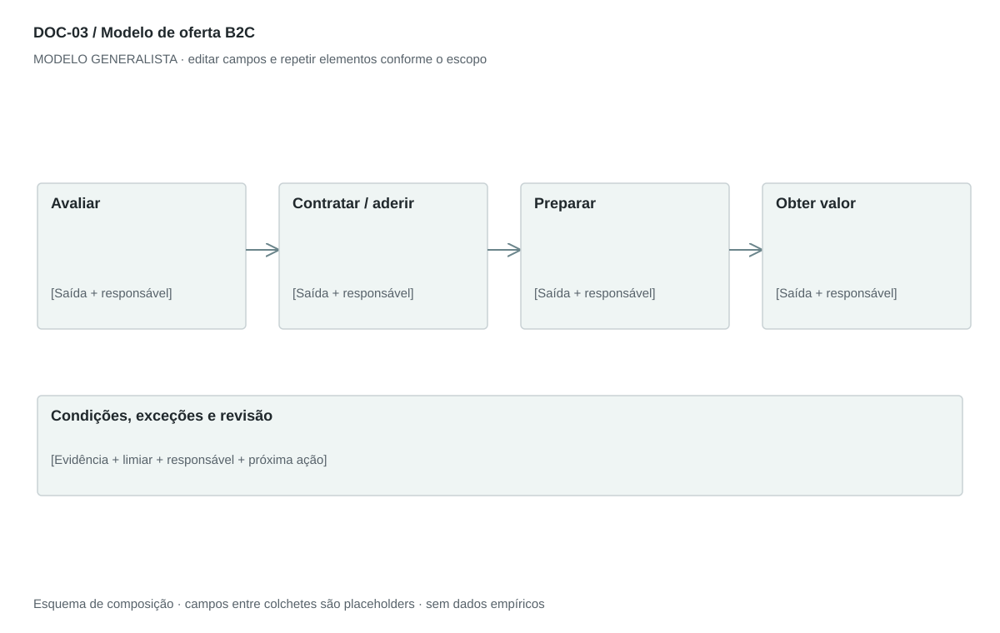

## For future Claude
Biblioteca generalista de Disruptive Venture Lab. Estrutura reutilizável, não análise preenchida nem evidência de um novo negócio.

# DOC-03 — Modelo de oferta B2C

Descrever como uma pessoa acessa, começa, usa e encerra uma oferta, com custos e exceções claros.

## Estudo do arquivo de referência

Fonte: `DOC-03-fonte.pdf`. 2 página(s). Duas páginas retrato. Registro, termos de uso, opções do aplicativo, ativação e uso com listas de três níveis. Benefícios fecham o documento. Regras de exceção aparecem antes da ativação. O texto pressupõe app, cadastro e autenticação, que não são universais.

Esta descrição registra o original. As recomendações abaixo são uma adaptação generalista, não uma reprodução nem validação do negócio-fonte.

## Formato e estilo recomendados

2–3 páginas retrato; jornada de uso curta e quadro destacado de custos e requisitos. Substituir termos técnicos por ações compreensíveis.

Aplicar o [sistema editorial](../SISTEMA-EDITORIAL.md), mantendo a hierarquia e a legibilidade.

## Dados comuns

| Campo comum | Tipo | O que preencher |
| --- | --- | --- |
| negocio | texto | Nome do negócio analisado, sem herdar o caso-fonte |
| documento_id | referência | ID do modelo e ID da instância, quando criada |
| versao | texto | Versão e estado de revisão |
| idioma | texto | Idioma escolhido para a entrega |
| audiencia | texto | Quem precisa tomar qual decisão |
| responsavel | referência | Autor responsável pela análise |
| data_base | data ISO | Data à qual as informações se referem |
| territorio | texto | Geografia relevante ou justificativa de não aplicação |
| objetivo_decisao | texto | Pergunta que o documento precisa responder |
| escopo | texto | Incluído, excluído e horizonte |
| estado | enum | rascunho, em_revisao, aprovado ou obsoleto |

## Dicionário específico

| Campo | Tipo | Descrição e dado necessário |
| --- | --- | --- |
| usuario | referencia | Pessoa ou papel beneficiário |
| necessidade | texto | Tarefa ou resultado buscado |
| acesso | texto | Canal de adesão, compra ou atendimento |
| passo | texto | Ação executável e seu resultado |
| custo | decimal | Valor cobrado; null significa desconhecido, zero só se confirmado |
| condicao | texto | Requisito, restrição ou política aprovada |
| excecao | texto | Falha previsível e alternativa |
| canal_ajuda | texto | Como a pessoa resolve dúvidas ou encerra o uso |

## Regras de preenchimento

Use este modelo como estrutura de investigação, não como análise concluída. Substitua os campos entre colchetes e retire as instruções de redação da versão entregue ao cliente. Na ausência de informação, escreva “não informado” e registre a tarefa de coleta; no JSON use `null`. Zero só representa um valor confirmado como zero. “Não aplicável” exige justificativa e responsável pela decisão.

Cada registro específico deve conter `proveniencia`: classificação (`observado`, `hipotese`, `inferencia`, `simulado` ou `desconhecido`), referência da fonte, localização na fonte, data-base, data de consulta, confiança e limitação. Uma conta feita com hipóteses continua sendo estimativa. Fontes podem ser locais ou externas, mas nenhum dado específico de outro negócio deve ser herdado.

Números precisam de unidade, denominador, moeda quando pertinente e período. Comparações usam a mesma base. Gráficos temporais exigem tempo; cenários independentes usam categorias. Figuras têm título, legenda, fonte, data-base e alternativa textual. Adapte o idioma e a identidade visual ao novo negócio.

## Gráficos, diagramas e imagens

Visual principal: **Primeiro valor para o consumidor**.

Conhecer → aderir/comprar → preparar → usar → receber confirmação → obter ajuda. Remover etapas não aplicáveis.

Imagens: Sequência com ícones ou ilustrações de ações; fotos reais opcionais de uso. Não pressupor aplicativo, cadastro, pagamento digital ou biometria.

### Brief para produzir o visual em outro negócio

Criar “Primeiro valor para o consumidor” para [negócio], em português ou no idioma escolhido, usando apenas [dados aprovados]. Aplicar: Conhecer → aderir/comprar → preparar → usar → receber confirmação → obter ajuda. Remover etapas não aplicáveis. Incluir título, rótulos legíveis, legenda, fonte, período e classificação da evidência. Sem dados, manter campos vazios e indicar o que falta. Usar o SVG como wireframe editável, não como gráfico factual.

## Relações com outros documentos

[jornada-cliente](./jornada-cliente.md), [momentos-verdade](./momentos-verdade.md), [proposta-valor](./proposta-valor.md).

## Critérios de revisão

- Nenhuma promessa absoluta de segurança, velocidade ou disponibilidade.
- Custo zero é distinto de custo desconhecido.
- Cancelamento e falhas têm caminho definido.

- Toda conclusão tem evidência ou rótulo de hipótese/inferência; toda lacuna tem próximo passo.
- A versão final responde à decisão indicada no cabeçalho.

---

# Modelo preenchível

> Copie a partir deste título para criar a instância. Instruções e campos devem ser substituídos; um esqueleto preenchido mecanicamente não equivale a análise.

# [Negócio] — Modelo de oferta B2C

**Versão:** [versão] · **Data-base:** [data] · **Responsável:** [papel]

**Audiência:** [quem decide] · **Território:** [recorte] · **Estado:** [rascunho/revisão/aprovado]

**Pergunta decisória:** [qual decisão este documento apoia?]

**Escopo e horizonte:** [incluído, excluído e período]

## 1. Para quem e para qual necessidade

[Instrução: Defina usuário e contexto. Diferencie pessoa que usa de pessoa que paga, quando necessário.]

[A preencher: análise, evidência, implicação e lacuna.]

## 2. Acesso e primeiro uso

[Instrução: Explique descoberta, compra ou adesão, preparação e primeira obtenção de valor.]

[A preencher: análise, evidência, implicação e lacuna.]

## 3. Condições de uso e custos

[Instrução: Requisitos, cobranças, restrições, cancelamento e alternativas. Use apenas políticas aprovadas.]

[A preencher: análise, evidência, implicação e lacuna.]

## 4. Uso recorrente

[Instrução: Descreva ações centrais, retorno esperado e confirmação de conclusão.]

[A preencher: análise, evidência, implicação e lacuna.]

## 5. Falhas e recuperação

[Instrução: Oriente o que fazer se o caminho principal falhar e como obter ajuda.]

[A preencher: análise, evidência, implicação e lacuna.]

## 6. Benefícios e próximo passo

[Instrução: Apresente o resultado esperado com seus limites e a ação seguinte.]

[A preencher: análise, evidência, implicação e lacuna.]

## Registros estruturados

Preencher uma ficha por registro e repetir conforme necessário.

| Campo | Valor |
| --- | --- |
| usuario | [A preencher] |
| necessidade | [A preencher] |
| acesso | [A preencher] |
| passo | [A preencher] |
| custo | [A preencher] |
| condicao | [A preencher] |
| excecao | [A preencher] |
| canal_ajuda | [A preencher] |
| Classificação | [observado / hipótese / inferência / simulado / desconhecido] |
| Fonte e localização | [ID + página, seção ou registro] |
| Data-base / consulta | [datas] |
| Unidade, moeda e período | [quando pertinente] |
| Limitação | [lacuna ou condição de interpretação] |

## Conclusão e encaminhamento

**Decisão proposta:** [decisão ou investigação necessária]

**Por quê:** [síntese das evidências e limitações]

**Alternativa considerada:** [alternativa e razão de rejeição]

**Condição de reversão:** [qual evidência mudaria a decisão]

**Próximo passo:** [ação] · **Dono:** [papel] · **Prazo:** [data] · **Critério:** [métrica e limiar, se pertinente]

## Fontes e lacunas

| ID | Fonte e localização | Data-base / consulta | O que sustenta | Limite / tarefa de coleta |
| --- | --- | --- | --- | --- |
| [ID] | [documento/página ou URL] | [datas] | [afirmação] | [limite e responsável] |
