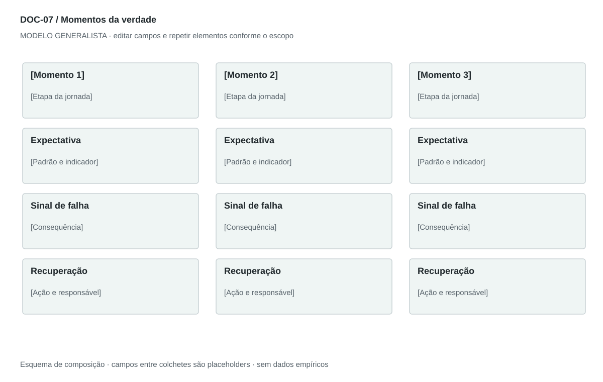

## For future Claude
Biblioteca generalista de Disruptive Venture Lab. Estrutura reutilizável, não análise preenchida nem evidência de um novo negócio.

# DOC-07 — Momentos da verdade

Identificar interações que alteram confiança e decisão de continuar, e definir resposta para sucesso e falha.

## Estudo do arquivo de referência

Fonte: `DOC-07-fonte.pdf`. 4 página(s). Quatro páginas retrato. Seis momentos descritos com padrão repetido: evento, impacto positivo, impacto negativo e expectativa. Fecha com seis recomendações. As últimas linhas de algumas páginas abrem o título do momento seguinte, criando leitura interrompida.

Esta descrição registra o original. As recomendações abaixo são uma adaptação generalista, não uma reprodução nem validação do negócio-fonte.

## Formato e estilo recomendados

2–4 páginas em fichas indivisíveis por momento. Quadro final compara prioridade e indicador; evitar quebrar título e conteúdo em páginas distintas.

Aplicar o [sistema editorial](../SISTEMA-EDITORIAL.md), mantendo a hierarquia e a legibilidade.

## Dados comuns

| Campo comum | Tipo | O que preencher |
| --- | --- | --- |
| negocio | texto | Nome do negócio analisado, sem herdar o caso-fonte |
| documento_id | referência | ID do modelo e ID da instância, quando criada |
| versao | texto | Versão e estado de revisão |
| idioma | texto | Idioma escolhido para a entrega |
| audiencia | texto | Quem precisa tomar qual decisão |
| responsavel | referência | Autor responsável pela análise |
| data_base | data ISO | Data à qual as informações se referem |
| territorio | texto | Geografia relevante ou justificativa de não aplicação |
| objetivo_decisao | texto | Pergunta que o documento precisa responder |
| escopo | texto | Incluído, excluído e horizonte |
| estado | enum | rascunho, em_revisao, aprovado ou obsoleto |

## Dicionário específico

| Campo | Tipo | Descrição e dado necessário |
| --- | --- | --- |
| momento_id | referencia | Identificador único do momento |
| etapa_id | referencia | Etapa da jornada correspondente |
| evento | texto | Condição que torna a interação decisiva |
| expectativa | texto | O que a pessoa precisa perceber |
| sucesso | texto | Experiência positiva e consequência |
| falha | texto | Experiência negativa e consequência |
| limiar | texto | Regra mensurável acordada, não número arbitrário |
| recuperacao | texto | Alternativa e responsável após a falha |

## Regras de preenchimento

Use este modelo como estrutura de investigação, não como análise concluída. Substitua os campos entre colchetes e retire as instruções de redação da versão entregue ao cliente. Na ausência de informação, escreva “não informado” e registre a tarefa de coleta; no JSON use `null`. Zero só representa um valor confirmado como zero. “Não aplicável” exige justificativa e responsável pela decisão.

Cada registro específico deve conter `proveniencia`: classificação (`observado`, `hipotese`, `inferencia`, `simulado` ou `desconhecido`), referência da fonte, localização na fonte, data-base, data de consulta, confiança e limitação. Uma conta feita com hipóteses continua sendo estimativa. Fontes podem ser locais ou externas, mas nenhum dado específico de outro negócio deve ser herdado.

Números precisam de unidade, denominador, moeda quando pertinente e período. Comparações usam a mesma base. Gráficos temporais exigem tempo; cenários independentes usam categorias. Figuras têm título, legenda, fonte, data-base e alternativa textual. Adapte o idioma e a identidade visual ao novo negócio.

## Gráficos, diagramas e imagens

Visual principal: **Fichas de sucesso, falha e recuperação**.

Colunas por momento; três faixas: expectativa, sinal de falha e recuperação. Prioridade em rótulos textuais; barras somente com dados observados comparáveis.

Imagens: Ícone funcional para cada momento; captura de mensagem real opcional. Não desenhar avaliações ou satisfação fictícias.

### Brief para produzir o visual em outro negócio

Criar “Fichas de sucesso, falha e recuperação” para [negócio], em português ou no idioma escolhido, usando apenas [dados aprovados]. Aplicar: Colunas por momento; três faixas: expectativa, sinal de falha e recuperação. Prioridade em rótulos textuais; barras somente com dados observados comparáveis. Incluir título, rótulos legíveis, legenda, fonte, período e classificação da evidência. Sem dados, manter campos vazios e indicar o que falta. Usar o SVG como wireframe editável, não como gráfico factual.

## Relações com outros documentos

[jornada-cliente](./jornada-cliente.md), [service-blueprint](./service-blueprint.md), [gestao-riscos](./gestao-riscos.md).

## Critérios de revisão

- Cada momento referencia uma etapa existente.
- Expectativa tem tradução operacional e responsável.
- Não usar satisfação inventada para priorizar.

- Toda conclusão tem evidência ou rótulo de hipótese/inferência; toda lacuna tem próximo passo.
- A versão final responde à decisão indicada no cabeçalho.

---

# Modelo preenchível

> Copie a partir deste título para criar a instância. Instruções e campos devem ser substituídos; um esqueleto preenchido mecanicamente não equivale a análise.

# [Negócio] — Momentos da verdade

**Versão:** [versão] · **Data-base:** [data] · **Responsável:** [papel]

**Audiência:** [quem decide] · **Território:** [recorte] · **Estado:** [rascunho/revisão/aprovado]

**Pergunta decisória:** [qual decisão este documento apoia?]

**Escopo e horizonte:** [incluído, excluído e período]

## 1. Critério de seleção

[Instrução: Explique por que essas interações são decisivas, sem tratar todo contato como crítico.]

[A preencher: análise, evidência, implicação e lacuna.]

## 2. Fichas dos momentos

[Instrução: Evento, expectativa, melhor experiência, pior experiência e consequência na decisão.]

[A preencher: análise, evidência, implicação e lacuna.]

## 3. Padrão de serviço

[Instrução: Defina comportamento esperado, indicador, limiar e responsável.]

[A preencher: análise, evidência, implicação e lacuna.]

## 4. Recuperação

[Instrução: Falha detectável, ação, canal alternativo, prazo e limite de autonomia.]

[A preencher: análise, evidência, implicação e lacuna.]

## 5. Priorização e teste

[Instrução: Escolha momentos para observar primeiro e como validar impacto.]

[A preencher: análise, evidência, implicação e lacuna.]

## Registros estruturados

Preencher uma ficha por registro e repetir conforme necessário.

| Campo | Valor |
| --- | --- |
| momento_id | [A preencher] |
| etapa_id | [A preencher] |
| evento | [A preencher] |
| expectativa | [A preencher] |
| sucesso | [A preencher] |
| falha | [A preencher] |
| limiar | [A preencher] |
| recuperacao | [A preencher] |
| Classificação | [observado / hipótese / inferência / simulado / desconhecido] |
| Fonte e localização | [ID + página, seção ou registro] |
| Data-base / consulta | [datas] |
| Unidade, moeda e período | [quando pertinente] |
| Limitação | [lacuna ou condição de interpretação] |

## Conclusão e encaminhamento

**Decisão proposta:** [decisão ou investigação necessária]

**Por quê:** [síntese das evidências e limitações]

**Alternativa considerada:** [alternativa e razão de rejeição]

**Condição de reversão:** [qual evidência mudaria a decisão]

**Próximo passo:** [ação] · **Dono:** [papel] · **Prazo:** [data] · **Critério:** [métrica e limiar, se pertinente]

## Fontes e lacunas

| ID | Fonte e localização | Data-base / consulta | O que sustenta | Limite / tarefa de coleta |
| --- | --- | --- | --- | --- |
| [ID] | [documento/página ou URL] | [datas] | [afirmação] | [limite e responsável] |
