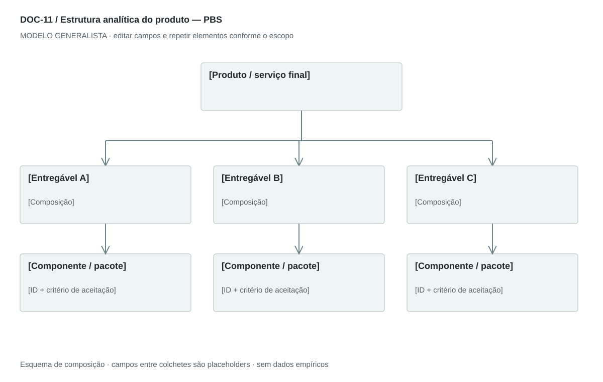

## For future Claude
Biblioteca generalista de Disruptive Venture Lab. Estrutura reutilizável, não análise preenchida nem evidência de um novo negócio.

# DOC-11 — Estrutura analítica do produto — PBS

Decompor o resultado a entregar em componentes verificáveis, independentemente do setor.

## Estudo do arquivo de referência

Fonte: `DOC-11-fonte.pdf`. 2 página(s). Duas páginas retrato com tabelas rasterizadas de quatro níveis e cabeçalhos cinza. A estrutura mistura sistema completo, subsistemas, funções e descrições. A segunda página contém duas imagens de continuação. Números hierárquicos apoiam a navegação.

Esta descrição registra o original. As recomendações abaixo são uma adaptação generalista, não uma reprodução nem validação do negócio-fonte.

## Formato e estilo recomendados

Uma árvore paisagem + dicionário de componentes em retrato. Usar substantivos para entregáveis e deixar atividades no WBS.

Aplicar o [sistema editorial](../SISTEMA-EDITORIAL.md), mantendo a hierarquia e a legibilidade.

## Dados comuns

| Campo comum | Tipo | O que preencher |
| --- | --- | --- |
| negocio | texto | Nome do negócio analisado, sem herdar o caso-fonte |
| documento_id | referência | ID do modelo e ID da instância, quando criada |
| versao | texto | Versão e estado de revisão |
| idioma | texto | Idioma escolhido para a entrega |
| audiencia | texto | Quem precisa tomar qual decisão |
| responsavel | referência | Autor responsável pela análise |
| data_base | data ISO | Data à qual as informações se referem |
| territorio | texto | Geografia relevante ou justificativa de não aplicação |
| objetivo_decisao | texto | Pergunta que o documento precisa responder |
| escopo | texto | Incluído, excluído e horizonte |
| estado | enum | rascunho, em_revisao, aprovado ou obsoleto |

## Dicionário específico

| Campo | Tipo | Descrição e dado necessário |
| --- | --- | --- |
| componente_id | referencia | Identificador estável do entregável |
| parent_id | referencia | Componente superior; null para a raiz |
| nivel | inteiro | Profundidade na decomposição |
| nome | texto | Entregável descrito por substantivo |
| descricao | texto | Escopo incluído e excluído |
| criterio_aceitacao | texto | Condição verificável de conclusão |
| interface | texto | Relação com outras partes |
| verificacao | texto | Método e evidência necessária para aceitar |

## Regras de preenchimento

Use este modelo como estrutura de investigação, não como análise concluída. Substitua os campos entre colchetes e retire as instruções de redação da versão entregue ao cliente. Na ausência de informação, escreva “não informado” e registre a tarefa de coleta; no JSON use `null`. Zero só representa um valor confirmado como zero. “Não aplicável” exige justificativa e responsável pela decisão.

Cada registro específico deve conter `proveniencia`: classificação (`observado`, `hipotese`, `inferencia`, `simulado` ou `desconhecido`), referência da fonte, localização na fonte, data-base, data de consulta, confiança e limitação. Uma conta feita com hipóteses continua sendo estimativa. Fontes podem ser locais ou externas, mas nenhum dado específico de outro negócio deve ser herdado.

Números precisam de unidade, denominador, moeda quando pertinente e período. Comparações usam a mesma base. Gráficos temporais exigem tempo; cenários independentes usam categorias. Figuras têm título, legenda, fonte, data-base e alternativa textual. Adapte o idioma e a identidade visual ao novo negócio.

## Gráficos, diagramas e imagens

Visual principal: **Árvore de componentes**.

Raiz do produto ou serviço, ramos de componentes e folhas verificáveis. Linhas contínuas significam composição; outras dependências vão para tabela separada.

Imagens: Diagrama de árvore obrigatório; imagem técnica ou foto de componente só quando necessária à identificação. Serviço pode ter entregáveis como diagnóstico, sessão e relatório.

### Brief para produzir o visual em outro negócio

Criar “Árvore de componentes” para [negócio], em português ou no idioma escolhido, usando apenas [dados aprovados]. Aplicar: Raiz do produto ou serviço, ramos de componentes e folhas verificáveis. Linhas contínuas significam composição; outras dependências vão para tabela separada. Incluir título, rótulos legíveis, legenda, fonte, período e classificação da evidência. Sem dados, manter campos vazios e indicar o que falta. Usar o SVG como wireframe editável, não como gráfico factual.

## Relações com outros documentos

[wbs](./wbs.md), [arquitetura-empresarial](./arquitetura-empresarial.md), [roadmap](./roadmap.md).

## Critérios de revisão

- A hierarquia não contém ciclos ou órfãos.
- Cada folha é verificável e não é uma lista vaga de tarefas.
- Não transportar módulos tecnológicos do exemplo.

- Toda conclusão tem evidência ou rótulo de hipótese/inferência; toda lacuna tem próximo passo.
- A versão final responde à decisão indicada no cabeçalho.

---

# Modelo preenchível

> Copie a partir deste título para criar a instância. Instruções e campos devem ser substituídos; um esqueleto preenchido mecanicamente não equivale a análise.

# [Negócio] — Estrutura analítica do produto — PBS

**Versão:** [versão] · **Data-base:** [data] · **Responsável:** [papel]

**Audiência:** [quem decide] · **Território:** [recorte] · **Estado:** [rascunho/revisão/aprovado]

**Pergunta decisória:** [qual decisão este documento apoia?]

**Escopo e horizonte:** [incluído, excluído e período]

## 1. Produto ou serviço final

[Instrução: Defina o resultado aceito pelo cliente e as fronteiras.]

[A preencher: análise, evidência, implicação e lacuna.]

## 2. Decomposição

[Instrução: Organize entregável → parte → subparte, com parent_id e nível.]

[A preencher: análise, evidência, implicação e lacuna.]

## 3. Dicionário dos componentes

[Instrução: Descrição, interface, critério de aceitação e evidência de verificação.]

[A preencher: análise, evidência, implicação e lacuna.]

## 4. Dependências

[Instrução: Mostre integrações e partes externas sem confundir relação de composição com dependência.]

[A preencher: análise, evidência, implicação e lacuna.]

## 5. Cobertura

[Instrução: Cheque que toda entrega prometida está representada e que nada foi duplicado.]

[A preencher: análise, evidência, implicação e lacuna.]

## Registros estruturados

Preencher uma ficha por registro e repetir conforme necessário.

| Campo | Valor |
| --- | --- |
| componente_id | [A preencher] |
| parent_id | [A preencher] |
| nivel | [A preencher] |
| nome | [A preencher] |
| descricao | [A preencher] |
| criterio_aceitacao | [A preencher] |
| interface | [A preencher] |
| verificacao | [A preencher] |
| Classificação | [observado / hipótese / inferência / simulado / desconhecido] |
| Fonte e localização | [ID + página, seção ou registro] |
| Data-base / consulta | [datas] |
| Unidade, moeda e período | [quando pertinente] |
| Limitação | [lacuna ou condição de interpretação] |

## Conclusão e encaminhamento

**Decisão proposta:** [decisão ou investigação necessária]

**Por quê:** [síntese das evidências e limitações]

**Alternativa considerada:** [alternativa e razão de rejeição]

**Condição de reversão:** [qual evidência mudaria a decisão]

**Próximo passo:** [ação] · **Dono:** [papel] · **Prazo:** [data] · **Critério:** [métrica e limiar, se pertinente]

## Fontes e lacunas

| ID | Fonte e localização | Data-base / consulta | O que sustenta | Limite / tarefa de coleta |
| --- | --- | --- | --- | --- |
| [ID] | [documento/página ou URL] | [datas] | [afirmação] | [limite e responsável] |
