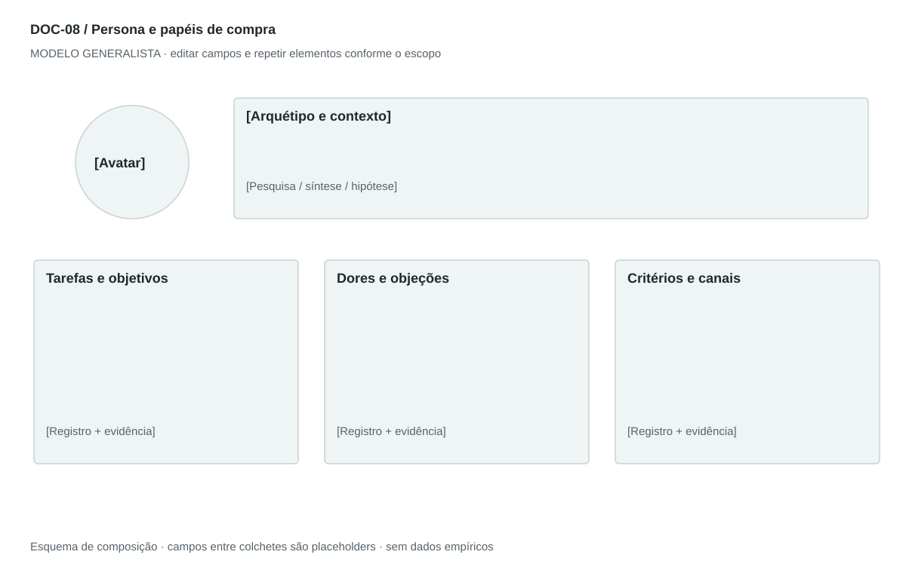

## For future Claude
Biblioteca generalista de Disruptive Venture Lab. Estrutura reutilizável, não análise preenchida nem evidência de um novo negócio.

# DOC-08 — Persona e papéis de compra

Representar um padrão de necessidades e decisões relevante para a oferta, com evidência e limites.

## Estudo do arquivo de referência

Fonte: `DOC-09-fonte.pdf`. 3 página(s). Três páginas retrato. Nome e arquétipo, fotografia central, perfil demográfico e narrativa; depois objetivos, hábitos, dores, expectativas, falas e canais. A ligação final à solução antecipa o encaixe sem demonstrá-lo. Perfil específico de renda, país e profissão não é generalizável.

Esta descrição registra o original. As recomendações abaixo são uma adaptação generalista, não uma reprodução nem validação do negócio-fonte.

## Formato e estilo recomendados

Ficha visual de uma página + 1–2 páginas analíticas. Priorizar comportamento, contexto, critérios e barreiras; demografia só quando explica uma decisão.

Aplicar o [sistema editorial](../SISTEMA-EDITORIAL.md), mantendo a hierarquia e a legibilidade.

## Dados comuns

| Campo comum | Tipo | O que preencher |
| --- | --- | --- |
| negocio | texto | Nome do negócio analisado, sem herdar o caso-fonte |
| documento_id | referência | ID do modelo e ID da instância, quando criada |
| versao | texto | Versão e estado de revisão |
| idioma | texto | Idioma escolhido para a entrega |
| audiencia | texto | Quem precisa tomar qual decisão |
| responsavel | referência | Autor responsável pela análise |
| data_base | data ISO | Data à qual as informações se referem |
| territorio | texto | Geografia relevante ou justificativa de não aplicação |
| objetivo_decisao | texto | Pergunta que o documento precisa responder |
| escopo | texto | Incluído, excluído e horizonte |
| estado | enum | rascunho, em_revisao, aprovado ou obsoleto |

## Dicionário específico

| Campo | Tipo | Descrição e dado necessário |
| --- | --- | --- |
| persona_id | referencia | Identificador compartilhado pelos documentos |
| arquetipo | texto | Padrão de necessidade e comportamento |
| base_perfil | enum | pesquisa, sintese ou hipotese |
| contexto | texto | Situação de uso relevante |
| tarefa | texto | Resultado buscado |
| criterio_decisao | texto | O que determina escolha ou rejeição |
| alternativa_atual | texto | Como resolve hoje |
| objecao | texto | Barreira verificável de adoção |
| papel_compra | texto | Participação na decisão de contratação |
| canal | texto | Canal demonstrado ou hipótese a investigar |
| anti_persona | texto | Perfil que não se beneficia ou não pode ser atendido |

## Regras de preenchimento

Use este modelo como estrutura de investigação, não como análise concluída. Substitua os campos entre colchetes e retire as instruções de redação da versão entregue ao cliente. Na ausência de informação, escreva “não informado” e registre a tarefa de coleta; no JSON use `null`. Zero só representa um valor confirmado como zero. “Não aplicável” exige justificativa e responsável pela decisão.

Cada registro específico deve conter `proveniencia`: classificação (`observado`, `hipotese`, `inferencia`, `simulado` ou `desconhecido`), referência da fonte, localização na fonte, data-base, data de consulta, confiança e limitação. Uma conta feita com hipóteses continua sendo estimativa. Fontes podem ser locais ou externas, mas nenhum dado específico de outro negócio deve ser herdado.

Números precisam de unidade, denominador, moeda quando pertinente e período. Comparações usam a mesma base. Gráficos temporais exigem tempo; cenários independentes usam categorias. Figuras têm título, legenda, fonte, data-base e alternativa textual. Adapte o idioma e a identidade visual ao novo negócio.

## Gráficos, diagramas e imagens

Visual principal: **Ficha de persona**.

Cabeçalho com arquétipo e base de evidência; cartão de contexto, tarefas, dores, critérios e canais. Retrato não ocupa mais espaço que as informações decisórias.

Imagens: Avatar abstrato original por padrão. Fotografia apenas licenciada e marcada como ilustrativa; não usar rosto como prova de entrevista. Sem idade, renda ou gênero decorativos.

### Brief para produzir o visual em outro negócio

Criar “Ficha de persona” para [negócio], em português ou no idioma escolhido, usando apenas [dados aprovados]. Aplicar: Cabeçalho com arquétipo e base de evidência; cartão de contexto, tarefas, dores, critérios e canais. Retrato não ocupa mais espaço que as informações decisórias. Incluir título, rótulos legíveis, legenda, fonte, período e classificação da evidência. Sem dados, manter campos vazios e indicar o que falta. Usar o SVG como wireframe editável, não como gráfico factual.

## Relações com outros documentos

[carta-empatia](./carta-empatia.md), [modelo-b2b](./modelo-b2b.md), [modelo-b2c](./modelo-b2c.md).

## Critérios de revisão

- História hipotética é identificada como tal.
- Dados pessoais reais e falas só entram quando autorizados.
- Perfil não presume preferência a partir de estereótipos.

- Toda conclusão tem evidência ou rótulo de hipótese/inferência; toda lacuna tem próximo passo.
- A versão final responde à decisão indicada no cabeçalho.

---

# Modelo preenchível

> Copie a partir deste título para criar a instância. Instruções e campos devem ser substituídos; um esqueleto preenchido mecanicamente não equivale a análise.

# [Negócio] — Persona e papéis de compra

**Versão:** [versão] · **Data-base:** [data] · **Responsável:** [papel]

**Audiência:** [quem decide] · **Território:** [recorte] · **Estado:** [rascunho/revisão/aprovado]

**Pergunta decisória:** [qual decisão este documento apoia?]

**Escopo e horizonte:** [incluído, excluído e período]

## 1. Identidade do perfil

[Instrução: Nome fictício, arquétipo e rótulo: baseado em pesquisa ou proto-persona hipotética.]

[A preencher: análise, evidência, implicação e lacuna.]

## 2. Contexto e tarefa

[Instrução: Rotina relevante, situação de uso, problema e alternativa atual.]

[A preencher: análise, evidência, implicação e lacuna.]

## 3. Objetivos e critérios

[Instrução: O que quer alcançar, como avalia opções e o que não aceita.]

[A preencher: análise, evidência, implicação e lacuna.]

## 4. Hábitos, dores e objeções

[Instrução: Comportamento observado, frequência, esforço e barreira de adoção.]

[A preencher: análise, evidência, implicação e lacuna.]

## 5. Papéis e compra

[Instrução: Usuário, influenciador, comprador, decisor e veto; em B2B, separar organização e papel.]

[A preencher: análise, evidência, implicação e lacuna.]

## 6. Canais e evidências

[Instrução: Onde busca informação, quais fontes sustentam o perfil e variações não cobertas.]

[A preencher: análise, evidência, implicação e lacuna.]

## 7. Implicações e anti-persona

[Instrução: Que decisões o perfil informa e para quem a oferta não serve.]

[A preencher: análise, evidência, implicação e lacuna.]

## Registros estruturados

Preencher uma ficha por registro e repetir conforme necessário.

| Campo | Valor |
| --- | --- |
| persona_id | [A preencher] |
| arquetipo | [A preencher] |
| base_perfil | [A preencher] |
| contexto | [A preencher] |
| tarefa | [A preencher] |
| criterio_decisao | [A preencher] |
| alternativa_atual | [A preencher] |
| objecao | [A preencher] |
| papel_compra | [A preencher] |
| canal | [A preencher] |
| anti_persona | [A preencher] |
| Classificação | [observado / hipótese / inferência / simulado / desconhecido] |
| Fonte e localização | [ID + página, seção ou registro] |
| Data-base / consulta | [datas] |
| Unidade, moeda e período | [quando pertinente] |
| Limitação | [lacuna ou condição de interpretação] |

## Conclusão e encaminhamento

**Decisão proposta:** [decisão ou investigação necessária]

**Por quê:** [síntese das evidências e limitações]

**Alternativa considerada:** [alternativa e razão de rejeição]

**Condição de reversão:** [qual evidência mudaria a decisão]

**Próximo passo:** [ação] · **Dono:** [papel] · **Prazo:** [data] · **Critério:** [métrica e limiar, se pertinente]

## Fontes e lacunas

| ID | Fonte e localização | Data-base / consulta | O que sustenta | Limite / tarefa de coleta |
| --- | --- | --- | --- | --- |
| [ID] | [documento/página ou URL] | [datas] | [afirmação] | [limite e responsável] |
