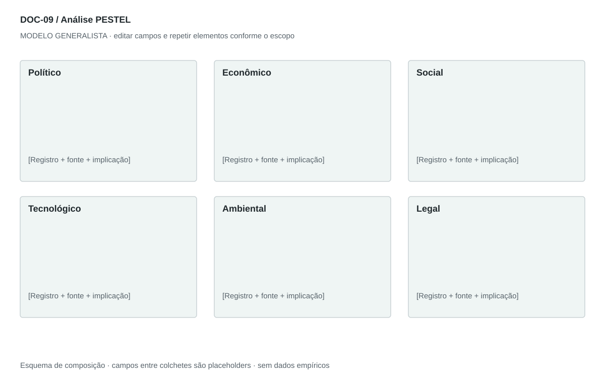

## For future Claude
Biblioteca generalista de Disruptive Venture Lab. Estrutura reutilizável, não análise preenchida nem evidência de um novo negócio.

# DOC-09 — Análise PESTEL

Examinar fatores externos que podem alterar demanda, custos, operação e decisões em um território e horizonte definidos.

## Estudo do arquivo de referência

Fonte: `DOC-08-fonte.pdf`. 3 página(s). Três páginas retrato; pequeno ícone circular de seis fatores no início e listas numeradas por dimensão. Cada bullet começa com assunto em negrito e termina na implicação. A terceira página contém apenas continuação da dimensão legal. Não há escala consistente de impacto nem registro individual de fontes.

Esta descrição registra o original. As recomendações abaixo são uma adaptação generalista, não uma reprodução nem validação do negócio-fonte.

## Formato e estilo recomendados

2–4 páginas retrato + quadro-síntese paisagem. Cabeçalho com território, data-base e horizonte. Dimensões com mecanismo, implicação, sinal e resposta.

Aplicar o [sistema editorial](../SISTEMA-EDITORIAL.md), mantendo a hierarquia e a legibilidade.

## Dados comuns

| Campo comum | Tipo | O que preencher |
| --- | --- | --- |
| negocio | texto | Nome do negócio analisado, sem herdar o caso-fonte |
| documento_id | referência | ID do modelo e ID da instância, quando criada |
| versao | texto | Versão e estado de revisão |
| idioma | texto | Idioma escolhido para a entrega |
| audiencia | texto | Quem precisa tomar qual decisão |
| responsavel | referência | Autor responsável pela análise |
| data_base | data ISO | Data à qual as informações se referem |
| territorio | texto | Geografia relevante ou justificativa de não aplicação |
| objetivo_decisao | texto | Pergunta que o documento precisa responder |
| escopo | texto | Incluído, excluído e horizonte |
| estado | enum | rascunho, em_revisao, aprovado ou obsoleto |

## Dicionário específico

| Campo | Tipo | Descrição e dado necessário |
| --- | --- | --- |
| dimensao | enum | politico, economico, social, tecnologico, ambiental ou legal |
| fator | texto | Mudança externa específica |
| territorio | texto | Geografia à qual o fator se aplica |
| horizonte | texto | Prazo em que pode produzir efeito |
| mecanismo | texto | Como o fator afeta o negócio |
| direcao | enum | oportunidade, ameaca, mista ou indeterminada |
| impacto | enum | baixo, medio, alto ou desconhecido, segundo rubrica |
| sinal | texto | Indicador que aciona revisão |
| resposta | texto | Ação ou investigação proporcional |

## Regras de preenchimento

Use este modelo como estrutura de investigação, não como análise concluída. Substitua os campos entre colchetes e retire as instruções de redação da versão entregue ao cliente. Na ausência de informação, escreva “não informado” e registre a tarefa de coleta; no JSON use `null`. Zero só representa um valor confirmado como zero. “Não aplicável” exige justificativa e responsável pela decisão.

Cada registro específico deve conter `proveniencia`: classificação (`observado`, `hipotese`, `inferencia`, `simulado` ou `desconhecido`), referência da fonte, localização na fonte, data-base, data de consulta, confiança e limitação. Uma conta feita com hipóteses continua sendo estimativa. Fontes podem ser locais ou externas, mas nenhum dado específico de outro negócio deve ser herdado.

Números precisam de unidade, denominador, moeda quando pertinente e período. Comparações usam a mesma base. Gráficos temporais exigem tempo; cenários independentes usam categorias. Figuras têm título, legenda, fonte, data-base e alternativa textual. Adapte o idioma e a identidade visual ao novo negócio.

## Gráficos, diagramas e imagens

Visual principal: **Painel de seis dimensões**.

Seis cartões com fator, mecanismo e sinal de monitoramento. Matriz impacto × incerteza opcional com rubrica explícita; não usar radar com notas arbitrárias.

Imagens: Seis ícones simples opcionais; evitar bandeiras e mapas como substitutos de dados. Série temporal só com unidade, período e fontes reais.

### Brief para produzir o visual em outro negócio

Criar “Painel de seis dimensões” para [negócio], em português ou no idioma escolhido, usando apenas [dados aprovados]. Aplicar: Seis cartões com fator, mecanismo e sinal de monitoramento. Matriz impacto × incerteza opcional com rubrica explícita; não usar radar com notas arbitrárias. Incluir título, rótulos legíveis, legenda, fonte, período e classificação da evidência. Sem dados, manter campos vazios e indicar o que falta. Usar o SVG como wireframe editável, não como gráfico factual.

## Relações com outros documentos

[cinco-forcas](./cinco-forcas.md), [swot-tows](./swot-tows.md), [gestao-riscos](./gestao-riscos.md), [analise-viabilidade](./analise-viabilidade.md).

## Critérios de revisão

- Cada fator tem território, data e fonte ou rótulo de hipótese.
- Político e legal não duplicam o mesmo argumento sem explicar perspectivas.
- Nenhuma regra legal do caso-fonte é herdada.

- Toda conclusão tem evidência ou rótulo de hipótese/inferência; toda lacuna tem próximo passo.
- A versão final responde à decisão indicada no cabeçalho.

---

# Modelo preenchível

> Copie a partir deste título para criar a instância. Instruções e campos devem ser substituídos; um esqueleto preenchido mecanicamente não equivale a análise.

# [Negócio] — Análise PESTEL

**Versão:** [versão] · **Data-base:** [data] · **Responsável:** [papel]

**Audiência:** [quem decide] · **Território:** [recorte] · **Estado:** [rascunho/revisão/aprovado]

**Pergunta decisória:** [qual decisão este documento apoia?]

**Escopo e horizonte:** [incluído, excluído e período]

## 1. Recorte e fontes

[Instrução: Território, setor, período, fontes e lacunas.]

[A preencher: análise, evidência, implicação e lacuna.]

## 2. Político

[Instrução: Políticas, estabilidade e prioridades públicas pertinentes; explicar mecanismo de impacto.]

[A preencher: análise, evidência, implicação e lacuna.]

## 3. Econômico

[Instrução: Renda, custos, crédito, preços e condições de demanda pertinentes.]

[A preencher: análise, evidência, implicação e lacuna.]

## 4. Social

[Instrução: Hábitos, expectativas e acesso com evidência contextual, sem estereótipos.]

[A preencher: análise, evidência, implicação e lacuna.]

## 5. Tecnológico

[Instrução: Alternativas, maturidade, dependências e mudanças de custo/desempenho.]

[A preencher: análise, evidência, implicação e lacuna.]

## 6. Ambiental

[Instrução: Uso de recursos, resíduos, exposição física e restrições pertinentes.]

[A preencher: análise, evidência, implicação e lacuna.]

## 7. Legal

[Instrução: Requisitos a verificar por jurisdição, vigência e aplicabilidade.]

[A preencher: análise, evidência, implicação e lacuna.]

## 8. Síntese e monitoramento

[Instrução: Prioridades, sinais de mudança, responsável e data de revisão.]

[A preencher: análise, evidência, implicação e lacuna.]

## Registros estruturados

Preencher uma ficha por registro e repetir conforme necessário.

| Campo | Valor |
| --- | --- |
| dimensao | [A preencher] |
| fator | [A preencher] |
| territorio | [A preencher] |
| horizonte | [A preencher] |
| mecanismo | [A preencher] |
| direcao | [A preencher] |
| impacto | [A preencher] |
| sinal | [A preencher] |
| resposta | [A preencher] |
| Classificação | [observado / hipótese / inferência / simulado / desconhecido] |
| Fonte e localização | [ID + página, seção ou registro] |
| Data-base / consulta | [datas] |
| Unidade, moeda e período | [quando pertinente] |
| Limitação | [lacuna ou condição de interpretação] |

## Conclusão e encaminhamento

**Decisão proposta:** [decisão ou investigação necessária]

**Por quê:** [síntese das evidências e limitações]

**Alternativa considerada:** [alternativa e razão de rejeição]

**Condição de reversão:** [qual evidência mudaria a decisão]

**Próximo passo:** [ação] · **Dono:** [papel] · **Prazo:** [data] · **Critério:** [métrica e limiar, se pertinente]

## Fontes e lacunas

| ID | Fonte e localização | Data-base / consulta | O que sustenta | Limite / tarefa de coleta |
| --- | --- | --- | --- | --- |
| [ID] | [documento/página ou URL] | [datas] | [afirmação] | [limite e responsável] |
