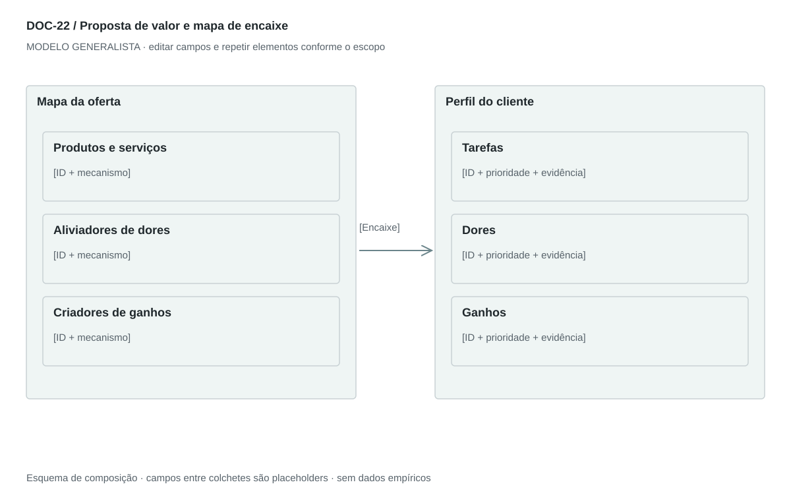

## For future Claude
Biblioteca generalista de Disruptive Venture Lab. Estrutura reutilizável, não análise preenchida nem evidência de um novo negócio.

# DOC-22 — Proposta de valor e mapa de encaixe

Relacionar tarefas, dores e ganhos do cliente aos elementos da oferta e às evidências de encaixe.

## Estudo do arquivo de referência

Fonte: `DOC-22-fonte.pdf`. 3 página(s). Três páginas retrato. Pequena imagem de value proposition canvas no topo e seis seções: jobs, pains, gains, pain relievers, gain creators e products/services. Bullets com título em negrito. A imagem é apenas orientação; o detalhamento está no texto. Algumas alegações absolutas de segurança não podem ser generalizadas.

Esta descrição registra o original. As recomendações abaixo são uma adaptação generalista, não uma reprodução nem validação do negócio-fonte.

## Formato e estilo recomendados

Uma prancha paisagem com perfil do cliente e mapa da oferta + 2 páginas de explicação. Diferenciar benefício esperado, mecanismo proposto e resultado demonstrado.

Aplicar o [sistema editorial](../SISTEMA-EDITORIAL.md), mantendo a hierarquia e a legibilidade.

## Dados comuns

| Campo comum | Tipo | O que preencher |
| --- | --- | --- |
| negocio | texto | Nome do negócio analisado, sem herdar o caso-fonte |
| documento_id | referência | ID do modelo e ID da instância, quando criada |
| versao | texto | Versão e estado de revisão |
| idioma | texto | Idioma escolhido para a entrega |
| audiencia | texto | Quem precisa tomar qual decisão |
| responsavel | referência | Autor responsável pela análise |
| data_base | data ISO | Data à qual as informações se referem |
| territorio | texto | Geografia relevante ou justificativa de não aplicação |
| objetivo_decisao | texto | Pergunta que o documento precisa responder |
| escopo | texto | Incluído, excluído e horizonte |
| estado | enum | rascunho, em_revisao, aprovado ou obsoleto |

## Dicionário específico

| Campo | Tipo | Descrição e dado necessário |
| --- | --- | --- |
| segmento_id | referencia | Perfil para o qual se busca encaixe |
| job_id | referencia | Tarefa ou resultado do cliente |
| dor_id | referencia | Obstáculo associado à tarefa |
| ganho_id | referencia | Resultado valorizado |
| elemento_oferta | texto | Produto, serviço ou capacidade entregue |
| mecanismo | texto | Como a oferta altera dor ou ganho |
| conexao | texto | IDs do perfil e da oferta ligados pelo mecanismo |
| prioridade | enum | essencial, complementar ou a testar |
| prova | texto | Observação, teste ou lacuna de evidência de encaixe |

## Regras de preenchimento

Use este modelo como estrutura de investigação, não como análise concluída. Substitua os campos entre colchetes e retire as instruções de redação da versão entregue ao cliente. Na ausência de informação, escreva “não informado” e registre a tarefa de coleta; no JSON use `null`. Zero só representa um valor confirmado como zero. “Não aplicável” exige justificativa e responsável pela decisão.

Cada registro específico deve conter `proveniencia`: classificação (`observado`, `hipotese`, `inferencia`, `simulado` ou `desconhecido`), referência da fonte, localização na fonte, data-base, data de consulta, confiança e limitação. Uma conta feita com hipóteses continua sendo estimativa. Fontes podem ser locais ou externas, mas nenhum dado específico de outro negócio deve ser herdado.

Números precisam de unidade, denominador, moeda quando pertinente e período. Comparações usam a mesma base. Gráficos temporais exigem tempo; cenários independentes usam categorias. Figuras têm título, legenda, fonte, data-base e alternativa textual. Adapte o idioma e a identidade visual ao novo negócio.

## Gráficos, diagramas e imagens

Visual principal: **Mapa de encaixe de valor**.

Perfil do cliente à direita com tarefas, dores e ganhos; oferta à esquerda com produtos/serviços, aliviadores e criadores. Conexões por IDs evidenciam correspondência. Não exigir correspondência artificial para todos os itens.

Imagens: Diagrama vetorial original inspirado no método; ícones discretos opcionais. Imagens de produto só se reais ou claramente propostas. Não representar desempenho com selo de aprovação fictício.

### Brief para produzir o visual em outro negócio

Criar “Mapa de encaixe de valor” para [negócio], em português ou no idioma escolhido, usando apenas [dados aprovados]. Aplicar: Perfil do cliente à direita com tarefas, dores e ganhos; oferta à esquerda com produtos/serviços, aliviadores e criadores. Conexões por IDs evidenciam correspondência. Não exigir correspondência artificial para todos os itens. Incluir título, rótulos legíveis, legenda, fonte, período e classificação da evidência. Sem dados, manter campos vazios e indicar o que falta. Usar o SVG como wireframe editável, não como gráfico factual.

## Relações com outros documentos

[persona](./persona.md), [carta-empatia](./carta-empatia.md), [modelo-b2b](./modelo-b2b.md), [modelo-b2c](./modelo-b2c.md), [business-model-canvas](./business-model-canvas.md).

## Critérios de revisão

- Cada benefício tem mecanismo e condição de verificação.
- Tarefa do cliente não é funcionalidade da oferta.
- Ausência de prova não se converte em promessa absoluta.

- Toda conclusão tem evidência ou rótulo de hipótese/inferência; toda lacuna tem próximo passo.
- A versão final responde à decisão indicada no cabeçalho.

---

# Modelo preenchível

> Copie a partir deste título para criar a instância. Instruções e campos devem ser substituídos; um esqueleto preenchido mecanicamente não equivale a análise.

# [Negócio] — Proposta de valor e mapa de encaixe

**Versão:** [versão] · **Data-base:** [data] · **Responsável:** [papel]

**Audiência:** [quem decide] · **Território:** [recorte] · **Estado:** [rascunho/revisão/aprovado]

**Pergunta decisória:** [qual decisão este documento apoia?]

**Escopo e horizonte:** [incluído, excluído e período]

## 1. Segmento e contexto

[Instrução: Uma proposta por persona ou segmento e situação prioritária.]

[A preencher: análise, evidência, implicação e lacuna.]

## 2. Tarefas do cliente

[Instrução: Resultados funcionais, sociais ou emocionais; priorize com evidência.]

[A preencher: análise, evidência, implicação e lacuna.]

## 3. Dores

[Instrução: Obstáculos, consequências e soluções alternativas.]

[A preencher: análise, evidência, implicação e lacuna.]

## 4. Ganhos

[Instrução: Resultados desejados e critérios de sucesso.]

[A preencher: análise, evidência, implicação e lacuna.]

## 5. Produtos e serviços

[Instrução: Elementos reais ou propostos que compõem a entrega.]

[A preencher: análise, evidência, implicação e lacuna.]

## 6. Aliviadores e criadores

[Instrução: Explique como cada elemento reduz uma dor ou cria um ganho.]

[A preencher: análise, evidência, implicação e lacuna.]

## 7. Encaixe e teste

[Instrução: Ligue os dois lados por IDs e registre evidência, lacuna e experimento.]

[A preencher: análise, evidência, implicação e lacuna.]

## 8. Declaração curta

[Instrução: Para [segmento] que [tarefa], a oferta [entrega] busca [resultado] por [mecanismo], em comparação com [alternativa].]

[A preencher: análise, evidência, implicação e lacuna.]

## Registros estruturados

Preencher uma ficha por registro e repetir conforme necessário.

| Campo | Valor |
| --- | --- |
| segmento_id | [A preencher] |
| job_id | [A preencher] |
| dor_id | [A preencher] |
| ganho_id | [A preencher] |
| elemento_oferta | [A preencher] |
| mecanismo | [A preencher] |
| conexao | [A preencher] |
| prioridade | [A preencher] |
| prova | [A preencher] |
| Classificação | [observado / hipótese / inferência / simulado / desconhecido] |
| Fonte e localização | [ID + página, seção ou registro] |
| Data-base / consulta | [datas] |
| Unidade, moeda e período | [quando pertinente] |
| Limitação | [lacuna ou condição de interpretação] |

## Conclusão e encaminhamento

**Decisão proposta:** [decisão ou investigação necessária]

**Por quê:** [síntese das evidências e limitações]

**Alternativa considerada:** [alternativa e razão de rejeição]

**Condição de reversão:** [qual evidência mudaria a decisão]

**Próximo passo:** [ação] · **Dono:** [papel] · **Prazo:** [data] · **Critério:** [métrica e limiar, se pertinente]

## Fontes e lacunas

| ID | Fonte e localização | Data-base / consulta | O que sustenta | Limite / tarefa de coleta |
| --- | --- | --- | --- | --- |
| [ID] | [documento/página ou URL] | [datas] | [afirmação] | [limite e responsável] |
