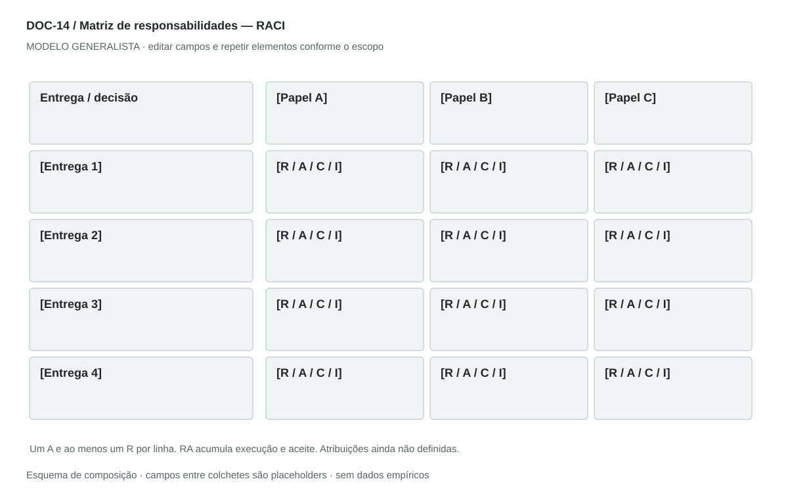

## For future Claude
Biblioteca generalista de Disruptive Venture Lab. Estrutura reutilizável, não análise preenchida nem evidência de um novo negócio.

# DOC-14 — Matriz de responsabilidades — RACI

Esclarecer quem executa, decide, é consultado e informado sobre cada entrega ou decisão.

## Estudo do arquivo de referência

Fonte: `DOC-14-fonte.pdf`. 2 página(s). Duas páginas retrato. Matriz rasterizada na primeira, legenda R/A/C/I abaixo, descrições de cargos na segunda. O quadro usa executivos e times como colunas, com células R, A e combinações. O detalhamento de cargos ajuda a leitura, mas não deve impor uma estrutura de grande empresa.

Esta descrição registra o original. As recomendações abaixo são uma adaptação generalista, não uma reprodução nem validação do negócio-fonte.

## Formato e estilo recomendados

Matriz paisagem de uma página, repetindo cabeçalho se necessário; dicionário de papéis e regras em página complementar.

Aplicar o [sistema editorial](../SISTEMA-EDITORIAL.md), mantendo a hierarquia e a legibilidade.

## Dados comuns

| Campo comum | Tipo | O que preencher |
| --- | --- | --- |
| negocio | texto | Nome do negócio analisado, sem herdar o caso-fonte |
| documento_id | referência | ID do modelo e ID da instância, quando criada |
| versao | texto | Versão e estado de revisão |
| idioma | texto | Idioma escolhido para a entrega |
| audiencia | texto | Quem precisa tomar qual decisão |
| responsavel | referência | Autor responsável pela análise |
| data_base | data ISO | Data à qual as informações se referem |
| territorio | texto | Geografia relevante ou justificativa de não aplicação |
| objetivo_decisao | texto | Pergunta que o documento precisa responder |
| escopo | texto | Incluído, excluído e horizonte |
| estado | enum | rascunho, em_revisao, aprovado ou obsoleto |

## Dicionário específico

| Campo | Tipo | Descrição e dado necessário |
| --- | --- | --- |
| atividade_id | referencia | Entrega ou decisão rastreada ao WBS |
| papel_id | referencia | Papel efetivamente disponível |
| atribuicao | enum | R, A, C, I, RA ou sem_participacao |
| autoridade | texto | O que o papel pode decidir |
| substituto | referencia | Papel acionado em ausência |
| escalonamento | texto | Como resolver impasse ou falta de capacidade |

## Regras de preenchimento

Use este modelo como estrutura de investigação, não como análise concluída. Substitua os campos entre colchetes e retire as instruções de redação da versão entregue ao cliente. Na ausência de informação, escreva “não informado” e registre a tarefa de coleta; no JSON use `null`. Zero só representa um valor confirmado como zero. “Não aplicável” exige justificativa e responsável pela decisão.

Cada registro específico deve conter `proveniencia`: classificação (`observado`, `hipotese`, `inferencia`, `simulado` ou `desconhecido`), referência da fonte, localização na fonte, data-base, data de consulta, confiança e limitação. Uma conta feita com hipóteses continua sendo estimativa. Fontes podem ser locais ou externas, mas nenhum dado específico de outro negócio deve ser herdado.

Números precisam de unidade, denominador, moeda quando pertinente e período. Comparações usam a mesma base. Gráficos temporais exigem tempo; cenários independentes usam categorias. Figuras têm título, legenda, fonte, data-base e alternativa textual. Adapte o idioma e a identidade visual ao novo negócio.

## Gráficos, diagramas e imagens

Visual principal: **Matriz RACI**.

Entregas em linhas e papéis em colunas; letras grandes, legenda textual e contraste. Marcar ausência de A ou R como pendência, sem atribuição automática.

Imagens: Tabela é o visual principal; nenhum retrato ou ícone de cargo é necessário.

### Brief para produzir o visual em outro negócio

Criar “Matriz RACI” para [negócio], em português ou no idioma escolhido, usando apenas [dados aprovados]. Aplicar: Entregas em linhas e papéis em colunas; letras grandes, legenda textual e contraste. Marcar ausência de A ou R como pendência, sem atribuição automática. Incluir título, rótulos legíveis, legenda, fonte, período e classificação da evidência. Sem dados, manter campos vazios e indicar o que falta. Usar o SVG como wireframe editável, não como gráfico factual.

## Relações com outros documentos

[arquitetura-empresarial](./arquitetura-empresarial.md), [wbs](./wbs.md), [roadmap](./roadmap.md).

## Critérios de revisão

- Exatamente um A por linha, contando RA como A.
- Ao menos um R por linha, contando RA como R.
- A pessoa ou papel atribuído existe e dispõe de capacidade.

- Toda conclusão tem evidência ou rótulo de hipótese/inferência; toda lacuna tem próximo passo.
- A versão final responde à decisão indicada no cabeçalho.

---

# Modelo preenchível

> Copie a partir deste título para criar a instância. Instruções e campos devem ser substituídos; um esqueleto preenchido mecanicamente não equivale a análise.

# [Negócio] — Matriz de responsabilidades — RACI

**Versão:** [versão] · **Data-base:** [data] · **Responsável:** [papel]

**Audiência:** [quem decide] · **Território:** [recorte] · **Estado:** [rascunho/revisão/aprovado]

**Pergunta decisória:** [qual decisão este documento apoia?]

**Escopo e horizonte:** [incluído, excluído e período]

## 1. Escopo e papéis

[Instrução: Liste papéis reais disponíveis; pessoas podem acumular funções.]

[A preencher: análise, evidência, implicação e lacuna.]

## 2. Matriz

[Instrução: Linhas de entregas ou decisões, colunas de papéis e atribuições R/A/C/I.]

[A preencher: análise, evidência, implicação e lacuna.]

## 3. Legenda

[Instrução: R executa; A responde pelo aceite; C contribui antes da decisão; I recebe informação.]

[A preencher: análise, evidência, implicação e lacuna.]

## 4. Escalonamento

[Instrução: Defina substituto, conflito de autoridade, prazo de decisão e revisão.]

[A preencher: análise, evidência, implicação e lacuna.]

## 5. Dicionário dos papéis

[Instrução: Descreva autoridade e limite sem depender de siglas de cargos.]

[A preencher: análise, evidência, implicação e lacuna.]

## Registros estruturados

Preencher uma ficha por registro e repetir conforme necessário.

| Campo | Valor |
| --- | --- |
| atividade_id | [A preencher] |
| papel_id | [A preencher] |
| atribuicao | [A preencher] |
| autoridade | [A preencher] |
| substituto | [A preencher] |
| escalonamento | [A preencher] |
| Classificação | [observado / hipótese / inferência / simulado / desconhecido] |
| Fonte e localização | [ID + página, seção ou registro] |
| Data-base / consulta | [datas] |
| Unidade, moeda e período | [quando pertinente] |
| Limitação | [lacuna ou condição de interpretação] |

## Conclusão e encaminhamento

**Decisão proposta:** [decisão ou investigação necessária]

**Por quê:** [síntese das evidências e limitações]

**Alternativa considerada:** [alternativa e razão de rejeição]

**Condição de reversão:** [qual evidência mudaria a decisão]

**Próximo passo:** [ação] · **Dono:** [papel] · **Prazo:** [data] · **Critério:** [métrica e limiar, se pertinente]

## Fontes e lacunas

| ID | Fonte e localização | Data-base / consulta | O que sustenta | Limite / tarefa de coleta |
| --- | --- | --- | --- | --- |
| [ID] | [documento/página ou URL] | [datas] | [afirmação] | [limite e responsável] |
