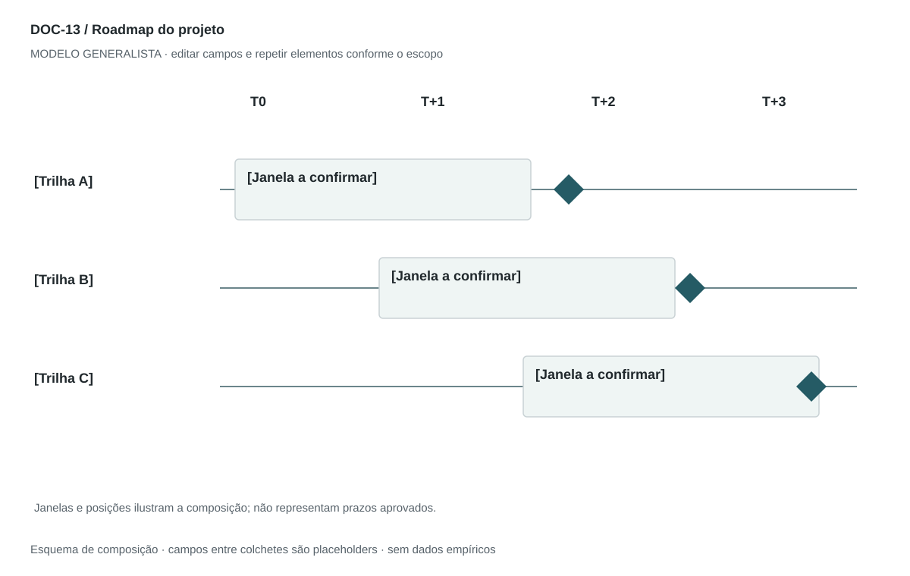

## For future Claude
Biblioteca generalista de Disruptive Venture Lab. Estrutura reutilizável, não análise preenchida nem evidência de um novo negócio.

# DOC-13 — Roadmap do projeto

Comunicar sequência, marcos, dependências e incertezas do plano de implantação.

## Estudo do arquivo de referência

Fonte: `DOC-13-fonte.pdf`. 1 página(s). Uma página retrato com fases, meses e semanas em bullets; quadro High-Level inserido como imagem ao final. O plano alterna referência mensal e semanal sem explicitar conversão, o que pede reconciliação antes de reutilizar. Monitoramento aparece como contínuo.

Esta descrição registra o original. As recomendações abaixo são uma adaptação generalista, não uma reprodução nem validação do negócio-fonte.

## Formato e estilo recomendados

Uma prancha paisagem + uma página de premissas. Usar faixas temporais ou datas consistentes; preservar sobreposição e dependências.

Aplicar o [sistema editorial](../SISTEMA-EDITORIAL.md), mantendo a hierarquia e a legibilidade.

## Dados comuns

| Campo comum | Tipo | O que preencher |
| --- | --- | --- |
| negocio | texto | Nome do negócio analisado, sem herdar o caso-fonte |
| documento_id | referência | ID do modelo e ID da instância, quando criada |
| versao | texto | Versão e estado de revisão |
| idioma | texto | Idioma escolhido para a entrega |
| audiencia | texto | Quem precisa tomar qual decisão |
| responsavel | referência | Autor responsável pela análise |
| data_base | data ISO | Data à qual as informações se referem |
| territorio | texto | Geografia relevante ou justificativa de não aplicação |
| objetivo_decisao | texto | Pergunta que o documento precisa responder |
| escopo | texto | Incluído, excluído e horizonte |
| estado | enum | rascunho, em_revisao, aprovado ou obsoleto |

## Dicionário específico

| Campo | Tipo | Descrição e dado necessário |
| --- | --- | --- |
| marco_id | referencia | Identificador do marco |
| trilha | texto | Frente de entrega |
| entrega_id | referencia | Componente ou pacote correspondente |
| inicio | data | Data ISO planejada ou null enquanto indefinida |
| fim | data | Data ISO planejada ou null enquanto indefinida |
| janela_relativa | texto | Alternativa a datas: T0, T+1 etc., sem tratar como calendário real |
| dependencia_id | referencia | Marco ou pacote precedente |
| criterio_marco | texto | Evidência de conclusão |
| confianca_prazo | enum | baixa, media, alta ou desconhecida |

## Regras de preenchimento

Use este modelo como estrutura de investigação, não como análise concluída. Substitua os campos entre colchetes e retire as instruções de redação da versão entregue ao cliente. Na ausência de informação, escreva “não informado” e registre a tarefa de coleta; no JSON use `null`. Zero só representa um valor confirmado como zero. “Não aplicável” exige justificativa e responsável pela decisão.

Cada registro específico deve conter `proveniencia`: classificação (`observado`, `hipotese`, `inferencia`, `simulado` ou `desconhecido`), referência da fonte, localização na fonte, data-base, data de consulta, confiança e limitação. Uma conta feita com hipóteses continua sendo estimativa. Fontes podem ser locais ou externas, mas nenhum dado específico de outro negócio deve ser herdado.

Números precisam de unidade, denominador, moeda quando pertinente e período. Comparações usam a mesma base. Gráficos temporais exigem tempo; cenários independentes usam categorias. Figuras têm título, legenda, fonte, data-base e alternativa textual. Adapte o idioma e a identidade visual ao novo negócio.

## Gráficos, diagramas e imagens

Visual principal: **Roadmap por trilhas**.

Eixo horizontal de tempo, trilhas de trabalho no vertical, barras de duração e losangos para marcos. Sem datas, mostrar janelas T0/T+1 com a legenda Planejamento a definir.

Imagens: Linha do tempo vetorial. Não usar fotos. Para serviço contínuo, separar implantação de rotina; não forçar um encerramento de operação.

### Brief para produzir o visual em outro negócio

Criar “Roadmap por trilhas” para [negócio], em português ou no idioma escolhido, usando apenas [dados aprovados]. Aplicar: Eixo horizontal de tempo, trilhas de trabalho no vertical, barras de duração e losangos para marcos. Sem datas, mostrar janelas T0/T+1 com a legenda Planejamento a definir. Incluir título, rótulos legíveis, legenda, fonte, período e classificação da evidência. Sem dados, manter campos vazios e indicar o que falta. Usar o SVG como wireframe editável, não como gráfico factual.

## Relações com outros documentos

[ciclo-vida-projeto](./ciclo-vida-projeto.md), [wbs](./wbs.md), [raci](./raci.md), [gestao-riscos](./gestao-riscos.md).

## Critérios de revisão

- Datas e semanas não entram em conflito.
- Dependências têm IDs existentes e não formam ciclos.
- Prazo não é compromisso aprovado quando ainda é hipótese.

- Toda conclusão tem evidência ou rótulo de hipótese/inferência; toda lacuna tem próximo passo.
- A versão final responde à decisão indicada no cabeçalho.

---

# Modelo preenchível

> Copie a partir deste título para criar a instância. Instruções e campos devem ser substituídos; um esqueleto preenchido mecanicamente não equivale a análise.

# [Negócio] — Roadmap do projeto

**Versão:** [versão] · **Data-base:** [data] · **Responsável:** [papel]

**Audiência:** [quem decide] · **Território:** [recorte] · **Estado:** [rascunho/revisão/aprovado]

**Pergunta decisória:** [qual decisão este documento apoia?]

**Escopo e horizonte:** [incluído, excluído e período]

## 1. Objetivo e base do plano

[Instrução: Data-base, horizonte, versão, capacidade e restrições.]

[A preencher: análise, evidência, implicação e lacuna.]

## 2. Trilhas de trabalho

[Instrução: Organize frentes por resultado e responsáveis, evitando lista de cargos.]

[A preencher: análise, evidência, implicação e lacuna.]

## 3. Marcos e entregas

[Instrução: Defina evidência necessária para cada marco e sua dependência.]

[A preencher: análise, evidência, implicação e lacuna.]

## 4. Cronograma

[Instrução: Início/fim planejados ou janelas; explicite precisão e flexibilidade.]

[A preencher: análise, evidência, implicação e lacuna.]

## 5. Gates e revisão

[Instrução: Condições para avançar, replanejar ou interromper; cadência de atualização.]

[A preencher: análise, evidência, implicação e lacuna.]

## Registros estruturados

Preencher uma ficha por registro e repetir conforme necessário.

| Campo | Valor |
| --- | --- |
| marco_id | [A preencher] |
| trilha | [A preencher] |
| entrega_id | [A preencher] |
| inicio | [A preencher] |
| fim | [A preencher] |
| janela_relativa | [A preencher] |
| dependencia_id | [A preencher] |
| criterio_marco | [A preencher] |
| confianca_prazo | [A preencher] |
| Classificação | [observado / hipótese / inferência / simulado / desconhecido] |
| Fonte e localização | [ID + página, seção ou registro] |
| Data-base / consulta | [datas] |
| Unidade, moeda e período | [quando pertinente] |
| Limitação | [lacuna ou condição de interpretação] |

## Conclusão e encaminhamento

**Decisão proposta:** [decisão ou investigação necessária]

**Por quê:** [síntese das evidências e limitações]

**Alternativa considerada:** [alternativa e razão de rejeição]

**Condição de reversão:** [qual evidência mudaria a decisão]

**Próximo passo:** [ação] · **Dono:** [papel] · **Prazo:** [data] · **Critério:** [métrica e limiar, se pertinente]

## Fontes e lacunas

| ID | Fonte e localização | Data-base / consulta | O que sustenta | Limite / tarefa de coleta |
| --- | --- | --- | --- | --- |
| [ID] | [documento/página ou URL] | [datas] | [afirmação] | [limite e responsável] |
