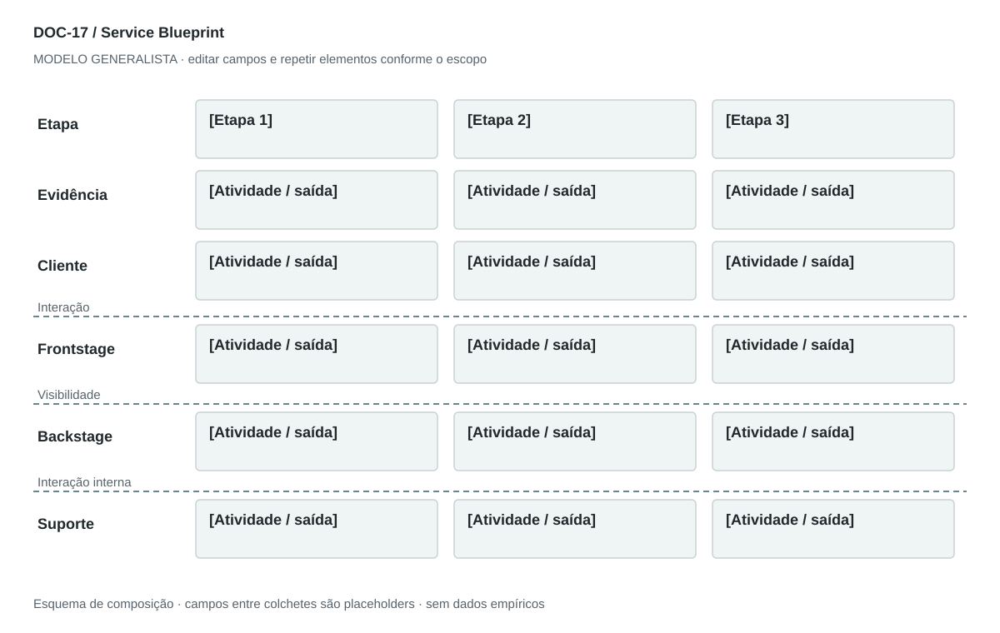

## For future Claude
Biblioteca generalista de Disruptive Venture Lab. Estrutura reutilizável, não análise preenchida nem evidência de um novo negócio.

# DOC-17 — Service Blueprint

Ligar a experiência do cliente às atividades visíveis, bastidores, suporte e evidências da prestação.

## Estudo do arquivo de referência

Fonte: `DOC-17-fonte.pdf`. 3 página(s). Três páginas retrato. Objetivo, componentes, fluxo numerado, tabela rasterizada, touchpoints, elementos críticos e melhorias. Usa os termos Visible Processes (Backstage), que tornam ambígua a fronteira de visibilidade; o modelo generalista explicita a correção.

Esta descrição registra o original. As recomendações abaixo são uma adaptação generalista, não uma reprodução nem validação do negócio-fonte.

## Formato e estilo recomendados

Uma prancha paisagem de raias alinhadas às etapas + 2 páginas de explicação. Linhas de interação, visibilidade e interação interna precisam de legenda.

Aplicar o [sistema editorial](../SISTEMA-EDITORIAL.md), mantendo a hierarquia e a legibilidade.

## Dados comuns

| Campo comum | Tipo | O que preencher |
| --- | --- | --- |
| negocio | texto | Nome do negócio analisado, sem herdar o caso-fonte |
| documento_id | referência | ID do modelo e ID da instância, quando criada |
| versao | texto | Versão e estado de revisão |
| idioma | texto | Idioma escolhido para a entrega |
| audiencia | texto | Quem precisa tomar qual decisão |
| responsavel | referência | Autor responsável pela análise |
| data_base | data ISO | Data à qual as informações se referem |
| territorio | texto | Geografia relevante ou justificativa de não aplicação |
| objetivo_decisao | texto | Pergunta que o documento precisa responder |
| escopo | texto | Incluído, excluído e horizonte |
| estado | enum | rascunho, em_revisao, aprovado ou obsoleto |

## Dicionário específico

| Campo | Tipo | Descrição e dado necessário |
| --- | --- | --- |
| etapa_id | referencia | Chave compartilhada com a jornada |
| evidencia_servico | texto | Elemento perceptível que demonstra a prestação |
| acao_cliente | texto | Ação da pessoa na etapa |
| frontstage | texto | Atividade visível ao cliente |
| backstage | texto | Atividade fora de sua percepção |
| suporte | texto | Recurso ou processo habilitador |
| responsavel | referencia | Papel responsável pelo handoff |
| espera | texto | Tempo observado ou hipótese com unidade |
| falha | texto | Modo de falha e contingência |

## Regras de preenchimento

Use este modelo como estrutura de investigação, não como análise concluída. Substitua os campos entre colchetes e retire as instruções de redação da versão entregue ao cliente. Na ausência de informação, escreva “não informado” e registre a tarefa de coleta; no JSON use `null`. Zero só representa um valor confirmado como zero. “Não aplicável” exige justificativa e responsável pela decisão.

Cada registro específico deve conter `proveniencia`: classificação (`observado`, `hipotese`, `inferencia`, `simulado` ou `desconhecido`), referência da fonte, localização na fonte, data-base, data de consulta, confiança e limitação. Uma conta feita com hipóteses continua sendo estimativa. Fontes podem ser locais ou externas, mas nenhum dado específico de outro negócio deve ser herdado.

Números precisam de unidade, denominador, moeda quando pertinente e período. Comparações usam a mesma base. Gráficos temporais exigem tempo; cenários independentes usam categorias. Figuras têm título, legenda, fonte, data-base e alternativa textual. Adapte o idioma e a identidade visual ao novo negócio.

## Gráficos, diagramas e imagens

Visual principal: **Blueprint em raias**.

Colunas de etapas; raias de evidência, cliente, frontstage, backstage e suporte. Interação separa cliente/frontstage; visibilidade separa frontstage/backstage; interação interna separa backstage/suporte.

Imagens: Diagrama vetorial de raias obrigatório. Fotografias de evidências de serviço são opcionais e devem representar pontos reais; não chamar processo invisível de visível.

### Brief para produzir o visual em outro negócio

Criar “Blueprint em raias” para [negócio], em português ou no idioma escolhido, usando apenas [dados aprovados]. Aplicar: Colunas de etapas; raias de evidência, cliente, frontstage, backstage e suporte. Interação separa cliente/frontstage; visibilidade separa frontstage/backstage; interação interna separa backstage/suporte. Incluir título, rótulos legíveis, legenda, fonte, período e classificação da evidência. Sem dados, manter campos vazios e indicar o que falta. Usar o SVG como wireframe editável, não como gráfico factual.

## Relações com outros documentos

[jornada-cliente](./jornada-cliente.md), [momentos-verdade](./momentos-verdade.md), [raci](./raci.md), [arquitetura-empresarial](./arquitetura-empresarial.md).

## Critérios de revisão

- Mesma etapa tem significado igual nos mapas de experiência.
- Linhas de visibilidade e interação são explícitas.
- Falhas e handoffs não desaparecem do desenho.

- Toda conclusão tem evidência ou rótulo de hipótese/inferência; toda lacuna tem próximo passo.
- A versão final responde à decisão indicada no cabeçalho.

---

# Modelo preenchível

> Copie a partir deste título para criar a instância. Instruções e campos devem ser substituídos; um esqueleto preenchido mecanicamente não equivale a análise.

# [Negócio] — Service Blueprint

**Versão:** [versão] · **Data-base:** [data] · **Responsável:** [papel]

**Audiência:** [quem decide] · **Território:** [recorte] · **Estado:** [rascunho/revisão/aprovado]

**Pergunta decisória:** [qual decisão este documento apoia?]

**Escopo e horizonte:** [incluído, excluído e período]

## 1. Recorte do serviço

[Instrução: Persona, objetivo, cenário, ponto de início e de fim.]

[A preencher: análise, evidência, implicação e lacuna.]

## 2. Evidências da prestação

[Instrução: O que a pessoa vê ou recebe: ambiente, objeto, mensagem, documento ou entrega.]

[A preencher: análise, evidência, implicação e lacuna.]

## 3. Ações do cliente

[Instrução: Mesmas etapas e IDs usados na jornada.]

[A preencher: análise, evidência, implicação e lacuna.]

## 4. Frontstage

[Instrução: Atendimento e processos que o cliente percebe diretamente.]

[A preencher: análise, evidência, implicação e lacuna.]

## 5. Backstage

[Instrução: Trabalho que o cliente não vê, abaixo da linha de visibilidade.]

[A preencher: análise, evidência, implicação e lacuna.]

## 6. Suporte e parceiros

[Instrução: Recursos e atividades internas ou externas que sustentam a entrega.]

[A preencher: análise, evidência, implicação e lacuna.]

## 7. Falhas e padrões

[Instrução: Espera, handoff, erro, contingência, responsável e medida de desempenho.]

[A preencher: análise, evidência, implicação e lacuna.]

## Registros estruturados

Preencher uma ficha por registro e repetir conforme necessário.

| Campo | Valor |
| --- | --- |
| etapa_id | [A preencher] |
| evidencia_servico | [A preencher] |
| acao_cliente | [A preencher] |
| frontstage | [A preencher] |
| backstage | [A preencher] |
| suporte | [A preencher] |
| responsavel | [A preencher] |
| espera | [A preencher] |
| falha | [A preencher] |
| Classificação | [observado / hipótese / inferência / simulado / desconhecido] |
| Fonte e localização | [ID + página, seção ou registro] |
| Data-base / consulta | [datas] |
| Unidade, moeda e período | [quando pertinente] |
| Limitação | [lacuna ou condição de interpretação] |

## Conclusão e encaminhamento

**Decisão proposta:** [decisão ou investigação necessária]

**Por quê:** [síntese das evidências e limitações]

**Alternativa considerada:** [alternativa e razão de rejeição]

**Condição de reversão:** [qual evidência mudaria a decisão]

**Próximo passo:** [ação] · **Dono:** [papel] · **Prazo:** [data] · **Critério:** [métrica e limiar, se pertinente]

## Fontes e lacunas

| ID | Fonte e localização | Data-base / consulta | O que sustenta | Limite / tarefa de coleta |
| --- | --- | --- | --- | --- |
| [ID] | [documento/página ou URL] | [datas] | [afirmação] | [limite e responsável] |
