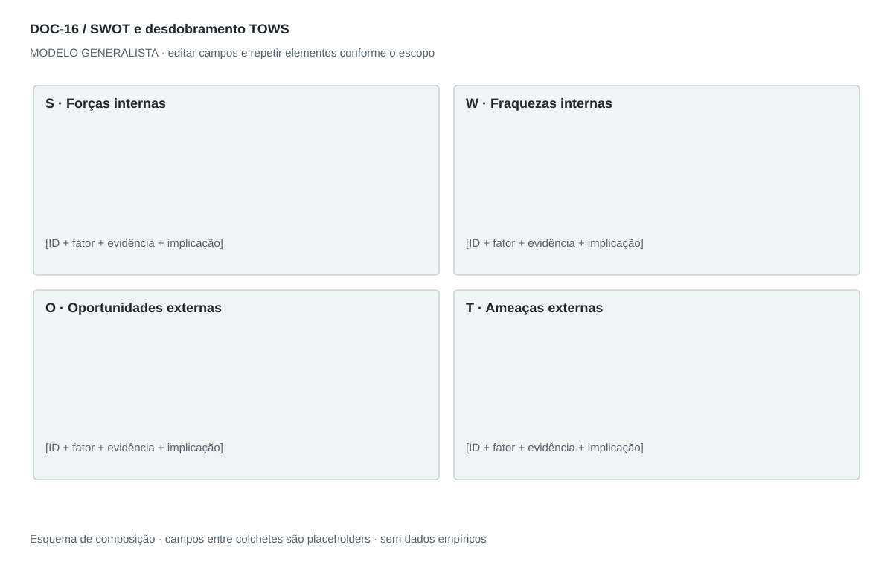

## For future Claude
Biblioteca generalista de Disruptive Venture Lab. Estrutura reutilizável, não análise preenchida nem evidência de um novo negócio.

# DOC-16 — SWOT e desdobramento TOWS

Sintetizar fatores internos e externos e convertê-los em escolhas estratégicas rastreáveis.

## Estudo do arquivo de referência

Fonte: `DOC-16-fonte.pdf`. 2 página(s). Duas páginas em paisagem. Matriz 2×2 com bullets centralizados e termos em negrito; títulos recebem pequenos destaques verde, vermelho, azul e amarelo. A segunda página continua os quadrantes inferiores. Não há cruzamento TOWS explícito no original.

Esta descrição registra o original. As recomendações abaixo são uma adaptação generalista, não uma reprodução nem validação do negócio-fonte.

## Formato e estilo recomendados

Uma página SWOT 2×2 com itens curtos e IDs; uma página de cruzamentos TOWS. Acrescentar explicações em anexo sem dividir quadrantes entre páginas.

Aplicar o [sistema editorial](../SISTEMA-EDITORIAL.md), mantendo a hierarquia e a legibilidade.

## Dados comuns

| Campo comum | Tipo | O que preencher |
| --- | --- | --- |
| negocio | texto | Nome do negócio analisado, sem herdar o caso-fonte |
| documento_id | referência | ID do modelo e ID da instância, quando criada |
| versao | texto | Versão e estado de revisão |
| idioma | texto | Idioma escolhido para a entrega |
| audiencia | texto | Quem precisa tomar qual decisão |
| responsavel | referência | Autor responsável pela análise |
| data_base | data ISO | Data à qual as informações se referem |
| territorio | texto | Geografia relevante ou justificativa de não aplicação |
| objetivo_decisao | texto | Pergunta que o documento precisa responder |
| escopo | texto | Incluído, excluído e horizonte |
| estado | enum | rascunho, em_revisao, aprovado ou obsoleto |

## Dicionário específico

| Campo | Tipo | Descrição e dado necessário |
| --- | --- | --- |
| item_id | referencia | Identificador S, W, O ou T |
| quadrante | enum | forca, fraqueza, oportunidade ou ameaca |
| fator | texto | Afirmação específica e verificável |
| justificativa | texto | Por que afeta o objetivo |
| cruzamento | enum | SO, ST, WO ou WT |
| itens_origem | lista | IDs dos fatores combinados |
| acao | texto | Escolha decorrente do cruzamento |
| criterio_prioridade | texto | Impacto, esforço e evidência usados na escolha |

## Regras de preenchimento

Use este modelo como estrutura de investigação, não como análise concluída. Substitua os campos entre colchetes e retire as instruções de redação da versão entregue ao cliente. Na ausência de informação, escreva “não informado” e registre a tarefa de coleta; no JSON use `null`. Zero só representa um valor confirmado como zero. “Não aplicável” exige justificativa e responsável pela decisão.

Cada registro específico deve conter `proveniencia`: classificação (`observado`, `hipotese`, `inferencia`, `simulado` ou `desconhecido`), referência da fonte, localização na fonte, data-base, data de consulta, confiança e limitação. Uma conta feita com hipóteses continua sendo estimativa. Fontes podem ser locais ou externas, mas nenhum dado específico de outro negócio deve ser herdado.

Números precisam de unidade, denominador, moeda quando pertinente e período. Comparações usam a mesma base. Gráficos temporais exigem tempo; cenários independentes usam categorias. Figuras têm título, legenda, fonte, data-base e alternativa textual. Adapte o idioma e a identidade visual ao novo negócio.

## Gráficos, diagramas e imagens

Visual principal: **Matriz SWOT 2×2**.

Forças e fraquezas na linha superior; oportunidades e ameaças na inferior. Texto alinhado à esquerda. Cores identificam quadrantes e não provam intensidade.

Imagens: Matriz textual; nenhum retrato, fotografia de mercado ou imagem de produto é necessário.

### Brief para produzir o visual em outro negócio

Criar “Matriz SWOT 2×2” para [negócio], em português ou no idioma escolhido, usando apenas [dados aprovados]. Aplicar: Forças e fraquezas na linha superior; oportunidades e ameaças na inferior. Texto alinhado à esquerda. Cores identificam quadrantes e não provam intensidade. Incluir título, rótulos legíveis, legenda, fonte, período e classificação da evidência. Sem dados, manter campos vazios e indicar o que falta. Usar o SVG como wireframe editável, não como gráfico factual.

## Relações com outros documentos

[pestel](./pestel.md), [cinco-forcas](./cinco-forcas.md), [estrategia-integrada](./estrategia-integrada.md).

## Critérios de revisão

- Interno e externo estão separados.
- Uma promessa futura não vira força comprovada.
- TOWS é extensão recomendada, não parte observada no documento-fonte.

- Toda conclusão tem evidência ou rótulo de hipótese/inferência; toda lacuna tem próximo passo.
- A versão final responde à decisão indicada no cabeçalho.

---

# Modelo preenchível

> Copie a partir deste título para criar a instância. Instruções e campos devem ser substituídos; um esqueleto preenchido mecanicamente não equivale a análise.

# [Negócio] — SWOT e desdobramento TOWS

**Versão:** [versão] · **Data-base:** [data] · **Responsável:** [papel]

**Audiência:** [quem decide] · **Território:** [recorte] · **Estado:** [rascunho/revisão/aprovado]

**Pergunta decisória:** [qual decisão este documento apoia?]

**Escopo e horizonte:** [incluído, excluído e período]

## 1. Recorte

[Instrução: Unidade de negócio, território e momento.]

[A preencher: análise, evidência, implicação e lacuna.]

## 2. Forças

[Instrução: Capacidades internas demonstradas que favorecem o objetivo.]

[A preencher: análise, evidência, implicação e lacuna.]

## 3. Fraquezas

[Instrução: Limitações internas relevantes, incluindo lacunas de evidência.]

[A preencher: análise, evidência, implicação e lacuna.]

## 4. Oportunidades

[Instrução: Mudanças externas favoráveis que o negócio pode explorar.]

[A preencher: análise, evidência, implicação e lacuna.]

## 5. Ameaças

[Instrução: Pressões externas que podem comprometer o objetivo.]

[A preencher: análise, evidência, implicação e lacuna.]

## 6. TOWS

[Instrução: Cruze SO, ST, WO e WT; indique quais itens sustentam cada ação.]

[A preencher: análise, evidência, implicação e lacuna.]

## 7. Prioridades

[Instrução: Escolha ações, responsáveis, evidência necessária e condições de revisão.]

[A preencher: análise, evidência, implicação e lacuna.]

## Registros estruturados

Preencher uma ficha por registro e repetir conforme necessário.

| Campo | Valor |
| --- | --- |
| item_id | [A preencher] |
| quadrante | [A preencher] |
| fator | [A preencher] |
| justificativa | [A preencher] |
| cruzamento | [A preencher] |
| itens_origem | [A preencher] |
| acao | [A preencher] |
| criterio_prioridade | [A preencher] |
| Classificação | [observado / hipótese / inferência / simulado / desconhecido] |
| Fonte e localização | [ID + página, seção ou registro] |
| Data-base / consulta | [datas] |
| Unidade, moeda e período | [quando pertinente] |
| Limitação | [lacuna ou condição de interpretação] |

## Conclusão e encaminhamento

**Decisão proposta:** [decisão ou investigação necessária]

**Por quê:** [síntese das evidências e limitações]

**Alternativa considerada:** [alternativa e razão de rejeição]

**Condição de reversão:** [qual evidência mudaria a decisão]

**Próximo passo:** [ação] · **Dono:** [papel] · **Prazo:** [data] · **Critério:** [métrica e limiar, se pertinente]

## Fontes e lacunas

| ID | Fonte e localização | Data-base / consulta | O que sustenta | Limite / tarefa de coleta |
| --- | --- | --- | --- | --- |
| [ID] | [documento/página ou URL] | [datas] | [afirmação] | [limite e responsável] |
