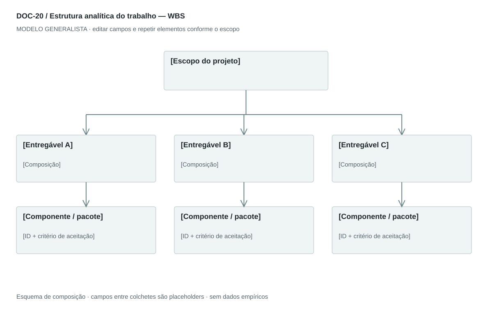

## For future Claude
Biblioteca generalista de Disruptive Venture Lab. Estrutura reutilizável, não análise preenchida nem evidência de um novo negócio.

# DOC-20 — Estrutura analítica do trabalho — WBS

Organizar o escopo total do projeto em pacotes de trabalho gerenciáveis e rastreáveis às entregas.

## Estudo do arquivo de referência

Fonte: `DOC-20-fonte.pdf`. 2 página(s). Duas páginas em paisagem. A primeira contém grande tabela rasterizada com sete colunas de frentes de trabalho e decomposições numeradas; a segunda explica gestão, produto, marketing/vendas, suporte, segurança, jurídico e infraestrutura. A tabela densa funciona como inventário, mas é difícil de ler na visão geral.

Esta descrição registra o original. As recomendações abaixo são uma adaptação generalista, não uma reprodução nem validação do negócio-fonte.

## Formato e estilo recomendados

Árvore resumida em paisagem + dicionário em retrato ou planilha. Desdobrar por entregável; tarefas detalhadas ficam dentro de pacotes e o cronograma no roadmap.

Aplicar o [sistema editorial](../SISTEMA-EDITORIAL.md), mantendo a hierarquia e a legibilidade.

## Dados comuns

| Campo comum | Tipo | O que preencher |
| --- | --- | --- |
| negocio | texto | Nome do negócio analisado, sem herdar o caso-fonte |
| documento_id | referência | ID do modelo e ID da instância, quando criada |
| versao | texto | Versão e estado de revisão |
| idioma | texto | Idioma escolhido para a entrega |
| audiencia | texto | Quem precisa tomar qual decisão |
| responsavel | referência | Autor responsável pela análise |
| data_base | data ISO | Data à qual as informações se referem |
| territorio | texto | Geografia relevante ou justificativa de não aplicação |
| objetivo_decisao | texto | Pergunta que o documento precisa responder |
| escopo | texto | Incluído, excluído e horizonte |
| estado | enum | rascunho, em_revisao, aprovado ou obsoleto |

## Dicionário específico

| Campo | Tipo | Descrição e dado necessário |
| --- | --- | --- |
| pacote_id | referencia | Identificador hierárquico do pacote |
| parent_id | referencia | Pacote superior ou null para raiz |
| entrega_id | referencia | Componente PBS ao qual contribui |
| escopo | texto | Resultado incluído e limites do pacote |
| responsavel | referencia | Papel de execução vinculado ao RACI |
| esforco | decimal | Estimativa em unidade declarada, null se desconhecida |
| unidade_esforco | texto | Horas, dias ou outra unidade consistente |
| custo | decimal | Estimativa na moeda declarada, sem assumir desembolso real |
| aceite | texto | Condição verificável de conclusão |
| dependencia_id | referencia | Outro pacote necessário |

## Regras de preenchimento

Use este modelo como estrutura de investigação, não como análise concluída. Substitua os campos entre colchetes e retire as instruções de redação da versão entregue ao cliente. Na ausência de informação, escreva “não informado” e registre a tarefa de coleta; no JSON use `null`. Zero só representa um valor confirmado como zero. “Não aplicável” exige justificativa e responsável pela decisão.

Cada registro específico deve conter `proveniencia`: classificação (`observado`, `hipotese`, `inferencia`, `simulado` ou `desconhecido`), referência da fonte, localização na fonte, data-base, data de consulta, confiança e limitação. Uma conta feita com hipóteses continua sendo estimativa. Fontes podem ser locais ou externas, mas nenhum dado específico de outro negócio deve ser herdado.

Números precisam de unidade, denominador, moeda quando pertinente e período. Comparações usam a mesma base. Gráficos temporais exigem tempo; cenários independentes usam categorias. Figuras têm título, legenda, fonte, data-base e alternativa textual. Adapte o idioma e a identidade visual ao novo negócio.

## Gráficos, diagramas e imagens

Visual principal: **Árvore de pacotes de trabalho**.

Projeto → entregas → pacotes. Não confundir ramos com ordem temporal. A ligação com PBS, RACI e roadmap é feita pelos IDs.

Imagens: Árvore e tabela; nenhum gráfico de progresso é necessário antes da execução. Não inserir frentes tecnológicas ou jurídicas sem pertinência.

### Brief para produzir o visual em outro negócio

Criar “Árvore de pacotes de trabalho” para [negócio], em português ou no idioma escolhido, usando apenas [dados aprovados]. Aplicar: Projeto → entregas → pacotes. Não confundir ramos com ordem temporal. A ligação com PBS, RACI e roadmap é feita pelos IDs. Incluir título, rótulos legíveis, legenda, fonte, período e classificação da evidência. Sem dados, manter campos vazios e indicar o que falta. Usar o SVG como wireframe editável, não como gráfico factual.

## Relações com outros documentos

[pbs](./pbs.md), [roadmap](./roadmap.md), [raci](./raci.md), [ciclo-vida-projeto](./ciclo-vida-projeto.md).

## Critérios de revisão

- Decomposição cobre todo o escopo declarado sem sobreposição.
- Pacote tem saída verificável, dono e unidade de estimativa.
- WBS não se confunde com PBS nem com sequência temporal.

- Toda conclusão tem evidência ou rótulo de hipótese/inferência; toda lacuna tem próximo passo.
- A versão final responde à decisão indicada no cabeçalho.

---

# Modelo preenchível

> Copie a partir deste título para criar a instância. Instruções e campos devem ser substituídos; um esqueleto preenchido mecanicamente não equivale a análise.

# [Negócio] — Estrutura analítica do trabalho — WBS

**Versão:** [versão] · **Data-base:** [data] · **Responsável:** [papel]

**Audiência:** [quem decide] · **Território:** [recorte] · **Estado:** [rascunho/revisão/aprovado]

**Pergunta decisória:** [qual decisão este documento apoia?]

**Escopo e horizonte:** [incluído, excluído e período]

## 1. Escopo do projeto

[Instrução: Incluído, excluído e critério de conclusão global.]

[A preencher: análise, evidência, implicação e lacuna.]

## 2. Decomposição

[Instrução: Resultados de nível superior e pacotes; incluir coordenação e transição necessárias.]

[A preencher: análise, evidência, implicação e lacuna.]

## 3. Dicionário dos pacotes

[Instrução: Entrega, limites, responsável, esforço, custo e critério de aceite.]

[A preencher: análise, evidência, implicação e lacuna.]

## 4. Dependências

[Instrução: Relacionar pacotes, componentes da PBS e marcos sem duplicar escopo.]

[A preencher: análise, evidência, implicação e lacuna.]

## 5. Controle de mudanças

[Instrução: Versionar inclusão/exclusão e seus impactos em prazo e orçamento.]

[A preencher: análise, evidência, implicação e lacuna.]

## Registros estruturados

Preencher uma ficha por registro e repetir conforme necessário.

| Campo | Valor |
| --- | --- |
| pacote_id | [A preencher] |
| parent_id | [A preencher] |
| entrega_id | [A preencher] |
| escopo | [A preencher] |
| responsavel | [A preencher] |
| esforco | [A preencher] |
| unidade_esforco | [A preencher] |
| custo | [A preencher] |
| aceite | [A preencher] |
| dependencia_id | [A preencher] |
| Classificação | [observado / hipótese / inferência / simulado / desconhecido] |
| Fonte e localização | [ID + página, seção ou registro] |
| Data-base / consulta | [datas] |
| Unidade, moeda e período | [quando pertinente] |
| Limitação | [lacuna ou condição de interpretação] |

## Conclusão e encaminhamento

**Decisão proposta:** [decisão ou investigação necessária]

**Por quê:** [síntese das evidências e limitações]

**Alternativa considerada:** [alternativa e razão de rejeição]

**Condição de reversão:** [qual evidência mudaria a decisão]

**Próximo passo:** [ação] · **Dono:** [papel] · **Prazo:** [data] · **Critério:** [métrica e limiar, se pertinente]

## Fontes e lacunas

| ID | Fonte e localização | Data-base / consulta | O que sustenta | Limite / tarefa de coleta |
| --- | --- | --- | --- | --- |
| [ID] | [documento/página ou URL] | [datas] | [afirmação] | [limite e responsável] |
