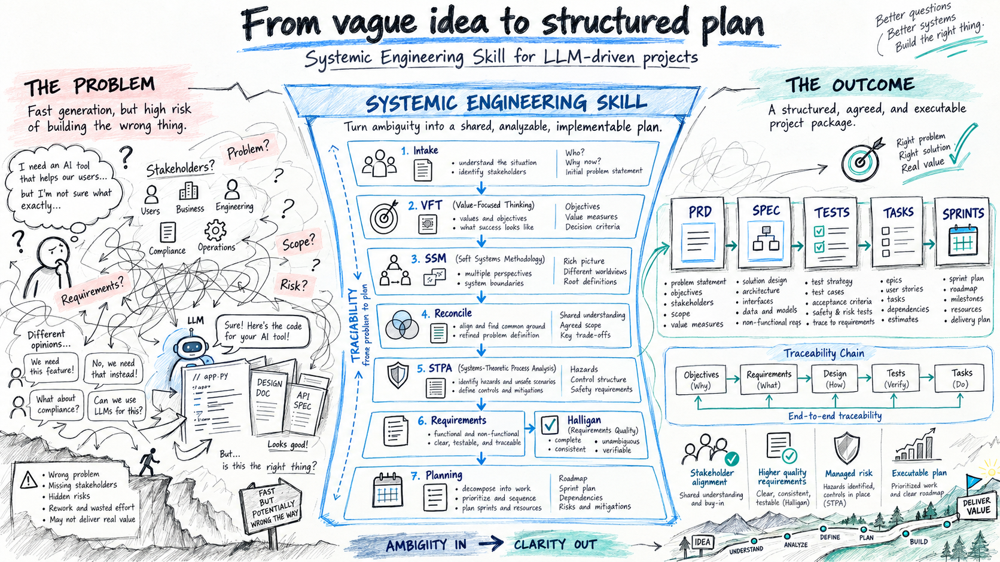

# Systemic Engineering Skill



> **EN:** An agent skill that turns an ambiguous software or systems project into traceable evidence and controlled execution: Value-Focused Thinking (VFT) → Soft Systems Methodology (SSM) → STPA (7-step LLM-assisted roadmap) → requirements scored with Halligan's quality metrics → planning artifacts, with human gates, hard/soft blockers and an audit trail. Standard-library Python only. **Version 2.1.**

**Autores:** Mauricio Vellasquez, Ícaro Veloso e Guilherme Thiago.

---

## Sumário

1. [O que é](#o-que-é)
2. [Princípios](#princípios)
3. [Fluxo de fases](#fluxo-de-fases)
4. [STPA em sete passos e requisitos além do STPA](#stpa-em-sete-passos-e-requisitos-além-do-stpa)
5. [Qualidade de requisitos (Halligan)](#qualidade-de-requisitos-halligan)
6. [Gates, autoridades e bloqueios](#gates-autoridades-e-bloqueios)
7. [Comandos](#comandos)
8. [Instalação e uso](#instalação-e-uso)
9. [Estrutura do repositório](#estrutura-do-repositório)
10. [Testes](#testes)
11. [Avaliação mais recente](#avaliação-mais-recente)
12. [Limitações e uso responsável](#limitações-e-uso-responsável)
13. [Referências](#referências)
14. [Como citar](#como-citar) · [Licença](#licença)

---

## O que é

A skill `systemic-engineering` conduz um projeto ambíguo ou de consequência relevante desde os **valores dos stakeholders** até **requisitos rastreáveis, verificáveis e medidos**, e daí a artefatos de planejamento (PRD, SPEC, TESTS, SPRINTS, TASKS) e à execução supervisionada por agentes.

Ela combina:

| Etapa | Método | Para que serve |
|---|---|---|
| Valores e objetivos | **VFT** (Value-Focused Thinking) | Descobrir o que importa antes de propor soluções |
| Situação problemática e fronteiras | **SSM** (Soft Systems Methodology) | Expor visões de mundo, poder, cultura e fronteiras contestáveis |
| Perdas, perigos e controle | **STPA**, no roteiro de 7 passos assistido por LLM | Derivar restrições e requisitos de segurança rastreáveis a perigos |
| Qualidade dos requisitos | **Halligan** (IRQ, dez fatores, taxa de omissão) | Medir e iterar a qualidade de cada requisito e do conjunto |
| Julgamento e execução | Agentes com papéis, juízes LLM como conselho consultivo | Executar com evidência, sem entregar a decisão a um modelo |

O estado do projeto fica em `.systemic-engineering/` (JSON e CSV/Markdown versionáveis), com gates imutáveis, hashes de artefatos e histórico de eventos. A skill **não certifica** segurança, conformidade legal, adequação médica ou financeira: ela estrutura análise e evidência para que pessoas qualificadas decidam.

## Princípios

- **Pessoas decidem.** Valores, prioridades, limites e aprovações são humanos. Nenhum LLM aprova um gate de alto impacto ou safety-critical.
- **Fatos, julgamentos e propostas separados.** Fonte, data de acesso, afirmação sustentada, confiança e conflito de cada alegação externa; cada requisito com origem, justificativa, alocação, método de verificação e vínculo de validação.
- **Cadeia de rastreabilidade única:** `SRC → STK → VAL → OBJ → SSM → LOSS → HAZ → SC → CA → UCA → CS → REQ → SPEC → TST → SPR → TSK → EVD → DEC`.
- **Não inventar valores.** O que a entrevista deixou em aberto vira *decisão pendente* e *requisito bloqueado*, nunca um número plausível.
- **Determinismo antes de opinião.** Verificações por script superam o parecer de modelos; evidência observada supera relato de conclusão; dissenso não resolvido permanece visível.

## Fluxo de fases

| # | Fase | Resultado |
|---|---|---|
| 1 | `intake` | Sistema de interesse, ciclo de vida, autoridades, classe de risco, evidências e plano de pesquisa |
| 2 | `vft` | Stakeholders, valores, objetivos, atributos e alternativas provisórias |
| 3 | `ssm` | Situação problemática, definições-raiz (CATWOE), modelos de atividade e debate de mudanças |
| 4 | `reconcile` | Comparação SSM × VFT: adicionar, revisar, dividir ou manter objetivos e fronteiras |
| 5 | `stpa` | Perdas, perigos, restrições, estrutura de controle, UCAs e cenários (passos 1–5) |
| 6 | `requirements` | Requisitos no template de Halligan, requisitos além do STPA (passo 6b), medição (passo 7) |
| 7 | `planning` | PRD, SPEC, TESTS, SPRINTS e TASKS no nível de sistema e de módulo |
| 8 | `execution` | Implementação em incrementos limitados, com verificação e evidência |
| 9 | `closure` | Validação contra os valores, risco residual, operação, manutenção e aprendizado |

As fases são iterativas. Voltar atrás gera um registro de delta e invalida as aprovações afetadas (comando `reopen`).

## STPA em sete passos e requisitos além do STPA

O roteiro segue a receita de sete passos da Aula 10 (ver [referências](#referências)):

1. **System Overview** de uma página (propósito, fronteira, atores, interfaces), única entrada.
2. **Perdas, perigos e restrições de segurança**, cada item marcado `[overview: "trecho"]` ou `[suposição]`. Perigo é estado, não causa; cada restrição inverte um perigo.
3. **Estrutura de controle:** controladores, ações de controle, processo controlado e feedback, com diagrama Mermaid.
4. **Ações de controle inseguras (UCA)** nos quatro tipos (não fornecer; fornecer; cedo, tarde ou fora de ordem; parado cedo ou aplicado por tempo demais), com fonte, tipo, ação, contexto concreto e perigo ligado.
5. **Cenários de perda** (classe 1: por que a UCA acontece; classe 2: por que a ação correta não é executada), apontando o elemento da estrutura de controle.
6. **Requisitos** no template de Halligan, com coluna de origem (SC, UCA ou CS): sem origem, sem requisito.
7. **Medição** com os dez fatores até RQ ≥ 0,85, reescrevendo requisitos com IRQ < 1.

**Três travas em todo passo:** (1) cada item cita o trecho do overview ou se declara suposição; (2) nenhum passo avança sem aprovação humana (HITL); (3) registra-se o prompt, a saída e a decisão de cada etapa ("Registro de etapas"). **Três falhas a evitar:** inventar UCA que a fonte não contém; parafrasear o handbook sem dizer a seção; tratar como STPA o que é de outro método. O modelo nunca assina conformidade nem "STPA concluída".

**Passo 6b (completude além do STPA).** O STPA deriva requisitos de segurança; ele não produz sozinho o conjunto funcional, de interface, de desempenho, de qualidade, de dados e de operação. O passo 6b gera esses requisitos a partir do overview, dos objetivos VFT e da entrevista, cada um com origem rastreável, e mantém uma matriz objetivo → requisitos. O `halligan.py` informa a mistura de tipos e dicas de completude (método 2 do adendo de Halligan: funcional e interface devem ser semelhantes, com funcional um pouco maior).

Os passos 6, 6b e 7 vivem em `04-requirements/requirements-log.md`, não no artefato do STPA, para que o gate STPA aprovado não seja invalidado ao preenchê-los.

## Qualidade de requisitos (Halligan)

Cada requisito é decomposto em sete elementos (ator, condições, ação, objeto, restrições, refinamento/origem do objeto, refinamento/destino da ação). Cada elemento aplicável vale 1 (satisfatório) ou 0.

- **IRQ** (qualidade individual) = elementos satisfatórios ÷ elementos aplicáveis.
- **RQ** = média dos IRQ do conjunto.
- **Dez fatores por requisito** (1/0): correção, completude, consistência, clareza, não ambiguidade, conectividade, singularidade, testabilidade, modificabilidade e viabilidade; **QFn** = média do fator n.
- **Taxa de omissão:** quantos requisitos novos surgiriam ao resolver as lacunas que o requisito sugere. Completude ajustada: `QF2' = média(IQF2) − média(omissão)` (pode ser negativa). O adendo conta os requisitos faltantes com qualidade zero: `RQ_adendo = ΣIRQ / (n + Σomissão)`.
- **Faixas de leitura (tabela 2 do artigo):** 0,01–0,3 muito pobre · 0,3–0,7 razoável · 0,85–0,99 adequado ao SRR · ≥ 0,99 adequado ao desenvolvimento crítico. O limiar de gate é 0,85.

```bash
python3 .agents/skills/systemic-engineering/scripts/halligan.py <projeto> [--threshold 0.85] [--json]
```

As notas ficam em `04-requirements/quality.csv`. Um modelo pode pontuar, mas **uma pessoa deve refazer uma amostra e aprovar** (slide 63 da Aula 10). O relatório inclui RTBD (percentual de requisitos com `TBD` ou bloqueados), requisitos candidatos a reescrita, `type_mix` e `completeness_hints`.

## Gates, autoridades e bloqueios

**Classes de risco:** `low`, `medium`, `high` e `safety-critical`. A classe é obrigatória antes de sair do intake e entra na impressão digital de toda aprovação; não pode ser rebaixada em silêncio.

**Autoridades.** Toda aprovação exige uma autoridade registrada em `00-intake/authorities.csv` (identidade, papel, escopo de fase, status ativo, `--authority-id` e evidência exata). `high` exige especialista de domínio; `safety-critical` exige especialista de domínio **e** autoridade de segurança; riscos `medium` e acima esperam um revisor independente. Esses registros melhoram a proveniência, mas **não autenticam identidade** fora do harness.

**Bloqueios hard e soft.** Cada bloqueio tem um código e é HARD ou SOFT conforme a classe de risco:

| | Exemplos |
|---|---|
| **HARD** (sempre; nenhuma flag contorna; `advance` sai com código 1) | classe de risco não definida, estado ou esquema inválido, autoridade ou evidência divergente, artefato obrigatório ausente, erro de rastreabilidade; em `high`, falta de especialista de domínio; em `safety-critical`, praticamente tudo, inclusive RQ < 0,85 |
| **SOFT** (em `low`/`medium`/`high`) | revisor independente ausente, aprovação só em fixture, requisito não executável (`blocked`/`draft`/`proposed`), RQ < 0,85, `quality.csv` ausente, etapa do STPA sem decisão, artefato à montante alterado |
| **Avisos sempre SOFT** (em toda classe) | `completeness-mix`, `objective-uncovered`, `rq-addendum-below-threshold`, `pending-requirements-high` |

Com bloqueios SOFT, `advance` **não avança nem falha em silêncio**: imprime JSON com `warnings`, cada um com `alternatives` concretas (por exemplo, "registrar revisor independente", "executar apenas o subconjunto aprovado", "resolver as decisões pendentes listadas"), sai com código 2 e não altera a fase. O agente deve **mostrar os avisos ao usuário**; só após decisão explícita se reexecuta `advance --acknowledge-warnings "<decisão>"`, que registra códigos, texto e horário no histórico.

**Modo fixture.** `init --mode fixture` serve a avaliações isoladas: aprovações simuladas exercitam os gates analíticos, mas disparam o aviso `fixture-only-approval` (HARD em `safety-critical`) antes de qualquer execução.

## Comandos

Todos os comandos usam apenas a biblioteca padrão do Python.

```bash
SK=.agents/skills/systemic-engineering/scripts

python3 $SK/sef.py init <projeto> --name "<nome>" [--mode fixture]
python3 $SK/sef.py status <projeto>                      # fase, bloqueios, avisos, RQ, aprovações obsoletas
python3 $SK/sef.py set-risk <projeto> --class medium --rationale "<motivo>"
python3 $SK/sef.py approve <projeto> --phase <fase> --by "<nome>" --role user \
      --authority-id <AUTH-ID> --evidence "<evidência registrada>" --decision approved --note "<escopo>"
python3 $SK/sef.py validate <projeto> --record           # valida todas as fases alcançadas e grava evidência
python3 $SK/sef.py advance <projeto> [--acknowledge-warnings "<decisão>"]
python3 $SK/sef.py pending <projeto> [--json] [--write]  # lista única de perguntas ao usuário (saída 2 se há pendências)
python3 $SK/sef.py reopen <projeto> --phase <fase> --by "<nome>" --reason "<motivo>" [--by-role <papel>]
python3 $SK/sef.py create-module <projeto> ...           # módulos materiais no planejamento

python3 $SK/validate_traceability.py <projeto>           # esquemas, IDs e semântica da cadeia
python3 $SK/halligan.py <projeto> [--threshold 0.85] [--json]
```

`pending` agrupa por decisão as perguntas que dependem do usuário (decisões pendentes, requisitos bloqueados ou propostos, requisitos com `TBD`) para que o agente as entregue **numa única rodada**.

## Instalação e uso

A skill é um diretório autocontido. Copie `.agents/skills/systemic-engineering/` para o local de skills do seu agente:

| Agente | Local |
|---|---|
| Agentes que leem `.agents/skills/` (por exemplo, Codex) | `<projeto>/.agents/skills/systemic-engineering/` ou o diretório global equivalente |
| Claude Code | `<projeto>/.claude/skills/systemic-engineering/` ou `~/.claude/skills/systemic-engineering/` |

Depois, peça ao agente algo como: *"Use a skill systemic-engineering para estruturar este projeto, dos valores dos stakeholders até requisitos aprovados e rastreáveis."* O `SKILL.md` roteia por fase e carrega só a referência necessária (`references/`).

Requisitos: Python 3 (testado com 3.14), sem dependências externas.

## Estrutura do repositório

```text
.agents/skills/systemic-engineering/
├── SKILL.md                    # ponto de entrada e roteador de fases
├── agents/                     # papéis e metadados de agente (openai.yaml, roles.yaml)
├── assets/templates/           # VFT, SSM, STPA, REQUIREMENTS-LOG, PRD, SPEC, TESTS, SPRINTS, TASKS, CSVs
├── references/                 # fluxo, evidência, VFT, SSM, STPA/requisitos, artefatos, juízes, fontes
└── scripts/
    ├── sef.py                  # estado, autoridades, gates e comandos
    ├── halligan.py             # métricas de qualidade de requisitos
    └── validate_traceability.py
tests/test_sef.py               # suíte de testes da skill
```

## Testes

```bash
python3 -m unittest discover -s tests
```

**Resultado mais recente (v2.1): 46 testes, todos passando** (aprox. 2 minutos). A suíte cobre, entre outros:

- máquina de estados, fases, hashes de artefatos e aprovações por autoridade registrada;
- política hard/soft de bloqueios, `--acknowledge-warnings` e registro no histórico;
- classe de risco obrigatória e invalidação de aprovação por mudança de risco;
- métricas de Halligan (IRQ, RQ, QF1–QF10, omissão, RTBD, faixas, `type_mix` e dicas de completude);
- lista única de perguntas (`pending`), aprovações obsoletas à montante e `reopen` (incluindo safety-critical);
- rastreabilidade (esquemas, IDs, relações `REQ → TST`) e o registro de etapas do STPA (passos 1–5 no gate STPA e 6–7 no gate de requisitos);
- templates e documentação coerentes com o roteiro (passo 6b, `requirements-log.md`).

## Avaliação mais recente

Avaliamos a v2.1 em um caso novo, **o prontuário eletrônico de uma clínica pequena** (risco alto, dados de saúde, 13 valores deixados em aberto de propósito), contra um **agente sem a skill, sem conhecimento do assunto, sem pesquisa e sem instrução sobre métricas**. Os dois receberam os mesmos documentos (um *System Overview* e uma ficha de fatos); produtores e juízes foram agentes Sonnet. Três juízes independentes pontuaram, às cegas, uma amostra de 40 requisitos por conjunto com a rubrica de Halligan; um quarto juiz mediu cobertura de perigos de um gabarito oculto e violações das regras do INCOSE GtWR.

| Medida | Sem a skill | v2.1 |
|---|---:|---:|
| Requisitos produzidos | 71 | 73 |
| RQ de Halligan (mediana dos 3 juízes) | 0,686 | **0,931** |
| Requisitos com IRQ = 1 | 15% | 68% |
| Não ambiguidade (QF5) | 0,68 | **0,90** |
| Singularidade (QF7) | 0,47 | **0,78** |
| Testabilidade (QF8) | 0,85 | 0,70 |
| Cobertura de perigos do gabarito | 17/18 | 15/18 |
| Violações GtWR por requisito | 3,30 | 2,60 |

**Como ler:**

- **Ganhos de forma:** requisitos mais singulares e menos ambíguos, com ator, ação e objeto explícitos. Os três juízes concordam na direção.
- **Perdas honestas:** a v2.1 deixou sem cobertura o acesso de emergência, a imutabilidade do registro e a autenticação individual, porque a ficha deixou as regras em aberto (`TBD`) e a skill, corretamente, **não as inventou**. Isso baixou a testabilidade e a cobertura.
- **O tamanho do efeito não é generalizável.** É um caso, uma execução por braço. O agente sem a skill escreveu requisitos sem sujeito explícito e com a aceitação embutida na mesma célula neste caso; o mesmo tipo de agente, em outros casos, ficou perto de 0,92–0,94, então boa parte do +0,245 vem da variação do controle.
- **Limitações:** produtores e juízes do mesmo modelo (viés de autopreferência e erros correlacionados); gabarito escrito pelos autores do experimento; sem teste de significância; a **pontuação humana de uma amostra ainda não foi feita**.
- **Fluxo real:** os passos 6, 6b e 7 gravados no log da fase de requisitos não dispararam aviso de artefato obsoleto, e o gate STPA passou sem avisos.

Convidamos a comunidade a repetir o experimento com mais casos, outros modelos e juízes humanos.

## Limitações e uso responsável

- A skill **não certifica** segurança, conformidade legal, adequação médica ou financeira, e não substitui FMEA, FTA, HAZOP, análise de segurança da informação, de privacidade ou casos de garantia exigidos pelo domínio.
- O STPA assistido por LLM pode inventar UCAs, parafrasear fontes sem citar a seção ou tratar como STPA o que é de outro método. Por isso toda saída é rascunho até uma pessoa aceitar, registrando o que aceitou e de qual trecho.
- Juízes LLM têm vieses conhecidos (verbosidade, posição, autopreferência). O conselho de juízes é **consultivo**: nenhum consenso de modelos substitui a aprovação humana.
- Os registros de autoridade e de aprovação melhoram a proveniência, mas não autenticam identidade.
- A cobertura de objetivos e a leitura de IDs são textuais: citar um ID em prosa conta como "definido".
- As métricas de Halligan perdem poder de discriminação perto de 1,0 (efeito de teto); o artigo recomenda amostragem e leitura em conjunto com os dez fatores.

## Referências

**Métricas e redação de requisitos**
- Halligan, R. J. *Requirements Quality Metrics: The Basis of Informed Requirements Engineering Management*. Apresentado no Complex Systems Engineering Synthesis and Assessment Technology Workshop (CSESAW '93), Calvados, MD, EUA, 1993. Project Performance (Australia) Pty Ltd, PPA-005330-9, 10 jul. 2014, com adendo sobre a estimativa da completude (7 jan. 2014).
- Halligan, R. *Requirements Analysis that Works!* Project Performance International, PPI-005261-4, 2017.
- INCOSE Requirements Working Group. *Guide to Writing Requirements v4 — Summary Sheet*. INCOSE, 2023. <https://www.incose.org/docs/default-source/working-groups/requirements-wg/guidetowritingrequirements/incose_rwg_gtwr_v4_summary_sheet.pdf>

**STPA e segurança**
- Leveson, N. G.; Thomas, J. P. *STPA Handbook*. MIT Partnership for Systems Approaches to Safety and Security (PSASS), 2018. <https://psas.scripts.mit.edu/home/get_file.php?name=STPA_handbook.pdf>
- Leveson, N. G. *Engineering a Safer World: Systems Thinking Applied to Safety*. MIT Press, 2011.
- Moreira, G. *Requisitos assistidos por LLM: Grounding e citação de fontes* (Aula 10, TE-251, 2026.2), 16 out. 2026 — roteiro de sete passos do STPA assistido por LLM, as três travas, as três falhas e o uso das métricas de Halligan.

**VFT e SSM**
- Vieira, G. B. et al. Using Value-Focused Thinking in an Integrated Process to Support Decisions. *Pesquisa Operacional*, v. 44, 2024. DOI [10.1590/0101-7438.2023.043.00276110](https://doi.org/10.1590/0101-7438.2023.043.00276110).
- Keeney, R. L. *Value-Focused Thinking: A Path to Creative Decisionmaking*. Harvard University Press, 1992.
- Checkland, P. B. Soft Systems Methodology. *Human Systems Management*, v. 8, n. 4, p. 273–289, 1989. DOI [10.3233/HSM-1989-8405](https://doi.org/10.3233/HSM-1989-8405).

**Engenharia de sistemas**
- INCOSE. *Systems Engineering Handbook*, 5ª ed., 2023. <https://www.incose.org/resources-publications/technical-publications/se-handbook/>
- ISO/IEC/IEEE 15288:2023. *Systems and software engineering — System life cycle processes*. <https://www.iso.org/standard/81702.html>
- NASA. *NASA Systems Engineering Handbook*, Rev. 2. <https://www.nasa.gov/wp-content/uploads/2018/09/nasa_systems_engineering_handbook_0.pdf>

**Julgamento por LLM e debate multiagente**
- Zheng, L. et al. Judging LLM-as-a-Judge with MT-Bench and Chatbot Arena. *NeurIPS*, 2023. <https://arxiv.org/abs/2306.05685>
- Du, Y. et al. Improving Factuality and Reasoning in Language Models through Multiagent Debate. *ICML*, 2024. <https://arxiv.org/abs/2305.14325>

Os trabalhos sobre juízes e debate sustentam o uso experimental, mas também registram vieses; não autorizam tratar o consenso de modelos como verdade nem como aprovação humana.

## Como citar

> Vellasquez, M.; Veloso, Í.; Thiago, G. *Systemic Engineering Skill* (versão 2.1). 2026. Repositório GitHub.

## Licença

A licença ainda será definida pelos autores. Até lá, nenhum direito de uso, cópia ou redistribuição além do permitido pelos termos da plataforma é concedido.
